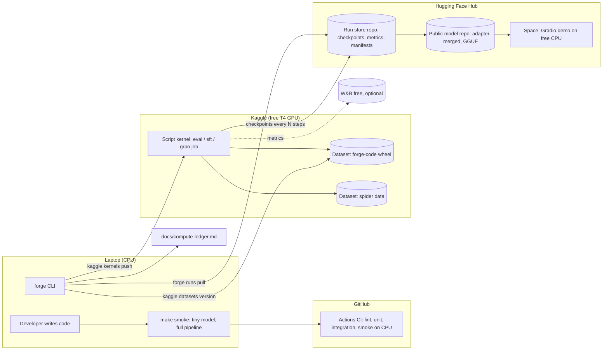
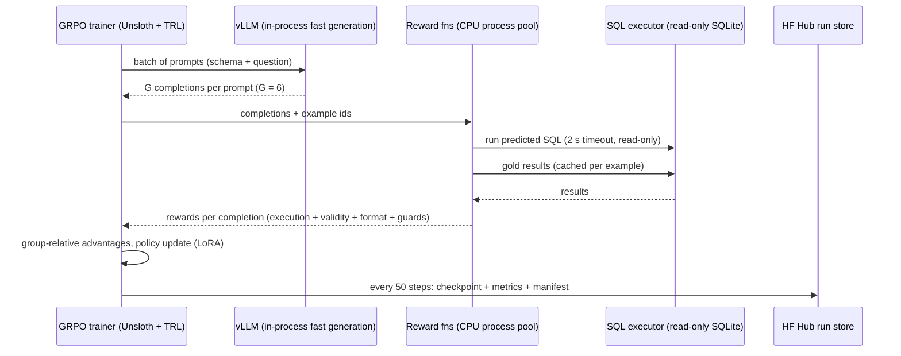

# Forge: Build Plan ($0 GPU edition)

> Post-train a small open-weight model with reinforcement learning on one verifiable job (text-to-SQL) until it closes most of the gap to much larger models. Every step is measured and audited, and the compute budget is $0.

| Field | Value |
|---|---|
| Repo | `forge-small-llm-grpo-text-to-sql` |
| URL | https://github.com/hoomanesteki/forge-small-llm-grpo-text-to-sql |
| Owner / product owner | Hooman Esteki |
| Status | Planned, not started |
| Plan version | 1.0 (2026-10-25) |
| Target | v1.0.0 in 9 phases, about 3 to 4 weeks part-time |
| Cash budget | $0 default. Hard ceiling $50, used only by an optional story (FG-606) |
| Executor | The developer working the current story |
| Gatekeeper | The reviewer who runs every phase gate and the final review |

## 0. How to use this document

This file is the single source of truth. In Phase 0 it is copied into the repo as `docs/PLAN.md`.

**Hooman (product owner).** Read sections 1, 2, 3.8 (compute plan), 8 and 11 first. Your jobs: create the free accounts (Kaggle, Hugging Face, optionally Weights & Biases), approve each gate, and watch the GPU ledger. Read every "Defend it" block; together they are the design rationale.

**Executor (developer).**
- Work one story at a time, in order. Read sections 3 and 5 before your first story.
- Everything you write must run on CPU first (tests, smoke pipeline). GPU runs only happen through the Kaggle runner, and only in stories that say so.
- Never change a contract in section 3.5 without a story that says to.

**Gatekeeper (reviewer).**
- At each phase end, run the gate in section 5.5.
- For GPU phases, also verify the run manifests: the reported numbers must come from the run files, the ledger must be updated, and the held-out dev split must not have been touched by training code.

**The rules that make this work on free compute:**

1. **CPU first.** Every pipeline (data, prompts, generation, execution, scoring, SFT, GRPO, reports) runs end to end on a laptop CPU with a tiny model, in CI, on every PR. GPU time is never spent finding a bug a CPU smoke test could find.
2. **Brick by brick.** Each phase adds one stage to a pipeline that already runs. The smoke test grows with it, and all earlier tests keep passing.
3. **Every GPU minute is planned and logged.** The weekly free quota is the scarce resource, so it is budgeted like money (section 3.8).

---

## 1. Product brief

### 1.1 Problem

Teams want LLM features that are cheap, private and fast, and frontier APIs are none of those at scale. Small open models (1B to 8B) are cheap and can run anywhere, but out of the box they are much worse at specific jobs. The open question every AI team faces: **how much of that gap can targeted post-training close, and what does it cost?**

Most portfolio fine-tuning projects answer this badly. They fine-tune on a dataset, show a loss curve, and stop. There is no held-out evaluation, no baseline, no check that the model learned the skill rather than gaming the metric, and no cost.

### 1.2 Why now (from our job data)

From 401 Seattle and SF postings collected on 2026-10-21:

- 25% ask for fine-tuning, RLHF/post-training or RL environments. That cluster is concentrated at AI labs and AI-native startups, which are the highest-paying employers in the sample.
- 48% ask for LLM evaluation. Hiring-side writers keep asking for the same proof: a baseline, a fixed eval set, error analysis, named failure cases and cost numbers.
- Postings name these specifically: "build RL environments, agent harnesses and rollout infrastructure; create reward signals from verifiers", and "decide when to train specialized models versus use frontier APIs".
- Reinforcement learning from verifiable rewards (RLVR, with GRPO as the common algorithm) became the standard recipe in 2025 because it needs no human preference labels, only a checker. Text-to-SQL has a perfect checker: run the query and compare the results.

Your portfolio has evaluation (TraceGym), model routing (ToolSmith), RAG, agents and MLOps. It has **no project where you change model weights**. Forge fills that gap, and it does so for $0, which is itself a story about engineering judgment.

### 1.3 Personas

| Persona | Role | What they need from Forge |
|---|---|---|
| **Maya, ML lead at a SaaS company** | Wants text-to-SQL in their analytics product without sending customer schemas to an API | Evidence that a small self-hosted model can reach a usable accuracy, plus what it costs to train and run |
| **Raj, research engineer at an AI startup** | Hires people for post-training | A clean RL setup with a verifier, reward design, checks against reward hacking, honest ablations and variance |
| **Hooman, the builder** | Has no GPU budget | A pipeline that runs entirely on free compute and is reproducible from a fresh clone |

### 1.4 Jobs to be done

1. When I consider a small model for a narrow task, I want to know how much training improves it, measured on held-out data, so I can decide between training and paying for an API.
2. When I train with RL, I want proof that the reward measures the real skill, so I don't ship a model that games its checker.
3. When I have no budget, I want a training workflow that fits free GPU quotas and survives session limits, so cost doesn't block the work.

### 1.5 Goals (v1)

- G1. A safe, fast SQL execution environment and verifier over the Spider databases.
- G2. A reproducible evaluation harness: execution accuracy with confidence intervals, breakdown by difficulty, an error taxonomy, and agreement with the official Spider test-suite evaluator.
- G3. A free-GPU operations layer: push jobs to Kaggle from the CLI, checkpoint to Hugging Face Hub, resume across 12-hour sessions, and log every GPU hour.
- G4. Supervised fine-tuning (SFT) baseline with LoRA.
- G5. GRPO with verifiable rewards (execution, validity, format) on top of SFT, and also from the base model, for comparison.
- G6. A reward-hacking audit with documented cases, fixes and regression tests.
- G7. Ablations and variance on the smaller model.
- G8. Shipped artifacts: LoRA adapter and merged model on the Hugging Face Hub with a model card, a GGUF build that runs locally (Ollama / llama.cpp), and a free CPU demo on Hugging Face Spaces.
- G9. A results page where every number traces to a run manifest.

### 1.6 Non-goals (v1)

- Beating state-of-the-art Spider systems. The goal is a measured uplift on a small model, honestly reported.
- Training models larger than about 4B parameters, which wouldn't fit free GPUs.
- Multi-turn tool-using SQL agents trained with RL. That is post-v1; v1 only does inference-time execution-guided retry.
- Any paid API calls for data generation or baselines.
- Training on outputs from frontier models. The SFT data comes from the dataset's gold SQL, which keeps licensing clean and costs nothing.

### 1.7 Success and proof metrics

These are targets. The real numbers go in `docs/results.md`, whatever they are. No number is published without a run manifest.

| ID | Metric | Target | How measured |
|---|---|---|---|
| M1 | Execution accuracy (EX) uplift, chosen model, base to SFT+GRPO, Spider dev | ≥ +8 points | Official test-suite EX, 1,034 dev examples, 95% bootstrap CI |
| M2 | GRPO adds over SFT alone | ≥ +2 points, McNemar p < 0.05 | Paired test on dev |
| M3 | Gap closed to a 2 to 4 times larger open model (zero-shot) | ≥ 50% of the gap | Same harness, same prompts |
| M4 | Fast reward comparator agrees with the official evaluator | ≥ 98% of predictions | Agreement check on baseline outputs (FG-108) |
| M5 | Reward-hacking cases found, fixed and regression-tested | ≥ 3 documented | Audit report (FG-601) |
| M6 | Cash spent on compute | $0 (ceiling $50 if FG-606 runs) | Compute ledger |
| M7 | GPU hours used | ≤ 45 | Compute ledger |
| M8 | GGUF Q4 quality loss vs merged fp16 | ≤ 2 points EX on val | FG-702 |
| M9 | Fresh clone: CPU smoke pipeline passes | ≤ 15 min | FG-803 |

### 1.8 Landscape and differentiation

| Typical project | Forge |
|---|---|
| Fine-tune, show loss curve | Held-out EX with CIs, paired tests, difficulty breakdown |
| Reward = "looks right" | Reward = execution against real databases, with an agreement check against the official evaluator |
| Assumes the reward is honest | Dedicated hacking audit, with fixes and regression tests |
| Needs rented A100s | Fits free Kaggle T4 quotas, with resume across sessions and a GPU ledger |
| Model lives in a notebook | Adapter, merged model, GGUF, Ollama file and a public demo |

---

## 2. Scope

### 2.1 v1 features (MoSCoW)

| Priority | Feature | Phase |
|---|---|---|
| Must | Spider data loader, checksums, splits by database, guard against dev leakage | 1 |
| Must | Schema serializer and prompt builder | 1 |
| Must | Safe SQL executor and fast result comparator | 1 |
| Must | Official test-suite evaluator integration and agreement check | 1 |
| Must | Eval runner, metrics with CIs, error taxonomy, report generator | 2 |
| Must | CPU smoke pipeline in CI with a tiny model | 2 |
| Must | Kaggle job runner, Hugging Face Hub run store, resume, time guard, GPU ledger | 3 |
| Must | vLLM inference backend; GPU baselines and model choice | 3 |
| Must | SFT with LoRA (Unsloth on GPU, TRL+PEFT on CPU) | 4 |
| Must | Reward functions with adversarial tests; GRPO trainer; training runs with resume | 5 |
| Must | Reward-hacking audit, fixes, regression tests | 6 |
| Must | Model card, adapter and merged model on the Hub | 7 |
| Must | Results page from manifests; README; release | 8 |
| Should | Execution-guided retry at inference time | 2 |
| Should | Curriculum by difficulty | 5 |
| Should | Ablations and a second seed on the small model | 6 |
| Should | GGUF export, Ollama Modelfile, local CLI | 7 |
| Should | Hugging Face Space demo on free CPU | 7 |
| Could | Out-of-domain check on BIRD mini-dev | 6 |
| Could | One paid "boost" run with Modal's free monthly credits, hard-capped | 6 |
| Won't (v1) | Multi-turn agent RL, models above 4B, paid API baselines | - |

### 2.2 Post-v1 backlog

- Multi-turn agentic RL: the model calls `describe_table` and `run_query` before answering, with rollouts in the same sandbox.
- Train on BIRD's training set (harder, more realistic schemas).
- Distillation comparison (SFT on a larger open model's outputs, if the license allows).
- Serve with vLLM behind an OpenAI-compatible endpoint (links to the Throttle project).

---

## 3. Architecture

### 3.1 System overview



### 3.2 The pipeline (the integration backbone)

One pipeline, used by evaluation, SFT data building, GRPO rewards and the demo. Each phase adds or deepens a stage. The CPU smoke test (`make smoke`) runs every stage end to end on 20 examples with a tiny model.

| Stage | Module | Input → Output | Phase built |
|---|---|---|---|
| 1. Load | `forge.data.spider` | files → `Example` list | 1 |
| 2. Split | `forge.data.splits` | examples → train / val / dev by database | 1 |
| 3. Prompt | `forge.data.prompts` | `Example` + schema → `Prompt` | 1 |
| 4. Generate | `forge.infer.*` | `Prompt` → `Generation` | 2 (CPU), 3 (vLLM) |
| 5. Extract | `forge.sql.extract` | text → SQL string or None | 1 |
| 6. Execute | `forge.sql.executor` | SQL → `ExecResult` | 1 |
| 7. Compare | `forge.sql.compare` | gold and predicted results → bool | 1 |
| 8. Score | `forge.eval.scoring` | → `Score` (fast EX, official EX, error class) | 1, 2 |
| 9. Aggregate | `forge.eval.metrics` | scores → EX, CIs, by hardness, paired tests | 2 |
| 10. Report | `forge.eval.report` | metrics → markdown, charts, manifest links | 2 |
| Train: SFT | `forge.train.sft` | train examples → LoRA adapter | 4 |
| Train: GRPO | `forge.train.grpo` + `forge.train.rewards` | prompts → rollouts → rewards (stages 5 to 7) → adapter | 5 |

Rewards reuse stages 5 to 7 exactly. The reward function and the evaluator can't disagree about what "correct" means, except where the fast comparator and the official evaluator differ, and FG-108 measures that.

### 3.3 Components

| Component | Package | Responsibility | Phase |
|---|---|---|---|
| Core types | `forge.core` | Contracts (section 3.5) | 1 |
| Data | `forge.data` | Spider loading, checksums, splits, schema text, prompts | 1 |
| SQL sandbox | `forge.sql` | Safe execution, extraction, comparison | 1 |
| Official eval | `forge.eval.testsuite` | Wrapper around the Spider test-suite evaluator | 1 |
| Eval harness | `forge.eval` | Runner, scoring, metrics, taxonomy, reports, retry | 2 |
| Inference | `forge.infer` | Backends: HF transformers (CPU), vLLM (GPU), llama.cpp (GGUF) | 2, 3, 7 |
| Ops | `forge.ops` | Kaggle runner, Hub run store, manifests, ledger, time guard | 0, 3 |
| Training | `forge.train` | Backend abstraction, SFT, rewards, GRPO, curriculum, callbacks | 4, 5 |
| Audit | `forge.audit` | Reward-hacking detectors and reports | 6 |
| Export | `forge.export` | Merge, Hub publish, GGUF, model card | 7 |
| Demo | `demo/` | Gradio app, Ollama Modelfile | 7 |

### 3.4 GRPO step (what happens on the GPU)



### 3.5 Contracts (created in FG-102, changed only by a story that says so)

```python
# src/forge/core/types.py
from __future__ import annotations
from datetime import datetime
from typing import Any, Literal, Protocol, Sequence, Callable
from pydantic import BaseModel

Hardness = Literal["easy", "medium", "hard", "extra"]
Split = Literal["train", "val", "dev"]

class Example(BaseModel, frozen=True):
    id: str                 # "spider-train-00042", stable across runs
    db_id: str
    question: str
    gold_sql: str
    hardness: Hardness      # from the official evaluator's hardness function
    split: Split

class Prompt(BaseModel, frozen=True):
    example_id: str
    messages: tuple[dict[str, str], ...]   # chat format: {"role", "content"}
    prompt_version: str                    # "p1", "p2" (ADR-0007)

class GenParams(BaseModel, frozen=True):
    temperature: float = 0.0
    top_p: float = 1.0
    max_new_tokens: int = 256
    n: int = 1
    seed: int = 0

class Generation(BaseModel):
    example_id: str
    model_ref: str                  # "Qwen/Qwen3-4B" or "<hub repo>@<revision>"
    adapter_ref: str | None = None
    sample_idx: int = 0
    text: str
    sql: str | None
    tokens_in: int
    tokens_out: int
    latency_ms: float

ErrorKind = Literal["syntax", "no_such_table", "no_such_column", "timeout", "denied", "empty_sql", "other"]

class ExecResult(BaseModel):
    ok: bool
    columns: list[str] | None = None
    rows: list[tuple[Any, ...]] | None = None
    error: str | None = None
    error_kind: ErrorKind | None = None
    truncated: bool = False
    ms: float = 0.0

class Score(BaseModel):
    example_id: str
    sample_idx: int = 0
    hardness: Hardness
    valid: bool                     # executed without error
    ex_fast: bool                   # forge.sql.compare
    ex_official: bool | None = None # test-suite evaluator, when run
    error_class: str | None = None  # taxonomy label (FG-204)
    attempts: int = 1               # 2 when the first query failed to run and was retried (FG-206)
    first_try_ex: bool | None = None  # official EX of that first reply (ADR-0015)

class RunManifest(BaseModel):
    run_id: str                     # "2026-11-03-qwen3-4b-grpo-a1b2c3d"
    kind: Literal["eval", "sft", "grpo", "export", "audit"]
    git_sha: str
    config: dict[str, Any]
    config_hash: str
    data_manifest_hash: str
    model_ref: str
    adapter_ref: str | None = None
    parent_run: str | None = None
    platform: Literal["local-cpu", "local-mps", "kaggle", "colab", "modal"]  # local-mps: ADR-0016
    gpu: str | None = None
    seed: int
    started_at: datetime
    ended_at: datetime | None = None
    gpu_hours: float = 0.0
    cost_usd: float = 0.0
    outputs: dict[str, str] = {}    # logical name -> path in run store
    status: Literal["running", "stopped_time_guard", "finished", "failed"] = "running"
```

```python
# Protocols (each created in the story named)
class SqlExecutor(Protocol):                       # FG-106
    def run(self, db_id: str, sql: str, *, timeout_ms: int = 2000,
            max_rows: int = 10_000) -> ExecResult: ...

def extract_sql(text: str) -> str | None: ...      # FG-107
def results_match(gold: ExecResult, pred: ExecResult, *, order_matters: bool) -> bool: ...  # FG-107

class InferenceBackend(Protocol):                  # FG-201
    name: str
    def generate(self, prompts: Sequence[Prompt], params: GenParams) -> list[Generation]: ...

# TRL-compatible reward signature (FG-501). kwargs carry dataset columns:
# example_id, db_id, gold_sql, hardness (lists aligned with completions).
RewardFunc = Callable[..., list[float]]

class RunStore(Protocol):                          # FG-304
    def put_file(self, run_id: str, local_path: str, dest: str) -> str: ...
    def put_manifest(self, manifest: RunManifest) -> None: ...
    def get_manifest(self, run_id: str) -> RunManifest: ...
    def latest_checkpoint(self, run_id: str) -> str | None: ...
    def pull(self, run_id: str, local_dir: str) -> None: ...

class TrainBackend(Protocol):                      # FG-402
    def load(self, model_ref: str, lora: "LoraConfig", *, load_in_4bit: bool) -> tuple[Any, Any]: ...  # model, tokenizer
    def sft(self, model, tok, dataset, cfg: "SftConfig", callbacks: list) -> str: ...      # returns adapter dir
    def grpo(self, model, tok, dataset, rewards: list[RewardFunc], cfg: "GrpoConfig",
             callbacks: list) -> str: ...
```

### 3.6 Data

| Item | Decision |
|---|---|
| Primary dataset | Spider 1.0: about 7,000 training questions over about 140 databases, and 1,034 dev questions over 20 **different** databases (cross-domain). License: CC BY-SA 4.0. Attribution goes in the README and model card |
| Databases | SQLite files from the official Spider release. FG-101 confirms the current download source and records its checksum |
| Splits | `train`: Spider train minus val databases. `val`: about 10% of the train **databases** (all their questions), used for checkpoint selection and tuning. `dev`: official Spider dev, used **only** for reported numbers (ADR-0004) |
| Dev budget | At most 6 dev evaluations in the whole project, each logged in `docs/dev-usage.md` with a reason. The runner refuses `--split dev` without `--reason` |
| Hardness | easy, medium, hard or extra, computed with the official evaluator's hardness function |
| Out-of-domain (Could) | BIRD mini-dev (500 examples) for a generalization check. FG-605 verifies its license and access |
| Contamination | Spider is public, so base models may have seen it during pretraining. The main claim is therefore the **relative uplift from training on the same model**, plus the BIRD check. The README says this |

### 3.7 Prompt and output format

Prompt version `p1` (ADR-0007):

```
system: You write SQLite queries. Reply with exactly one SQL query in a ```sql code block. No explanation.
user:   Database schema:
        <CREATE TABLE statements, normalized, one per table, with primary and foreign keys>

        Question: <question>
```

- Version `p2` adds 3 sample rows per table as SQL comments. FG-307 compares p1 and p2 on val for the chosen model, and the winner is fixed for all later phases.
- Qwen3-family models run in non-thinking mode (`enable_thinking=False` in the chat template), with `max_new_tokens=256`. Long reasoning traces would multiply GPU time on a T4; a short-reasoning variant is a post-v1 ablation.
- `extract_sql` takes the last ```sql block. If there is none, it takes the last line starting with `SELECT` or `WITH` that parses as a query (sqlglot), and otherwise returns `None`.

### 3.8 Compute plan and budget

**Platforms**

| Platform | What | Limits (check at start; free tiers change) | Use |
|---|---|---|---|
| Laptop CPU | Your machine | None | All development, tests and smoke runs. GGUF evaluation |
| GitHub Actions | 2-core Linux runners, free for public repos | Job time limits | CI, including the CPU smoke pipeline |
| **Kaggle Notebooks** (primary) | T4 GPU (16 GB), with internet once the account is phone-verified | 12 h per session; weekly GPU quota shown in account settings (users report about 30 h) | All GPU jobs, as script kernels pushed by CLI. Use the T4, not the P100: vLLM needs a newer GPU architecture than the P100 has |
| Google Colab (fallback) | Free GPU, usually a T4 | No published limits; can be interrupted | Manual fallback if the Kaggle quota runs out. `forge kaggle run --emit-notebook` produces an equivalent notebook |
| Hugging Face Hub | Free model and dataset repos | Storage fair use | Run store (private repo), public model artifacts, Space |
| Hugging Face Spaces | Free CPU Space | Slow CPU | Demo with GGUF |
| Modal (Could, FG-606) | $30/month free credits on the Starter plan (check whether a card is needed, and set a spend limit) | Billing beyond the credits | Optional single boost run |
| Weights & Biases (optional) | Free personal tier | - | Live training charts. Fallback: JSONL metrics in the run store |

**GPU hour budget** (estimates; FG-301 measures real throughput and the gatekeeper updates this table at Gate 3)

| Job | Model | Est. GPU h | Story |
|---|---|---|---|
| Throughput spike | 1.7B and 4B | 1.5 | FG-301 |
| Baselines: 3 candidates on val, plus a larger reference model and the chosen model on dev | up to 8B in 4-bit | 3 | FG-307 |
| SFT pilot | 1.7B | 1 | FG-404 |
| SFT main | chosen (about 4B) | 2.5 | FG-404 |
| SFT checkpoint evals (val) | chosen | 1 | FG-404 |
| GRPO pilot (100 steps) | 1.7B | 1.5 | FG-507 |
| GRPO main (about 600 steps, 2 sessions with resume) | chosen | 14 | FG-507 |
| Checkpoint selection (val) and dev eval | chosen | 2 | FG-508 |
| Hacking fix re-run | chosen | 3 | FG-602 |
| Ablations, 3 runs, plus a second seed | 1.7B | 8 | FG-603, FG-604 |
| Reserve | - | 6 | - |
| **Total** | | **about 43 h** (about 2 Kaggle weeks) | |

**Session rules**

- Every training job saves a checkpoint to the Hub every 50 steps and at the time guard (11 h 15 min). A new session resumes from the latest checkpoint.
- Every GPU session appends a row to `docs/compute-ledger.md` automatically (FG-305): date, platform, GPU, hours, run id, purpose and cost.
- Before pushing a GPU job, `forge kaggle run` prints the estimated hours and the remaining weekly budget (from the ledger), and asks for confirmation unless `--yes`.

### 3.9 Run store layout (private Hub repo `hoomanesteki/forge-runs`)

```
runs/<run_id>/
  manifest.json            # RunManifest
  config.yaml
  metrics.jsonl            # one line per logging step
  samples/step-000050.jsonl  # sample completions with rewards (GRPO)
  checkpoints/step-000050/ # LoRA adapter + trainer state (latest 2 kept)
  eval/<split>-generations.jsonl
  eval/<split>-scores.jsonl
  eval/<split>-first-tries.jsonl  # first replies of retried samples (--retry 1, ADR-0015)
  eval/<split>-report.md
```

### 3.10 Configuration

```yaml
# configs/grpo/qwen3-4b-main.yaml  (illustrative; real values set in FG-504/FG-507)
run:
  kind: grpo
  model_ref: Qwen/Qwen3-4B            # fixed by ADR-0012 after FG-307
  init_adapter: runs/<sft_run_id>/checkpoints/best
  seed: 42
data:
  prompt_version: p1
  split: train
  curriculum: [easy, medium, hard, extra]   # FG-505
  filter_by_sft_pass_rate: [0.0, 0.9]       # drop items SFT always solves
lora: { r: 16, alpha: 32, dropout: 0.0, target: [q_proj, k_proj, v_proj, o_proj, gate_proj, up_proj, down_proj] }
grpo:
  num_generations: 6
  max_prompt_length: 1536
  max_completion_length: 256
  learning_rate: 5.0e-6
  per_device_train_batch_size: 6
  gradient_accumulation_steps: 4
  max_steps: 600
  beta: library_default               # record the actual value in the manifest
rewards:
  execution: 1.0
  validity: 0.1
  format: 0.05
  guards: { constant_query: -0.5, non_select: -1.0, multiple_statements: -0.5 }
ops:
  checkpoint_every: 50
  time_guard_minutes: 675
  hub_run_repo: hoomanesteki/forge-runs
```

### 3.11 Repository layout

```
forge-small-llm-grpo-text-to-sql/
  CONTRIBUTING.md  README.md  CHANGELOG.md  Makefile  pyproject.toml  LICENSE
  src/forge/
    core/      types.py ids.py hashing.py
    data/      spider.py splits.py schema.py prompts.py manifest.py
    sql/       executor.py extract.py compare.py
    eval/      runner.py scoring.py metrics.py taxonomy.py report.py testsuite.py retry.py
    infer/     base.py hf_backend.py vllm_backend.py llamacpp_backend.py
    train/     config.py backends.py sft.py rewards.py grpo.py curriculum.py callbacks.py
    audit/     detectors.py report.py
    export/    merge.py publish.py gguf.py model_card.py
    ops/       kaggle.py hub.py manifest.py ledger.py timeguard.py doctor.py
    cli.py
  configs/     eval/ sft/ grpo/ models.yaml
  kaggle/      entry.py kernel-metadata.template.json
  third_party/ test_suite_eval/   # vendored official evaluator, license kept
  demo/        app.py requirements.txt ollama/Modelfile
  scripts/     plan_parser.py import_backlog.py check_story_tests.py lint_prose.py
  tests/       conftest.py unit/ integration/ smoke/ fixtures/
  docs/        PLAN.md adr/ gates/ progress.md results.md compute-ledger.md dev-usage.md
               audit/ model-card.md runbook.md
  .github/     workflows/ci.yml pull_request_template.md
```

### 3.12 Tech stack

| Layer | Choice | Why |
|---|---|---|
| Language | Python 3.11 or 3.12 (match Kaggle's image; FG-301 checks), `uv` | Kaggle compatibility |
| Data | `datasets`, `pydantic`, `sqlglot` (SQL parsing for guards and taxonomy) | Typed records; SQL parsing that handles real-world queries |
| Execution | Python `sqlite3` with a read-only URI, an authorizer callback and a progress handler | Fast, safe, no extra services |
| Official metric | Spider test-suite evaluator (vendored) | Comparable with published numbers |
| GPU training | Unsloth (4-bit LoRA, fast GRPO with vLLM generation) on top of TRL | Fits T4 memory |
| CPU training | TRL + PEFT with a tiny model | Same code path, testable in CI |
| GPU inference | vLLM (fp16 on T4) | Throughput for evals |
| CPU inference | transformers; llama.cpp via `llama-cpp-python` for GGUF | Smoke tests; local demo |
| Stats | numpy, scipy (bootstrap, McNemar via `statsmodels`) | Honest comparisons |
| Ops | Kaggle CLI, `huggingface_hub`, optional `wandb` | Free compute and storage |
| Quality | ruff, mypy (strict in `core`, `sql`, `eval`, `train.rewards`), pytest, hypothesis | |
| Demo | Gradio on Hugging Face Spaces (CPU), Ollama | Free hosting |

### 3.13 Architecture decisions (ADR summaries)

| ADR | Decision | Revisit if |
|---|---|---|
| 0001 | Record decisions as ADRs | - |
| 0002 | Pin dependencies to the latest stable at start; match Kaggle's Python and CUDA | Kaggle image changes |
| 0003 | Spider 1.0 as primary dataset; BIRD mini-dev as optional OOD check | License or access problem |
| 0004 | Val split by database from train; dev touched at most 6 times, logged | - |
| 0005 | Kaggle T4 script kernels as primary compute; Hub as run store; Colab fallback | Kaggle quota or policy change |
| 0006 | One `TrainBackend` interface: Unsloth on GPU, TRL+PEFT on CPU | Unsloth breaks on Kaggle (fallback: TRL+PEFT+bitsandbytes on GPU, slower) |
| 0007 | Non-thinking output, SQL in a code block, prompt version fixed after FG-307 | - |
| 0008 | Fast comparator for rewards, official test-suite EX for reported numbers | Agreement under 98% |
| 0009 | SFT data from gold SQL only; no frontier-model outputs | - |
| 0010 | LoRA r=16 on all linear layers, 4-bit base | Memory or quality issues |
| 0011 | GRPO starting hyperparameters (section 3.10); changes are logged per run | - |
| 0012 | Model choice, decided in FG-307 from measured baselines | - |
| 0013 | Experiment tracking: W&B free if available, JSONL in the run store always | - |

---

## 4. Integrity model

Forge's credibility depends on four things: no leakage, an honest reward, valid evaluation, and safe execution.

| Risk | What could go wrong | Control | Verified by |
|---|---|---|---|
| Split leakage | Questions from val or dev databases end up in training | Splits by `db_id`; training loaders refuse `val` and `dev`; a hash manifest per split | I1, FG-104 tests |
| Dev overfitting | Tuning against the reported set | Dev only via `--reason`, at most 6 uses, logged | Gate checks of `docs/dev-usage.md` |
| Reward hacking | Model finds outputs that score without solving (constant answers, format games) | Guards in rewards, audit detectors, regression tests | FG-601, FG-602, I3 |
| Comparator error | Fast comparator calls wrong answers right (or the reverse) | Agreement check against the official evaluator; official EX for reported numbers | I5, FG-108 |
| Unsafe SQL | A query writes, attaches files, or runs forever | Read-only URI, authorizer denies everything except reads, progress-handler timeout, row cap | I2, FG-106 tests |
| Irreproducible numbers | Can't tell which code, config or data made a number | Run manifest with git SHA, config hash and data hash; results generated from manifests | I4, FG-801 |
| Silent compute overspend | Quota used up by failed runs | CPU smoke first, ledger, budget prompt before every push | I7, FG-305 |

**Invariants** (tests in `tests/integration/test_invariants.py`, run at every gate):

| ID | Invariant | Added in |
|---|---|---|
| I1 | No `db_id` appears in more than one split, and training code raises on `val` or `dev` | 1 |
| I2 | After any evaluation or reward run, every database file's sha256 is unchanged, and non-SELECT statements return `error_kind="denied"` | 1 |
| I3 | Reward functions are deterministic: the same inputs give the same outputs | 5 |
| I4 | Every number in `docs/results.md` maps to a run manifest that exists in the run store | 2 (report), 8 (results page) |
| I5 | Fast comparator agreement with the official evaluator is ≥ 98% on stored baseline outputs | 1 |
| I6 | Greedy evaluation of the same checkpoint on the same backend reproduces EX within 0.5 points | 3 |
| I7 | Every GPU run manifest has a matching ledger row, and total cash cost is ≤ $50 | 3 |

---

## 5. Delivery operating model

### 5.1 Roles

| Role | Who | Does | Does not |
|---|---|---|---|
| Product owner | Hooman | Creates accounts and tokens, approves gates, decides open questions (section 9.3), watches the ledger | Run unplanned GPU jobs |
| Executor | Developer | Implements one story per branch, CPU tests first, opens PRs to `dev`. Pushes GPU jobs **only** in stories marked `GPU job`, within the budget | Change contracts, weaken tests, touch dev split without `--reason`, exceed the story's GPU estimate by more than 50% without stopping |
| Gatekeeper | Reviewer | Runs phase gates, verifies manifests, ledger and dev usage, writes gate reports and fix stories | Write feature code during a gate |

### 5.2 Branches and releases

- `main` is protected. It only takes release PRs from `dev` (merge commit), each tagged and released.
- `dev` is protected and is the integration branch. It only takes story PRs (squash merge). CI must be green.
- Story branches: `feat/fg-<id>-<slug>`. Also `spike/`, `fix/`, `chore/`, `ci/`, `docs/`, `test/`, and `exp/` for GPU-run stories whose main output is a run.
- Tags: Phase 0 is `v0.0.1`, Phase N is `v0.N.0` for N = 1 to 7, and Phase 8 is `v1.0.0`.

### 5.3 Story workflow (executor)

```bash
git switch dev && git pull --ff-only
git switch -c feat/fg-203-metrics

# tests first (from the story's Tests line), watch them fail
uv run pytest tests/unit/test_metrics.py -x

# implement, then the local check (lint, types, unit, integration, smoke)
make check

# GPU stories only: smoke on CPU first, then push the job
make smoke
uv run forge kaggle run --job grpo --config configs/grpo/qwen3-1p7b-pilot.yaml   # prints estimate, asks to confirm
uv run forge kaggle status <run_id> --watch
uv run forge runs pull <run_id>

# docs/progress.md updated in the same PR; results docs only from generated files
git add -A && git commit -m "feat(eval): bootstrap CIs and McNemar test for paired runs"
git push -u origin feat/fg-203-metrics
gh pr create --base dev --title "FG-203 Metrics with confidence intervals" --body-file .github/pull_request_template.md
gh pr checks --watch && gh pr merge --squash --delete-branch
```

**GPU job rules**

- A GPU job may be pushed only when `make smoke` passes on the same commit.
- Push only the job the story names, with the config the story names or a config committed in the same PR.
- If a job fails in its first 10 minutes, stop. Read the kernel log (`forge kaggle logs`), reproduce on CPU, fix, then retry. No blind retries.
- If the estimate is exceeded by 50%, stop and report to the product owner.

### 5.4 Definition of Ready and Definition of Done

**Ready:**
- [ ] Dependencies are merged.
- [ ] Acceptance criteria are testable.
- [ ] For GPU stories, the budget in section 3.8 has room (`forge ledger summary`).

**Done:**
- [ ] Every acceptance criterion has a test or a gate check, and the test names match the story.
- [ ] `make check` and CI are green, and `make smoke` passes.
- [ ] No contract in section 3.5 changed unless the story says so (with an ADR).
- [ ] GPU stories: the run manifest is in the run store, the ledger row exists, and generated reports are committed.
- [ ] `docs/progress.md` is updated.
- [ ] No secrets, tokens or notebook outputs with tokens are committed.

### 5.5 Phase gate protocol (gatekeeper)

1. **Inventory.** Every phase story is done in `docs/progress.md`, and the milestone has no open issues.
2. **Clean CPU run.** In a fresh clone: `make gate PHASE=N`. That runs lint, types, unit and integration tests for phases ≤ N, the invariants, and `make smoke`.
3. **Traceability.** `uv run python scripts/check_story_tests.py --phase N`.
4. **Contract drift.** `git diff v<prev>..dev -- src/forge/core` is empty, or every change is justified by a story and an ADR.
5. **Run audit (GPU phases).** For every run in this phase:
   - the manifest exists in the run store
   - the git SHA is on `dev`
   - the ledger has the row
   - `docs/dev-usage.md` lists any dev evaluation with a reason
   - every number in the phase's report is regenerated from the stored scores (`forge report rebuild <run_id>`) and matches
6. **Read the risky code.** Read the code the phase gate checklist names.
7. **Demo.** Run the phase demo and paste its output.
8. **Report and decide.** Write `docs/gates/phase-N.md` (template below). On PASS, and after the product owner's OK:
   ```bash
   gh pr create --base main --head dev --title "Release v0.N.0: Phase N <name>" --body-file docs/gates/phase-N.md
   gh pr merge --merge
   git switch main && git pull && git tag -a v0.N.0 -m "Phase N: <name>" && git push origin v0.N.0
   gh release create v0.N.0 --notes-file docs/gates/phase-N.md
   ```
   On FAIL, write fix stories and stop. They start at `FG-N91`, but a phase's planned pilot or found story may take `FG-N91` (FG-291, FG-491, FG-591, FG-891); gate fix stories then start at the next free number, and the gate report lists them. Phase 2's gate fixes are FG-292 to FG-294.

```markdown
# Phase N gate: <name>
Decision: PASS | FAIL      Date:      Commit:
## Tests (passed / failed / skipped for later phases)
## Invariants I1..I7 (pass / fail / n.a.)
## Runs this phase (run id, kind, GPU h, status, key metric, manifest link)
## Ledger: GPU h this phase / total / remaining weekly quota; cash $ total
## Dev split uses so far: N of 6
## Demo output
## Findings and fix stories
## Budget table update (section 3.8), if estimates changed
```

### 5.6 CI (`.github/workflows/ci.yml`)

| Job | Steps | Added in |
|---|---|---|
| `lint-type` | ruff, ruff format check, mypy | FG-001 |
| `unit` | `pytest tests/unit` | FG-001 |
| `integration` | `pytest tests/integration` with the Spider fixture subset (FG-103) | FG-002 |
| `smoke` | `make smoke`: tiny model, 20 examples, full pipeline. Grows each phase | FG-207 |
| `security` | gitleaks, pip-audit | FG-002 |
| `prose` | `scripts/lint_prose.py` on README and docs | FG-802 |

There is no GPU in CI. GPU stages are covered in CI by the CPU backends, and on Kaggle by the stories marked `GPU job`.

### 5.7 Testing strategy

| Level | Location | Rules |
|---|---|---|
| Unit | `tests/unit` | Pure logic: extraction, comparison, metrics, rewards, config. No network |
| Integration | `tests/integration` | Real SQLite over a **fixture subset**: 5 Spider databases and 60 questions, committed under `tests/fixtures/spider_mini/` (CC BY-SA attribution kept). Invariants live here |
| Smoke | `tests/smoke` + `make smoke` | Full pipeline on CPU with a tiny random-weight model from the `trl-internal-testing` org (FG-207 confirms the exact name). Checks wiring, not accuracy |
| GPU runs | Kaggle, by story | Every GPU run starts with 5 minutes of the same smoke steps on the GPU image before the long job (FG-303 `--preflight`) |

**Phase markers.** Every test carries `@pytest.mark.phase(n)`. `tests/conftest.py` (FG-001) adds `--phase N`, skips tests from later phases, and makes a missing marker a collection error.

**Hermetic rule.** CI makes no network calls except installing packages and downloading the tiny model (cached). No API keys in CI.

### 5.8 `CONTRIBUTING.md` (repo root, created in FG-003)

```markdown
# Forge: rules for contributors

Forge post-trains a small LLM with GRPO on text-to-SQL, on free GPUs. The plan is docs/PLAN.md.
One story at a time. The story block is the spec.

## Commands
- make check            lint, types, unit, integration
- make smoke            full pipeline on CPU with a tiny model (must pass before any GPU job)
- make gate PHASE=N     what a phase gate runs
- uv run forge --help   CLI: data, eval, train, kaggle, runs, ledger, report, export

## Hard rules
1. Branch from dev, PR into dev, squash merge. Never push to dev or main.
2. Tests first. Every test has @pytest.mark.phase(n).
3. Never delete, skip or weaken a test to get green. Stop and explain instead.
4. Don't change src/forge/core/* unless the story says so.
5. Training code must never load the val or dev split. Use forge.data.splits.load_train().
6. The dev split is only evaluated with --reason, and only in stories that say so.
7. Reported numbers come from generated reports, never typed by hand.
8. GPU jobs only in stories marked "GPU job", only after make smoke passes, only through forge kaggle run.
9. Every SQL execution goes through forge.sql.executor. Never open a Spider DB in write mode.
10. No secrets in code, configs, notebooks or logs. Tokens come from env or Kaggle Secrets.
11. Update docs/progress.md in the same PR.

## Style
- Type hints everywhere; mypy strict in core, sql, eval, train/rewards.
- Comments explain why. No banners, no emoji.
- Commits: conventional commits, imperative, lowercase, max 72 chars, "Refs: FG-xxx" in the body.

## Stop and ask when
- A dependency story isn't merged, or acceptance criteria contradict a contract.
- A GPU job fails twice, or would exceed its estimate by 50%.
- You would need money, a new account, or a model with a gated license.
```

### 5.9 Checklists

**Executor: implement a story**

```text
Implement story FG-XXX from docs/PLAN.md.
1. Read CONTRIBUTING.md, the FG-XXX block, plan sections 3.2, 3.5 and 3.8, and the files listed under "Files".
2. Check that the "Depends on" stories are merged to dev. If not, stop and say which one.
3. Follow plan section 5.3. If the story is marked "GPU job", follow the GPU job rules exactly.
4. Build the smallest thing that meets every acceptance criterion.
5. Report in the PR: tests added, run ids and GPU hours (if any), assumptions.
```

**Gatekeeper: run phase gate N**

```text
Gatekeeper for Forge Phase N. No feature code during a gate.
Follow docs/PLAN.md section 5.5 and the "Phase gate N" checklist. Run every command yourself.
For each run this phase: verify the manifest, the ledger row, dev-usage entries, and rebuild its report
from stored scores to confirm the numbers. Update the section 3.8 budget table if estimates were off.
Write docs/gates/phase-N.md. On failure, write fix stories from FG-N91, or from the next free
number when a pilot or found story holds FG-N91, list them in the report, and stop.
On success, share the demo steps; open the release PR only after the product owner's OK.
```

**Gatekeeper: final review**

```text
Review Forge before v1.0.0 as a skeptical post-training researcher.
1. Fresh clone: make gate PHASE=8.
2. Recompute every number in docs/results.md from the run store. Flag mismatches.
3. Check for leakage: splits, training loaders, curriculum filters, dev usage log.
4. Read the reward functions and the audit report. Try to think of a hack the audit missed;
   write a test for it and run it against stored samples.
5. Read the README and model card as a hiring manager with 2 minutes. List what's unclear or overclaimed.
Write docs/gates/final-review.md, ranked by severity.
```

### 5.10 Voice and style

- **README and docs:** lead with the result in one line, then the method. Use short sentences, numbers with units, and tables. Include a "Limits" section (contamination, small dev set, single seed on the main model).
- **Banned words** (`scripts/lint_prose.py`, enforced in CI from FG-802): leverage, seamless, robust, comprehensive, cutting-edge, state-of-the-art (unless citing a paper's claim), delve, empower, unlock, elevate, game-changer, supercharge, revolutionize, "in today's", "it's worth noting", "plays a crucial role", "a testament to", "Furthermore,", "Moreover,", "In conclusion", "dive into", and em dashes.
- **Code comments:** say why. For example: `# Kaggle sessions end at 12 h; stop at 11 h 15 m so the final checkpoint upload finishes.`
- **Commits:** conventional commits, natural wording, with varied phrasing. Example: `fix(rewards): give zero for queries with no FROM clause` with the body `Model learned to return SELECT 3 after counting rows in a previous rollout. Refs: FG-602`.
- **Attribution:** commits and PRs carry the author's name only. No tool-generated trailers.
- **No filler files.** No CODE_OF_CONDUCT, SECURITY.md boilerplate or extra templates unless a story asks.

### 5.11 Progress tracking

- `docs/progress.md` has one table per phase: `ID | Title | Pts | Status | PR | Run ids | Notes`, plus a "Found" list.
- GitHub milestones `Phase 0` to `Phase 8`. Labels: `phase:N`, `theme:T1` to `theme:T6`, `epic:E01` to `epic:E13`, `pts:N`, `type:story|spike|gpu|fix`.
- `scripts/import_backlog.py` creates issues from the `#### FG-` blocks, idempotently, with `--dry-run`.
- `docs/compute-ledger.md` and `docs/dev-usage.md` are append-only logs, written by the CLI.

---

## 6. Backlog structure

### 6.1 Themes

| Theme | Name | Outcome |
|---|---|---|
| T1 | Environment and data | Clean splits, safe execution, a correct checker |
| T2 | Evaluation | Numbers you can trust, with uncertainty and error analysis |
| T3 | Free compute ops | GPU work fits free quotas, survives session limits, and is fully logged |
| T4 | Training | SFT and GRPO that measurably improve the model |
| T5 | Integrity | Proof the model learned the skill, not the checker |
| T6 | Ship and proof | Artifacts people can run, and a results page people believe |

### 6.2 Epics

| Epic | Name | Theme | Phases | Points |
|---|---|---|---|---|
| E01 | Repo and delivery tooling | T6 | 0 | 13 |
| E02 | Accounts, ledger and manifests | T3 | 0 | 5 |
| E03 | Data and splits | T1 | 1 | 10 |
| E04 | Schema and prompts | T1 | 1 | 5 |
| E05 | SQL sandbox and scoring | T1 | 1 | 13 |
| E06 | Evaluation harness | T2 | 2 | 28 |
| E07 | Kaggle and Hub operations | T3 | 3 | 22 |
| E08 | Baselines and model choice | T2 | 3 | 3 |
| E09 | Supervised fine-tuning | T4 | 4 | 19 |
| E10 | Rewards and GRPO | T4 | 5 | 30 |
| E11 | Integrity, audit and ablations | T5 | 6 | 21 |
| E12 | Packaging and demo | T6 | 7 | 16 |
| E13 | Results and release | T6 | 8 | 11 |
| | **Total** | | | **196** |

### 6.3 Phase summary

| Phase | Name | Stories | Points | GPU h (est.) | Tag | Demo in one line |
|---|---|---|---|---|---|---|
| 0 | Foundation | 6 | 18 | 0 | v0.0.1 | CI green; `forge doctor` confirms accounts; backlog imported |
| 1 | Data and SQL environment | 8 | 28 | 0 | v0.1.0 | Gold SQL scores 100% fast EX on val; a write attempt is denied; comparator agrees with the official evaluator |
| 2 | Evaluation harness | 8 | 28 | 0 | v0.2.0 | `make smoke` runs the whole eval pipeline on CPU and renders a report |
| 3 | Free-GPU ops and baselines | 7 | 25 | 4.5 | v0.3.0 | One command runs a GPU eval on Kaggle and pulls the report; model chosen |
| 4 | Supervised fine-tuning | 6 | 19 | 4.5 | v0.4.0 | SFT adapter beats base on val |
| 5 | Rewards and GRPO | 8 | 30 | 17.5 | v0.5.0 | GRPO adapter beats SFT on val; dev evaluated once |
| 6 | Integrity and ablations | 6 | 21 | 11 | v0.6.0 | Audit report with 3+ hacks fixed; ablation table |
| 7 | Packaging and demo | 5 | 16 | 0 | v0.7.0 | `ollama run forge-sql` answers locally; public Space works |
| 8 | Results and release | 4 | 11 | 0 | v1.0.0 | Results page from manifests; fresh-clone smoke passes |
| | **Total** | **58** | **196** | **about 37.5 + 6 reserve** | | |

Velocity assumption: about 12 to 18 points per working day, plus waiting for GPU runs, so about 3 to 4 weeks part-time. GPU phases overlap with CPU work on the next phase's stories while runs are going.

---

## 7. Phases and stories

Each story block has these fields:
- **Epic**, **Points**, **Branch** and **Depends on**, parsed by the backlog importer.
- **Story**: who wants it and why.
- **Build**: direction and file paths. Make sensible local choices, but keep the contracts.
- **Acceptance criteria**: what must be true.
- **Tests**: exact `file::function` names the gate checks for.
- **Files**: the main files touched.

Stories marked **GPU job** push work to Kaggle and must follow the GPU job rules in section 5.3.

---

## Phase 0: Foundation (tag v0.0.1)

**Goal.** A repo, CI, accounts and logs that every later story relies on.

**Demo at the end.**
- CI is green on a PR to `dev`.
- `uv run forge doctor` prints a table with Python, uv, Kaggle auth, Hugging Face auth, the run store repo and free disk space, all OK.
- `scripts/import_backlog.py --dry-run` lists 58 stories and 196 points.
- `uv run forge ledger summary` shows 0 GPU hours and $0.

**Entry criteria.** A GitHub account with `gh` authenticated, `uv` installed, and Docker not required.

| ID | Title | Epic | Pts |
|---|---|---|---|
| FG-001 | Repo scaffold and toolchain | E01 | 3 |
| FG-002 | CI and branch protection | E01 | 3 |
| FG-003 | Docs skeleton and contributor rules | E01 | 2 |
| FG-004 | Backlog import and traceability scripts | E01 | 5 |
| FG-005 | Accounts runbook and `forge doctor` | E02 | 3 |
| FG-006 | Compute ledger, dev-usage log and manifest builder | E02 | 2 |

#### FG-001 · Repo scaffold and toolchain
- **Epic:** E01 · **Points:** 3 · **Branch:** `chore/fg-001-scaffold` · **Depends on:** none
- **Story:** As the executor, I want a working Python project with fixed commands, so every later story starts the same way.
- **Build:**
  - Create the repo, then commit a one-line README on `main`, create `dev` from `main`, and branch from `dev`:
    ```bash
    gh repo create hoomanesteki/forge-small-llm-grpo-text-to-sql --public --license apache-2.0 --gitignore Python \
      --description "Post-training a small open-weight LLM with GRPO reinforcement learning on verifiable text-to-SQL rewards, using free Kaggle GPUs. Reproducible Spider evals, reward-hacking audit, LoRA adapters and a GGUF model you can run locally." --clone
    gh repo edit hoomanesteki/forge-small-llm-grpo-text-to-sql --add-topic reinforcement-learning,grpo,llm-fine-tuning,text-to-sql,small-language-models,unsloth,rlvr
    ```
  - `uv init --package --name forge`; `requires-python = ">=3.10,<3.13"`. Leave the exact version to match Kaggle; FG-301 confirms it.
  - `pyproject.toml` with the ruff, mypy and pytest config from section 5.7. Optional extras:
    - `[cpu]`: torch CPU, transformers, peft, trl, datasets
    - `[gpu]`: unsloth, vllm, bitsandbytes (installed only on Kaggle)
    - `[demo]`: gradio, llama-cpp-python
  - `tests/conftest.py` with the phase marker plugin (`--phase N`; a missing marker is an error; later phases are skipped).
  - `Makefile` targets: `setup`, `lint`, `fmt`, `type`, `test-unit`, `test-int`, `smoke`, `check`, `gate`. A target that isn't ready yet prints which story adds it.
  - `src/forge/cli.py`: a Typer app with `forge version`.
  - `.gitignore` covers `data/`, `runs/`, `cache/`, `*.gguf`, `.env` and `kaggle.json`.
- **Acceptance criteria:**
  - [ ] Fresh clone: `uv sync --extra cpu && make lint type test-unit` passes.
  - [ ] A test without a phase marker fails collection.
  - [ ] `--phase 0` skips a `phase(1)` test.
- **Tests:** `tests/unit/test_package.py::test_version_cli`, `tests/unit/test_phase_plugin.py::test_missing_marker_is_error`, `tests/unit/test_phase_plugin.py::test_later_phase_skipped`
- **Files:** `pyproject.toml`, `Makefile`, `tests/conftest.py`, `src/forge/cli.py`, `.gitignore`

#### FG-002 · CI and branch protection
- **Epic:** E01 · **Points:** 3 · **Branch:** `ci/fg-002-ci` · **Depends on:** FG-001
- **Story:** As the product owner, I want every PR checked, so `dev` always works.
- **Build:**
  - `.github/workflows/ci.yml` with `lint-type`, `unit`, `integration` and `security` (gitleaks, pip-audit). Matrix on Python 3.11 and 3.12. Use `astral-sh/setup-uv` with cache. CPU-only torch wheels via the PyTorch CPU index.
  - `scripts/protect_branches.sh` uses `gh api` to protect `main` and `dev`: required checks, PRs required, no force push, linear history on `dev`. Run it once and paste the output in the PR.
- **Acceptance criteria:**
  - [ ] A PR runs all jobs green.
  - [ ] A ruff error fails `lint-type` (shown in a throwaway commit, then reverted).
  - [ ] A direct push to `dev` is rejected.
- **Tests:** `tests/unit/test_ci_config.py::test_workflow_has_required_jobs`
- **Files:** `.github/workflows/ci.yml`, `scripts/protect_branches.sh`

#### FG-003 · Docs skeleton and contributor rules
- **Epic:** E01 · **Points:** 2 · **Branch:** `docs/fg-003-docs` · **Depends on:** FG-001
- **Story:** As any contributor to this repo, I want the rules and plan in the repo, so I don't guess.
- **Build:**
  - `docs/PLAN.md` (this file).
  - `CONTRIBUTING.md` (section 5.8).
  - `docs/adr/0001-record-decisions.md` and `docs/adr/0002-dependency-pins.md`.
  - `docs/progress.md` with tables for every phase.
  - `docs/compute-ledger.md` with a header row only.
  - `docs/dev-usage.md` with a header row only.
  - `docs/runbook.md` stub.
  - `.github/pull_request_template.md` (What / Why / How I tested it / Runs and GPU hours / Notes).
- **Acceptance criteria:**
  - [ ] All files exist, and `docs/PLAN.md` contains `#### FG-001 · Repo scaffold and toolchain`.
- **Tests:** `tests/unit/test_docs.py::test_required_docs_present`
- **Files:** `docs/**`, `CONTRIBUTING.md`, `.github/pull_request_template.md`

#### FG-004 · Backlog import and traceability scripts
- **Epic:** E01 · **Points:** 5 · **Branch:** `chore/fg-004-backlog` · **Depends on:** FG-003
- **Story:** As the product owner, I want stories as GitHub issues and a check that planned tests exist, so progress is visible and nothing is skipped quietly.
- **Build:**
  - `scripts/plan_parser.py`:
    - Parses `docs/PLAN.md`, skipping fenced code blocks.
    - Story regex: `^#### (FG-\d{3}) · (.+)$`.
    - Fields: Epic, Points, Branch, Depends on, Tests. A Tests line of `none (...)` means no tests.
    - Phase comes from the preceding `## Phase N:` heading.
    - A story is marked GPU when its Build section starts with the words GPU job in bold (two asterisks on each side).
  - `scripts/import_backlog.py`: creates milestones, labels and one issue per story. Idempotent by story ID. Options `--dry-run` and `--phase`.
  - `scripts/check_story_tests.py --phase N`: confirms each named test exists, using `ast` for Python.
- **Acceptance criteria:**
  - [ ] The dry run shows 58 stories, 196 points, 9 phases, and 11 stories labeled GPU.
  - [ ] A second import run creates nothing new.
- **Tests:** `tests/unit/test_plan_parser.py::test_parses_story_blocks`, `tests/unit/test_plan_parser.py::test_totals_match_plan`, `tests/unit/test_check_story_tests.py::test_reports_missing_test`
- **Files:** `scripts/plan_parser.py`, `scripts/import_backlog.py`, `scripts/check_story_tests.py`

#### FG-005 · Accounts runbook and `forge doctor`
- **Epic:** E02 · **Points:** 3 · **Branch:** `feat/fg-005-doctor` · **Depends on:** FG-001
- **Story:** As the product owner, I want a checklist and a command that confirm my free accounts work, so GPU stories don't fail on setup.
- **Build:**
  - `docs/runbook.md`, "Accounts" section. Steps for the product owner:
    1. Kaggle: create an account, then **phone-verify it**. Without that there is no GPU or internet in notebooks. Create an API token and save it to `~/.kaggle/kaggle.json` with mode 600.
    2. Hugging Face: create an account and a write token (`HF_TOKEN` in `.env`, never committed). Create the private model repo `hoomanesteki/forge-runs`.
    3. Kaggle Secrets: add `HF_TOKEN`, and optionally `WANDB_API_KEY`, for kernels to read.
    4. Optional: a W&B free account.
  - `src/forge/ops/doctor.py` and `forge doctor` check:
    - Python and uv versions
    - the Kaggle CLI is installed and authenticated (a cheap list call)
    - Hugging Face `whoami` succeeds
    - the run store repo exists and is private
    - at least 10 GB of free disk

    It prints a pass/fail table and never prints token values. It exits 1 if a required check fails.
- **Acceptance criteria:**
  - [ ] With the Kaggle credentials missing, doctor shows a clear fix hint and exits 1.
  - [ ] Output never contains a token (tested with a canary token in env).
- **Tests:** `tests/unit/test_doctor.py::test_reports_missing_kaggle_creds`, `tests/unit/test_doctor.py::test_never_prints_tokens`
- **Files:** `ops/doctor.py`, `cli.py`, `docs/runbook.md`

#### FG-006 · Compute ledger, dev-usage log and manifest builder
- **Epic:** E02 · **Points:** 2 · **Branch:** `feat/fg-006-ledger` · **Depends on:** FG-001
- **Story:** As the product owner with no budget, I want every GPU hour and every dev-split use recorded, so free quotas and evaluation hygiene are visible.
- **Build:**
  - `ops/ledger.py`:
    - `append(row)` and `summary(window_days=7)` over `docs/compute-ledger.md`.
    - Columns: date, platform, GPU, hours, run_id, purpose, cost_usd.
    - `forge ledger add` (manual rows, for Colab) and `forge ledger summary` (hours this week and total, cash total, remaining weekly hours against `FORGE_WEEKLY_GPU_HOURS`, default 30).
  - `ops/manifest.py`: `build_manifest(kind, config, ...)` with the git SHA (refusing a dirty tree unless `--allow-dirty` is passed, which is recorded) and `config_hash` (sha256 of canonical JSON).
  - `data/manifest.py`, as a placeholder: `data_manifest_hash()` returns `"unset"` until FG-103.
  - `docs/dev-usage.md` writer: `log_dev_use(run_id, reason)`.
- **Acceptance criteria:**
  - [ ] Appending, then summarizing, gives correct totals.
  - [ ] A dirty tree blocks manifest creation without the flag.
- **Tests:** `tests/unit/test_ledger.py::test_append_and_summary`, `tests/unit/test_manifest.py::test_dirty_tree_blocked`, `tests/unit/test_manifest.py::test_config_hash_stable`
- **Files:** `ops/ledger.py`, `ops/manifest.py`, `data/manifest.py`, `cli.py`

### Integration checkpoint 0
- `make gate PHASE=0` is green. `forge doctor` passes on the product owner's machine (screenshot in the gate report).
- Smoke: `uv run forge version && uv run forge ledger summary`.

### Phase gate 0
- [ ] Branch protection active. Issues and milestones imported.
- [ ] No secrets in the repo (gitleaks clean). `kaggle.json` is git-ignored.
- [ ] Tag `v0.0.1`.

### Defend it
- **Why spend a phase on accounts and a ledger?** Free compute is the budget. If GPU hours aren't counted from day one, you find out you've run out in the middle of the RL run.
- **Why refuse manifests on a dirty tree?** A number from uncommitted code can't be reproduced. That's the most common way ML results become impossible to trust.

---

## Phase 1: Data and SQL environment (tag v0.1.0)

**Goal.** Clean data with leak-proof splits, prompts, a safe executor, and a checker that agrees with the official Spider evaluator.

**Demo at the end.**
- `forge data fetch && forge data stats` prints split sizes, databases per split and the hardness mix.
- `forge eval gold --split val` scores the gold SQL against itself: 100% fast EX and 100% official EX.
- `forge sql run --db concert_singer "DELETE FROM singer"` returns `denied`.
- `forge eval agreement --mutations 2000` prints an agreement of 98% or more.

**Entry criteria.** Phase 0 gate passed.

| ID | Title | Epic | Pts |
|---|---|---|---|
| FG-101 | Spike: data sources, licenses and official evaluator | E03 | 2 |
| FG-102 | Core types and hashing | E03 | 2 |
| FG-103 | Spider loader, checksums and fixture subset | E03 | 3 |
| FG-104 | Splits by database and dev guard | E03 | 3 |
| FG-105 | Schema serializer and prompt builder | E04 | 5 |
| FG-106 | Safe SQL executor | E05 | 5 |
| FG-107 | SQL extraction and result comparator | E05 | 3 |
| FG-108 | Official evaluator integration and agreement check | E05 | 5 |

#### FG-101 · Spike: data sources, licenses and official evaluator
- **Epic:** E03 · **Points:** 2 · **Branch:** `spike/fg-101-data` · **Depends on:** FG-003
- **Story:** As the architect, I want confirmed sources and licenses before writing loaders, so nothing is built on a dead link or a license problem.
- **Build:** Timebox: 3 hours. Answer each of these, with URLs and checksums:
  1. The current official download for Spider 1.0 (questions plus SQLite databases). Is a programmatic download possible, or must the product owner download a zip by hand? Record the file list and sizes.
  2. The license (expected CC BY-SA 4.0) and the attribution text.
  3. The official test-suite evaluator repo: its license, how to call execution evaluation in-process or by CLI, Python version compatibility, where the hardness function lives, and whether the dev "test suite" databases are needed and where to get them.
  4. Whether `train_others` should be included in training. Recommend yes if its databases don't overlap dev.

  Vendor the evaluator into `third_party/test_suite_eval/` with its license file, unchanged except for import fixes. Note every change in `third_party/test_suite_eval/CHANGES.md`.
- **Acceptance criteria:**
  - [ ] `docs/spikes/data.md` answers all four questions.
  - [ ] ADR-0003 is written.
  - [ ] The vendored evaluator runs on two gold queries from one Spider database.
- **Tests:** `tests/integration/test_testsuite_smoke.py::test_official_eval_runs_on_fixture`
- **Files:** `docs/spikes/data.md`, `docs/adr/0003-dataset.md`, `third_party/test_suite_eval/**`

#### FG-102 · Core types and hashing
- **Epic:** E03 · **Points:** 2 · **Branch:** `feat/fg-102-core-types` · **Depends on:** FG-001
- **Story:** As the executor, I want the shared contracts in code, so every module agrees on shapes.
- **Build:**
  - `core/types.py`, exactly as in section 3.5.
  - `core/hashing.py`: `canonical_json(obj) -> bytes` and `sha256_hex`.
  - `core/ids.py`: `make_run_id(kind, model_ref, git_sha) -> str` (date-model-kind-sha7, slugified).
- **Acceptance criteria:**
  - [ ] Frozen models are immutable.
  - [ ] Canonical JSON is stable across key orders.
  - [ ] Run ids match `^\d{4}-\d{2}-\d{2}-[a-z0-9-]+-(eval|sft|grpo|export|audit)-[0-9a-f]{7}$`.
- **Tests:** `tests/unit/test_core_types.py::test_example_is_frozen`, `tests/unit/test_hashing.py::test_canonical_json_stable`, `tests/unit/test_ids.py::test_run_id_format`
- **Files:** `core/types.py`, `core/hashing.py`, `core/ids.py`

#### FG-103 · Spider loader, checksums and fixture subset
- **Epic:** E03 · **Points:** 3 · **Branch:** `feat/fg-103-loader` · **Depends on:** FG-101, FG-102
- **Story:** As the data owner, I want Spider loaded identically everywhere with verified files, so every run trains and tests on the same data.
- **Build:**
  - `forge data fetch`: downloads, or accepts `--from-zip path` (per the spike), into `data/spider/`, then verifies the sha256 values in `data/spider.sha256`.
  - `data/spider.py`: `load_raw() -> list[Example]`.
    - Stable ids: `spider-train-NNNNN`, `spider-others-NNNNN`, `spider-dev-NNNNN`.
    - Hardness comes from the vendored evaluator.
  - `data/manifest.py`: per-split id lists, plus the sha256 of the raw files, give `data_manifest_hash()`.
  - **Fixture subset:** 5 training databases and 60 questions, under `tests/fixtures/spider_mini/` with a README for attribution. Both `forge data` and the tests can point at it with `FORGE_DATA_DIR`.
  - `forge data stats` prints counts by split, by database and by hardness.
- **Acceptance criteria:**
  - [ ] The counts match the spike's numbers.
  - [ ] A checksum mismatch raises with the file name.
  - [ ] The fixture subset loads in CI.
  - [ ] Every example has a hardness.
- **Tests:** `tests/integration/test_loader.py::test_fixture_subset_loads`, `tests/integration/test_loader.py::test_hardness_assigned`, `tests/unit/test_loader.py::test_checksum_mismatch_raises`, `tests/integration/test_loader.py::test_full_counts_match_manifest`. That last test is marked `requires_full_data`. It runs locally and at gates, and is skipped in CI with an explicit reason.
- **Files:** `data/spider.py`, `data/manifest.py`, `data/spider.sha256`, `tests/fixtures/spider_mini/**`, `cli.py`

#### FG-104 · Splits by database and dev guard
- **Epic:** E03 · **Points:** 3 · **Branch:** `feat/fg-104-splits` · **Depends on:** FG-103
- **Story:** As a skeptical reviewer, I want splits that can't leak and a dev set that is hard to overuse, so the reported numbers mean something.
- **Build:**
  - `data/splits.py`:
    - `dev` is the official dev set.
    - `val` is a deterministic 10% of the train **databases**, chosen by sorting their `sha256(db_id + seed)` values.
    - `train` is the rest.
  - Public functions: `load_train()`, `load_val()`, and `load_dev(*, reason: str, run_id: str)`. `load_dev` raises without a non-empty reason and appends to `docs/dev-usage.md`.
  - Split manifests: `data/splits/<name>.ids.txt` plus a hash.
  - Invariant I1.
  - A static check test: no module under `src/forge/train/` references `load_val` or `load_dev`.
- **Acceptance criteria:**
  - [ ] No `db_id` is in two splits.
  - [ ] The val split is identical across runs.
  - [ ] `load_dev` without a reason raises.
  - [ ] The training-package import check passes.
- **Tests:** `tests/integration/test_invariants.py::test_i1_splits_disjoint_by_db`, `tests/unit/test_splits.py::test_val_split_deterministic`, `tests/unit/test_splits.py::test_load_dev_requires_reason`, `tests/unit/test_splits.py::test_train_package_never_loads_val_or_dev`
- **Files:** `data/splits.py`

#### FG-105 · Schema serializer and prompt builder
- **Epic:** E04 · **Points:** 5 · **Branch:** `feat/fg-105-prompts` · **Depends on:** FG-104
- **Story:** As the model, I want a clear, compact schema and question, so the prompt gives me what I need and nothing else.
- **Build:**
  - `data/schema.py`:
    - `schema_text(db_id, version)` reads `CREATE TABLE` statements from `sqlite_master`, normalizes whitespace, and keeps primary and foreign keys.
    - Version `p2` adds up to 3 sample rows per table as `-- sample:` comments, with values cut to 50 characters.
    - Results are cached per (db, version).
  - `data/prompts.py`: `build_prompt(example, version) -> Prompt` with the section 3.7 messages.
  - `forge data prompt-stats --tokenizer <model>` reports prompt token lengths (p50, p95, max) and how many exceed `max_prompt_length` (1,536).
  - Overflow policy: drop the sample rows first, then drop the columns of tables not mentioned in the question by name (a simple string match), and log it. If a prompt still overflows, exclude the example from training and count it (it still counts in eval).
- **Acceptance criteria:**
  - [ ] Schema text includes primary keys and foreign keys for a fixture database.
  - [ ] p2 contains sample rows, and p1 doesn't.
  - [ ] Prompt messages have the system and user roles with the exact template.
  - [ ] The overflow policy is applied and logged.
- **Tests:** `tests/unit/test_schema.py::test_schema_includes_pk_fk`, `tests/unit/test_schema.py::test_p2_adds_sample_rows`, `tests/unit/test_prompts.py::test_prompt_messages_shape`, `tests/unit/test_prompts.py::test_overflow_policy`
- **Files:** `data/schema.py`, `data/prompts.py`, `cli.py`

#### FG-106 · Safe SQL executor
- **Epic:** E05 · **Points:** 5 · **Branch:** `feat/fg-106-executor` · **Depends on:** FG-103
- **Story:** As the reward function, I want to run model-written SQL fast and safely, so training can execute thousands of queries without risk or hangs.
- **Build:** `sql/executor.py`: `SqliteExecutor(data_dir)` implementing `SqlExecutor`.
  - **Connection:** `sqlite3.connect(f"file:{path}?mode=ro&immutable=1", uri=True)`, cached per process and database.
  - **Authorizer callback:** allows only `SQLITE_SELECT`, `SQLITE_READ`, `SQLITE_FUNCTION` and `SQLITE_RECURSIVE`. Everything else is denied, giving `error_kind="denied"`.
  - **Timeout:** a progress handler every 1,000 VM steps checks a deadline (`timeout_ms`), giving `timeout`.
  - **Row cap:** `fetchmany(max_rows + 1)` gives `truncated=True` beyond the cap.
  - **Text decoding:** `text_factory` decodes bytes with `errors="replace"`, because some Spider rows aren't valid UTF-8.
  - **Error classification:** errors map to `ErrorKind` by message (syntax, no such table, no such column). Empty SQL gives `empty_sql`.
  - `run_many(items, workers)` uses a process pool for parallel execution.
  - Invariant I2: the sha256 of every database file is unchanged after a run.
- **Acceptance criteria:**
  - [ ] A SELECT returns its columns and rows.
  - [ ] INSERT, UPDATE, DELETE, DROP, ATTACH, `PRAGMA writable_schema=1` and CREATE all return `denied`.
  - [ ] An infinite recursive CTE stops at about the timeout.
  - [ ] 20,000 rows are truncated at the cap.
  - [ ] Two statements in one call are rejected.
  - [ ] Bad UTF-8 is handled.
  - [ ] I2 passes after 1,000 mixed queries.
- **Tests:** `tests/integration/test_executor.py::test_select_returns_rows`, `tests/integration/test_executor.py::test_writes_denied`, `tests/integration/test_executor.py::test_timeout`, `tests/integration/test_executor.py::test_row_cap_truncates`, `tests/integration/test_executor.py::test_multiple_statements_rejected`, `tests/integration/test_executor.py::test_bad_utf8_handled`, `tests/integration/test_invariants.py::test_i2_db_files_unchanged`
- **Files:** `sql/executor.py`

#### FG-107 · SQL extraction and result comparator
- **Epic:** E05 · **Points:** 3 · **Branch:** `feat/fg-107-compare` · **Depends on:** FG-106
- **Story:** As the evaluator, I want to pull the SQL out of a reply and decide if its results match the gold results, the same way every time.
- **Build:**
  - `sql/extract.py`: the section 3.7 rules. Strip a trailing semicolon and surrounding whitespace.
  - `sql/compare.py`: `results_match(gold, pred, order_matters)`.
    - If either result isn't `ok`, there is no match.
    - Normalize values: numbers compare numerically (`1 == 1.0`), floats are rounded to 6 decimals, and strings compare exactly.
    - Without `order_matters`, compare row multisets (`Counter`). With it, compare lists.
    - When column counts are equal and are 6 or fewer, also accept a column permutation that makes the rows match. That mirrors the official evaluator.
  - `order_matters(gold_sql)` is true when `sqlglot` finds a top-level `ORDER BY` in the gold query.
- **Acceptance criteria:**
  - [ ] Every listed case behaves as its test name says.
- **Tests:** `tests/unit/test_extract.py::test_last_code_block_wins`, `tests/unit/test_extract.py::test_fallback_select_line`, `tests/unit/test_extract.py::test_none_when_no_sql`, `tests/unit/test_compare.py::test_multiset_ignores_order`, `tests/unit/test_compare.py::test_respects_order_by`, `tests/unit/test_compare.py::test_numeric_normalization`, `tests/unit/test_compare.py::test_column_permutation_accepted`
- **Files:** `sql/extract.py`, `sql/compare.py`

#### FG-108 · Official evaluator integration and agreement check
- **Epic:** E05 · **Points:** 5 · **Branch:** `feat/fg-108-official-eval` · **Depends on:** FG-107, FG-101
- **Story:** As a reader comparing with published numbers, I want reported accuracy from the official evaluator, and proof that the fast reward checker agrees with it.
- **Build:**
  - `eval/testsuite.py`: `official_exec_match(items) -> list[bool]` using the vendored evaluator (in-process if the spike allows, otherwise a subprocess on temp files).
  - `forge eval gold --split X`: scores gold against gold, which must be 100%.
  - `forge eval agreement --mutations N`. For N val examples it creates mutated predictions with `sqlglot`:
    - drop a WHERE condition
    - swap a selected column
    - change an aggregate (COUNT to SUM)
    - flip ORDER BY direction
    - change a literal
    - keep the gold query unchanged (about 30% of items)

    It computes fast and official EX for each, and reports the agreement rate plus the first 20 disagreements with SQL and results.
  - Invariant I5, initially on mutations. FG-307 re-checks it on real model outputs.
- **Acceptance criteria:**
  - [ ] Gold scores 100% on val with both checkers.
  - [ ] Agreement is ≥ 98% on 2,000 mutations, and disagreements are written to `docs/audit/agreement-<date>.md`.
- **Tests:** `tests/integration/test_testsuite.py::test_gold_scores_perfect`, `tests/integration/test_testsuite.py::test_agreement_on_mutations`, `tests/integration/test_invariants.py::test_i5_fast_vs_official_agreement`
- **Files:** `eval/testsuite.py`, `eval/mutations.py`, `cli.py`

### Integration checkpoint 1
- `make gate PHASE=1` passes, including I1, I2 and I5. The `requires_full_data` tests run locally against the full Spider data.
- Smoke `scripts/smoke/phase_1.sh` runs `fetch` (or `--from-zip`), `stats`, `gold --split val`, the denied DELETE, and `agreement --mutations 500`.

### Phase gate 1
- [ ] Read `sql/executor.py`: the authorizer is default-deny, and every path has a timeout.
- [ ] Read `data/splits.py`: dev access only through `load_dev(reason=...)`.
- [ ] The agreement report is committed.
- [ ] Tag `v0.1.0`.

### Defend it
- **Why split by database, not by question?** Spider's dev set uses databases never seen in training. Splitting val by question would leak schemas into training and overstate generalization.
- **Why build your own comparator if the official one exists?** Rewards are computed hundreds of thousands of times. The fast one is cheap; the official one is the source of truth for reported numbers. The agreement check proves they mean the same thing.
- **How do you stop model-written SQL from doing damage?** A read-only immutable connection, an authorizer that only permits reads, a timeout, a row cap, single statements only, and a test that the database files are byte-identical afterwards.

---

## Phase 2: Evaluation harness (tag v0.2.0)

**Goal.** One command evaluates any model and backend on any split. It produces scores, confidence intervals, a difficulty breakdown, an error taxonomy and a report, and the whole pipeline runs on CPU in CI.

**Demo at the end.**
- `make smoke` generates with the tiny model on the fixture's 20 val questions, executes, scores, renders the run report with every section filled in and prints it. The run lives in a scratch runs folder that the pipeline removes at the end. The accuracy is about 0%, as expected for random weights. Only a smoke of every phase (`PHASE` unset or 8) on a clean commit writes `.smoke-ok-<sha>`.
- `forge report compare <gold-run> <smoke-run>` renders a paired comparison (`scripts/smoke/phase_2.sh` makes both runs).

**Entry criteria.** Phase 1 gate passed.

| ID | Title | Epic | Pts |
|---|---|---|---|
| FG-201 | Inference backend protocol and CPU backend | E06 | 3 |
| FG-202 | Eval runner | E06 | 5 |
| FG-203 | Metrics with confidence intervals and paired tests | E06 | 5 |
| FG-204 | Error taxonomy | E06 | 3 |
| FG-205 | Report generator | E06 | 3 |
| FG-206 | Execution-guided retry | E06 | 3 |
| FG-207 | CPU smoke pipeline in CI | E06 | 3 |
| FG-291 | Local pilot baseline on Apple silicon | E06 | 3 |

#### FG-201 · Inference backend protocol and CPU backend
- **Epic:** E06 · **Points:** 3 · **Branch:** `feat/fg-201-hf-backend` · **Depends on:** FG-105, FG-107
- **Story:** As the eval runner, I want one interface for generating SQL, so CPU, vLLM and GGUF backends are interchangeable.
- **Build:**
  - `infer/base.py`: the `InferenceBackend` protocol, `FakeBackend(fn)` for tests, and `render_chat(tokenizer, messages)`. The last one applies the chat template with `add_generation_prompt=True`, and with `enable_thinking=False` when the template supports it.
  - `infer/hf_backend.py`: transformers on CPU. Greedy or sampled generation with left-padding batches, `extract_sql` applied, and token counts and latency recorded. Adapters load through PEFT when `adapter_ref` is given.
- **Acceptance criteria:**
  - [ ] The tiny model generates text for 5 prompts.
  - [ ] `enable_thinking=False` is passed when the template supports it.
  - [ ] An adapter path is loaded.
- **Tests:** `tests/smoke/test_hf_backend.py::test_generates_with_tiny_model`, `tests/unit/test_infer_base.py::test_chat_template_kwargs`, `tests/smoke/test_hf_backend.py::test_loads_adapter`
- **Files:** `infer/base.py`, `infer/hf_backend.py`

#### FG-202 · Eval runner
- **Epic:** E06 · **Points:** 5 · **Branch:** `feat/fg-202-eval-runner` · **Depends on:** FG-201, FG-108, FG-006
- **Story:** As anyone evaluating a model, I want one resumable command that produces complete, traceable results.
- **Build:** `eval/runner.py` and `forge eval run`, with options:
  - `--model`, `--adapter`, `--backend hf|vllm|llamacpp|fake`
  - `--split train|val|dev`, `--reason` (required for dev), `--limit`
  - `--prompt-version`, `--n`, `--temperature`, `--retry 0|1`
  - `--run-id`, `--store local|hub`

  Steps:
  1. Load the split (dev through `load_dev`).
  2. Build prompts.
  3. Generate in batches.
  4. Execute through `run_many`.
  5. Compute fast EX against the cached gold results (`cache/gold/<split>.pkl`, built once).
  6. Compute official EX in a batch at the end.
  7. Assign the error class (FG-204, a placeholder until then).
  8. Write `generations.jsonl` and `scores.jsonl` incrementally.

  Resume skips ids already scored. A manifest is written at start and finish, and outputs are mirrored to the run store when the store is `hub`.
- **Acceptance criteria:**
  - [ ] A fake backend returning gold SQL gives 100% EX; one returning `SELECT 1` gives 0%.
  - [ ] Killing a run and restarting it completes without duplicates.
  - [ ] `--split dev` without `--reason` is refused, and with a reason it logs to `docs/dev-usage.md`.
- **Tests:** `tests/integration/test_eval_runner.py::test_end_to_end_with_fake_backend`, `tests/integration/test_eval_runner.py::test_resume_no_duplicates`, `tests/integration/test_eval_runner.py::test_dev_requires_reason`
- **Files:** `eval/runner.py`, `eval/scoring.py`, `cli.py`

#### FG-203 · Metrics with confidence intervals and paired tests
- **Epic:** E06 · **Points:** 5 · **Branch:** `feat/fg-203-metrics` · **Depends on:** FG-202
- **Story:** As a reader, I want uncertainty and significance with every number, so small differences aren't oversold.
- **Build:** `eval/metrics.py`:
  - `summarize(scores)`: EX (fast and official), valid rate, EX by hardness, and 95% bootstrap CIs (1,000 resamples, fixed seed).
  - `compare(scores_a, scores_b)`: paired delta with a paired bootstrap CI, and an exact McNemar test (statsmodels) with the 2×2 table.
  - `pass_at_k(scores, k)`: the unbiased estimator, for runs with `n > 1`.
- **Acceptance criteria:**
  - [ ] The CI contains the point estimate.
  - [ ] McNemar on a known table matches a reference value.
  - [ ] pass@k matches the closed form on toy data.
- **Tests:** `tests/unit/test_metrics.py::test_ex_by_hardness`, `tests/unit/test_metrics.py::test_bootstrap_ci_contains_estimate`, `tests/unit/test_metrics.py::test_mcnemar_known_table`, `tests/unit/test_metrics.py::test_pass_at_k_unbiased`
- **Files:** `eval/metrics.py`

#### FG-204 · Error taxonomy
- **Epic:** E06 · **Points:** 3 · **Branch:** `feat/fg-204-taxonomy` · **Depends on:** FG-202
- **Story:** As the model trainer, I want failures grouped by cause, so I know what training should fix and can see whether it did.
- **Build:** `eval/taxonomy.py`: `classify(example, generation, exec_result, gold_result) -> str`, using `sqlglot` to compare the predicted and gold query structure. The first matching class, in this order, wins:
  1. `no_sql`
  2. `syntax`
  3. `schema_link` (no such table or column)
  4. `wrong_tables` (different table sets)
  5. `join` (same tables, different join conditions)
  6. `projection` (different selected columns)
  7. `aggregation`
  8. `where` (different filter conditions)
  9. `group_order` (GROUP BY, HAVING, ORDER BY or LIMIT differ)
  10. `value` (only literals differ)
  11. `other`
- **Acceptance criteria:**
  - [ ] Each class has a fixture case that is classified correctly.
- **Tests:** `tests/unit/test_taxonomy.py::test_taxonomy_cases`
- **Files:** `eval/taxonomy.py`

#### FG-205 · Report generator
- **Epic:** E06 · **Points:** 3 · **Branch:** `feat/fg-205-report` · **Depends on:** FG-203, FG-204
- **Story:** As the product owner, I want a readable report per run and per comparison, generated from stored scores only.
- **Build:** `eval/report.py`, with three commands:
  - `forge report run <run_id>` writes `eval/<split>-report.md`. It contains:
    - a header with the model, adapter, prompt version, backend, split, git SHA and manifest link
    - an EX table with CIs (fast and official)
    - a by-hardness table and PNG chart
    - a taxonomy table
    - 5 example failures per top class
  - `forge report compare <a> <b>` writes a paired report: deltas, McNemar, and per-hardness and per-class changes.
  - `forge report rebuild <run_id>` regenerates a report from the stored scores, and the gate diffs it against the committed one.
- **Acceptance criteria:**
  - [ ] Reports render from fixture scores.
  - [ ] The rebuild is byte-identical except for the timestamp line.
- **Tests:** `tests/unit/test_report.py::test_report_renders_from_scores`, `tests/unit/test_report.py::test_rebuild_matches_original`, `tests/unit/test_report.py::test_compare_report_has_mcnemar`
- **Files:** `eval/report.py`, `cli.py`

#### FG-206 · Execution-guided retry
- **Epic:** E06 · **Points:** 3 · **Branch:** `feat/fg-206-retry` · **Depends on:** FG-202
- **Story:** As a practical user, I want the model to fix its own query when it errors, so cheap inference-time feedback is measured next to training.
- **Build:**
  - `eval/retry.py`: when `--retry 1` is set and the first query errors, send one more turn with the error text: `That query failed with: <error>. Reply with a corrected query.` Use the second answer.
  - Scores store `attempts` and `first_try_ex`, and reports show EX with and without retry.
- **Acceptance criteria:**
  - [ ] A fake backend that fixes on the second try raises EX.
  - [ ] Retry is never used on queries that succeeded.
- **Tests:** `tests/unit/test_retry.py::test_retry_uses_error_message`, `tests/unit/test_retry.py::test_retry_only_on_error`
- **Files:** `eval/retry.py`, `eval/runner.py`

#### FG-207 · CPU smoke pipeline in CI
- **Epic:** E06 · **Points:** 3 · **Branch:** `ci/fg-207-smoke` · **Depends on:** FG-205
- **Story:** As the person paying with free GPU hours, I want the full pipeline proven on CPU on every PR, so GPU time is never spent on wiring bugs.
- **Build:**
  - `make smoke` runs `forge eval run --backend hf --model <tiny> --split val --limit 20` against the fixture data, then `forge report run`.
  - It writes `.smoke-ok-<git_sha>` on success, which the Kaggle runner checks (FG-303).
  - Confirm the exact tiny model id in the `trl-internal-testing` org; record it in `configs/models.yaml`.
  - Add the CI `smoke` job.
  - Invariant I4 (initial): every number in the smoke report is found in the stored scores and the manifest.
- **Acceptance criteria:**
  - [ ] The CI smoke job runs in under 10 minutes.
  - [ ] The marker file is written.
  - [ ] I4 passes.
- **Tests:** `tests/smoke/test_smoke_eval.py::test_eval_pipeline_on_tiny_model`, `tests/integration/test_invariants.py::test_i4_report_numbers_trace_to_manifest`
- **Files:** `Makefile`, `.github/workflows/ci.yml`, `configs/models.yaml`

#### FG-291 · Local pilot baseline on Apple silicon
- **Epic:** E06 · **Points:** 3 · **Branch:** `exp/fg-291-local-pilot-baseline` · **Depends on:** FG-205, FG-207
- **Story:** As the product owner, with the Kaggle and Hugging Face accounts still pending, I want a real model scored on val on the laptop's GPU, so the harness meets real replies before any GPU hour is spent.
- **Build:** as ADR-0016 decides:
  - `core/types.py`: `RunManifest.platform` gains `local-mps`, a run on Apple silicon's GPU through PyTorch's MPS backend. This story changes the contract, with ADR-0016. `forge.ops.manifest.Platform` and `forge.ops.ledger.PLATFORMS` take it too, and a `local-mps` ledger row counts toward neither the Kaggle weekly quota nor the project's GPU hours.
  - `forge eval run --device cpu|mps`, `cpu` by default, picks where the hf backend runs the model. The manifest's config records the device, the manifest's platform follows it (`local-mps` for `mps`), and the report header names the platform. `mps` is refused with `--split dev` and with the fake backend, and where torch can't use it the run is refused rather than moved to the CPU.
  - `forge eval run --config <yaml>` takes options from a file in `configs/eval/`, and the command line overrides them. A file sets only options that change a score; the run id, store and dev reason stay on the command line.
  - `configs/models.yaml` pins `Qwen/Qwen2.5-Coder-0.5B-Instruct` (Apache-2.0, not gated) to a commit under `pilot`, and `configs/eval/pilot-qwen25coder05b-val.yaml` runs it on the full val split: greedy, prompt p1, no retry, on `mps`.
  - Run the pilot from a clean commit, write its report with `forge report run`, add its ledger row, and commit the run whole under `docs/runs/<run_id>/` with a README that says what a pilot is. Pilot numbers are val only and never stand beside a T4 number as the same measurement; FG-307 still chooses the model from the T4 runs.
- **Acceptance criteria:**
  - [ ] A `--device mps` run is `local-mps` in its manifest and its report header, and a run on the default `cpu` stays `local-cpu`.
  - [ ] `--device mps` is refused with `--split dev`, with the fake backend, and where torch can't use MPS.
  - [ ] A `local-mps` ledger row is accepted and counts toward neither the Kaggle quota nor the GPU hours.
  - [ ] A config file gives defaults that the command line overrides, and a file that sets any other option (run id, store, dev reason) or a value of the wrong kind is refused before anything runs.
  - [ ] The pilot model is pinned to a commit, and every config in `configs/eval/` passes the eval checks and stays off dev.
  - [ ] The pilot run is committed whole: finished, made from the clean commit its id ends with, every val question once, a `local-mps` ledger row, and a report that rebuilds from its files with every number traced (I4).
- **Tests:** `tests/unit/test_core_types.py::test_manifest_names_a_run_on_apple_silicon_gpu`, `tests/unit/test_eval_config.py::test_platform_follows_the_device`, `tests/integration/test_eval_runner.py::test_mps_run_is_labeled_a_local_mps_pilot`, `tests/unit/test_eval_config.py::test_config_refused_before_anything_runs`, `tests/unit/test_hf_backend.py::test_mps_by_name_is_refused_where_torch_cant_use_it`, `tests/unit/test_ledger.py::test_local_mps_counts_in_neither_quota_nor_gpu_total`, `tests/unit/test_ledger.py::test_ledger_takes_every_manifest_platform`, `tests/unit/test_eval_config.py::test_config_file_gives_defaults_the_command_line_overrides`, `tests/unit/test_eval_config.py::test_config_file_refused_unless_it_holds_options`, `tests/unit/test_eval_config.py::test_cli_refuses_a_bad_config_file_before_anything_runs`, `tests/unit/test_eval_config.py::test_config_file_options_are_eval_run_options`, `tests/unit/test_models_config.py::test_pilot_model_is_pinned_and_its_config_runs_it_on_val`, `tests/unit/test_models_config.py::test_every_eval_config_is_runnable`, `tests/integration/test_artifacts.py::test_pilot_run_is_committed_whole`, `tests/integration/test_artifacts.py::test_pilot_report_rebuilds_and_traces_to_its_files`
- **Files:** `core/types.py`, `ops/manifest.py`, `ops/ledger.py`, `eval/config.py`, `infer/hf_backend.py`, `eval/report.py`, `cli.py`, `configs/models.yaml`, `configs/eval/*.yaml`, `docs/runs/**`, `docs/adr/0016-local-mps-pilot.md`

### Integration checkpoint 2
- `make gate PHASE=2`: all tests, I1, I2, I4 and I5. The smoke pipeline passes in CI.
- Smoke `scripts/smoke/phase_2.sh`:
  1. Gold run with the fake backend on val: 100%.
  2. Tiny model smoke run.
  3. Compare report.
  4. Rebuild report, diff clean.

### Phase gate 2
- [ ] The report template has every section, and the numbers come only from stored files.
- [ ] Read `eval/runner.py`: resume logic, dev guard, manifest written on failure too.
- [ ] Tag `v0.2.0`.

### Defend it
- **Why McNemar and not just two accuracies?** Both models answer the same questions. A paired test uses that, and it tells you whether a 2-point gain on 1,034 questions is real.
- **What does the error taxonomy buy you?** It turns "accuracy went up" into "schema-linking errors dropped by half, joins didn't move", which tells you what the next training change should target.
- **Why a CPU smoke test with a random tiny model?** It can't test accuracy, but it tests every join between stages. That's where most pipeline bugs are, and finding them on a free GPU costs a session.

---

## Phase 3: Free-GPU ops and baselines (tag v0.3.0)

**Goal.** One command pushes a GPU job to Kaggle, survives the session limit, stores everything on the Hub and logs the hours. Then use it to measure baselines and choose the model.

**Demo at the end.**
- `forge kaggle run --job eval --config configs/eval/qwen3-4b-val.yaml` prints the estimate and remaining quota, pushes, and returns a run id.
- `forge kaggle wait <id> && forge runs pull <id>` brings back the report. `forge ledger summary` shows the hours.
- ADR-0012 names the chosen model, with a val table for all candidates.

**Entry criteria.** Phase 2 gate passed. The product owner's Kaggle account is phone-verified, and `forge doctor` passes.

| ID | Title | Epic | Pts |
|---|---|---|---|
| FG-301 | Spike: Kaggle, Unsloth and vLLM on a T4 | E07 | 3 |
| FG-302 | Code and data packaging as Kaggle datasets | E07 | 3 |
| FG-303 | Kaggle job runner CLI | E07 | 5 |
| FG-304 | Hub run store and resume | E07 | 5 |
| FG-305 | Time guard and automatic ledger rows | E07 | 3 |
| FG-306 | vLLM inference backend | E07 | 3 |
| FG-307 | GPU baselines and model choice | E08 | 3 |

#### FG-301 · Spike: Kaggle, Unsloth and vLLM on a T4
- **Epic:** E07 · **Points:** 3 · **Branch:** `spike/fg-301-kaggle-gpu` · **Depends on:** FG-005
- **Story:** As the architect, I want measured facts about the free GPU environment, so the training plan fits reality instead of guesses.
- **Build:** **GPU job**, budget 1.5 h. Timebox: 1 day. Push a throwaway script kernel by hand with the Kaggle CLI, then answer:
  1. The kernel metadata fields for GPU, internet, the accelerator type (T4 vs P100) and private datasets; whether the accelerator can be chosen from the CLI or only in the UI.
  2. Whether Kaggle Secrets are available in pushed (non-interactive) runs.
  3. Kaggle's Python and CUDA versions, and the time to `pip install` unsloth and vLLM. Should we upload wheels as a dataset to save install time?
  4. Whether vLLM generation runs on the T4 in fp16, and its tokens/s for 1.7B and 4B models on 100 prompts.
  5. Whether Unsloth GRPO with fast inference (vLLM) runs on the T4 for 1.7B and 4B in 4-bit with `num_generations=6` and `max_completion_length=256`: seconds per step and peak VRAM, over 10 steps each.
  6. What happens at the 12-hour limit: is the output kept? Plan for "no", so the time guard and Hub uploads matter.

  Fallbacks, written into the ADRs:
  - If Unsloth plus vLLM fails on the T4, use TRL GRPO with plain HF generation on 1.7B only, and update the budget.
  - If Secrets aren't available in pushed runs, use a private Kaggle dataset holding an HF token scoped to the run-store repo only. Document the risk.
- **Acceptance criteria:**
  - [ ] `docs/spikes/kaggle-gpu.md` with measurements.
  - [ ] ADR-0005 and ADR-0006 written.
  - [ ] Section 3.8 budget table updated with measured numbers.
  - [ ] Ledger rows added.
- **Tests:** `tests/unit/test_kaggle_metadata.py::test_metadata_template_valid`
- **Files:** `docs/spikes/kaggle-gpu.md`, `docs/adr/0005-*.md`, `docs/adr/0006-*.md`, `kaggle/kernel-metadata.template.json`

#### FG-302 · Code and data packaging as Kaggle datasets
- **Epic:** E07 · **Points:** 3 · **Branch:** `feat/fg-302-kaggle-datasets` · **Depends on:** FG-301
- **Story:** As the job runner, I want the exact commit's code and the verified data available inside Kaggle, so a GPU run uses the same code CI tested.
- **Build:**
  - `forge kaggle publish-code` runs `uv build`, then writes `build/kaggle-code/` with the wheel, `requirements-gpu.txt` (pinned) and `GIT_SHA`. It then runs `kaggle datasets version -p build/kaggle-code -m <sha>`, or `create` the first time. It is private.
  - `forge kaggle publish-data` uploads the Spider files and checksum file once, as a private dataset (CC BY-SA attribution in its description).
  - If the spike recommends it, `publish-wheels` uploads prebuilt GPU wheels.
- **Acceptance criteria:**
  - [ ] The bundle contains the wheel and the SHA, and the commands are built correctly (subprocess mocked).
  - [ ] A real publish works once (paste the output in the PR).
- **Tests:** `tests/unit/test_kaggle_publish.py::test_code_bundle_contains_wheel_and_sha`, `tests/unit/test_kaggle_publish.py::test_publish_commands`
- **Files:** `ops/kaggle.py`, `cli.py`

#### FG-303 · Kaggle job runner CLI
- **Epic:** E07 · **Points:** 5 · **Branch:** `feat/fg-303-kaggle-runner` · **Depends on:** FG-302, FG-207
- **Story:** As the executor, I want one safe command to run a GPU job, so pushing work to free GPUs is repeatable and can't skip the checks.
- **Build:**
  - `forge kaggle run --job eval|sft|grpo|spike --config X [--preflight/--no-preflight] [--yes] [--emit-notebook out.ipynb]`. It:
    1. Refuses unless `.smoke-ok-<HEAD sha>` exists and the tree is clean.
    2. Checks that the code dataset version equals HEAD, and publishes it if not.
    3. Reads the job estimate from the config's `ops.est_gpu_hours`, compares it with `forge ledger summary`, and refuses over budget (unless `--allow-over-budget`, which is recorded).
    4. Prints the estimate and asks to confirm (unless `--yes`).
    5. Renders `kaggle/entry.py` with the job arguments, and the kernel metadata (private, GPU, internet, code and data datasets).
    6. Runs `kaggle kernels push` and prints the run id.
  - `kaggle/entry.py`, which runs on Kaggle:
    1. Installs the wheel and requirements.
    2. Reads the secrets.
    3. Preflight: 5 examples through the same job path on the GPU.
    4. Runs the job.
    5. Uploads outputs and the manifest to the Hub.
    6. Always writes the final status, even on an exception.
  - `forge kaggle status|logs|wait <run_id>`.
  - `--emit-notebook` writes an equivalent Colab notebook for the manual fallback.
- **Acceptance criteria:**
  - [ ] The runner refuses without the smoke marker, on a dirty tree, and over budget.
  - [ ] The rendered entry script contains the job arguments.
  - [ ] The emitted notebook is valid JSON with the same steps.
  - [ ] One real eval job on 50 val examples succeeds end to end.
- **Tests:** `tests/unit/test_kaggle_runner.py::test_refuses_without_smoke_marker`, `tests/unit/test_kaggle_runner.py::test_refuses_over_budget`, `tests/unit/test_kaggle_runner.py::test_entry_renders_job_args`, `tests/unit/test_kaggle_runner.py::test_emit_notebook_valid`
- **Files:** `ops/kaggle.py`, `kaggle/entry.py`, `cli.py`

#### FG-304 · Hub run store and resume
- **Epic:** E07 · **Points:** 5 · **Branch:** `feat/fg-304-run-store` · **Depends on:** FG-102
- **Story:** As a training job with a 12-hour life, I want checkpoints and results stored off the machine, so nothing is lost when the session ends.
- **Build:** `ops/hub.py`:
  - `HubRunStore(repo_id)` and `LocalRunStore(root)`, both implementing `RunStore`.
  - Uploads use `huggingface_hub` (`upload_folder` for checkpoints), retried 3 times with backoff.
  - `latest_checkpoint(run_id)` finds the highest `step-NNNNNN`.
  - Retention keeps the latest 2 checkpoints plus `best/`.
  - `forge runs list|show|pull <run_id>`, mirrored into local `runs/`.
- **Acceptance criteria:**
  - [ ] The local store round-trips.
  - [ ] The latest-checkpoint pick is right.
  - [ ] Retention keeps the right ones.
  - [ ] Hub calls are correct (API mocked).
- **Tests:** `tests/unit/test_run_store.py::test_local_store_roundtrip`, `tests/unit/test_run_store.py::test_latest_checkpoint_selects_highest_step`, `tests/unit/test_run_store.py::test_retention_keeps_latest_two_and_best`, `tests/unit/test_run_store.py::test_hub_store_calls_api`
- **Files:** `ops/hub.py`, `cli.py`

#### FG-305 · Time guard and automatic ledger rows
- **Epic:** E07 · **Points:** 3 · **Branch:** `feat/fg-305-time-guard` · **Depends on:** FG-304, FG-006
- **Story:** As the product owner, I want jobs to stop cleanly before the session limit and their hours recorded automatically, so no run is lost and none goes uncounted.
- **Build:**
  - `train/callbacks.py`: `TimeGuardCallback(deadline_minutes)` for HF Trainer. When the deadline nears, it saves a checkpoint, pushes it, sets `control.should_training_stop`, and marks the manifest status `stopped_time_guard`.
  - Eval jobs check the same deadline between batches.
  - `forge runs pull` appends a ledger row from the manifest (wall-clock GPU hours) if one doesn't exist yet. It is idempotent by run id.
  - Invariant I7.
- **Acceptance criteria:**
  - [ ] A tiny CPU trainer with a 1-minute deadline stops, saves and marks its status.
  - [ ] Pulling twice adds one ledger row.
  - [ ] I7 passes.
- **Tests:** `tests/smoke/test_time_guard.py::test_time_guard_stops_and_saves`, `tests/unit/test_ledger.py::test_pull_appends_once`, `tests/integration/test_invariants.py::test_i7_gpu_runs_in_ledger`
- **Files:** `train/callbacks.py`, `ops/ledger.py`, `ops/hub.py`

#### FG-306 · vLLM inference backend
- **Epic:** E07 · **Points:** 3 · **Branch:** `feat/fg-306-vllm-backend` · **Depends on:** FG-201, FG-301
- **Story:** As the evaluator on a GPU, I want fast batched generation, so evaluating 1,000 examples takes minutes, not hours.
- **Build:** `infer/vllm_backend.py`:
  - `LLM(model, dtype="float16", max_model_len=2048, gpu_memory_utilization from config, enable_lora=True)`.
  - Uses 4-bit bitsandbytes loading only for reference models larger than 4B, if the spike confirmed it works.
  - Adapters through `LoRARequest`.
  - The chat template is rendered with the same `render_chat`.
  - The vLLM import is guarded, so CI imports the module without vLLM installed.
- **Acceptance criteria:**
  - [ ] Sampling params map correctly from `GenParams` (vLLM mocked in CI).
  - [ ] The real backend is proven in FG-307.
- **Tests:** `tests/unit/test_vllm_backend.py::test_sampling_params_mapping`, `tests/unit/test_vllm_backend.py::test_import_guard`
- **Files:** `infer/vllm_backend.py`

#### FG-307 · GPU baselines and model choice
- **Epic:** E08 · **Points:** 3 · **Branch:** `exp/fg-307-baselines` · **Depends on:** FG-303, FG-304, FG-305, FG-306
- **Story:** As the product owner, I want measured baselines before training, so the model choice is data-driven and the uplift has a clear starting point.
- **Build:** **GPU job**, budget 3 h.
  - Candidates in `configs/models.yaml`: small open instruct models from about 1.5B to 4B, for example Qwen3 1.7B, Qwen3 4B and Qwen2.5-Coder 3B Instruct. Check each license and skip gated ones. Add one larger reference model (about 8B, loaded in 4-bit).
  - Runs:
    1. All candidates on val with p1.
    2. The top candidate with p2.
    3. The reference model on val.
    4. **The chosen model and the reference on dev, once each** (`--reason "baseline"`). This is dev use 1 and 2 of 6.
  - Re-check I5 agreement on the real predictions.
  - Check I6: evaluate the same model on 100 val examples twice; the two results must agree within 0.5 points.
  - Pick the model with the best val EX that also passes the spike's memory check for GRPO and leaves visible headroom (EX below about 75%).
- **Acceptance criteria:**
  - [ ] The reports and manifests for every run are committed under `docs/runs/`.
  - [ ] ADR-0012 (model) and ADR-0007 (prompt version) are written with the table.
  - [ ] I5 holds on real outputs, and I6 holds.
  - [ ] The ledger is updated, and the dev-usage log has 2 entries.
- **Tests:** `tests/integration/test_artifacts.py::test_phase3_baseline_reports_present`, `tests/integration/test_invariants.py::test_i6_greedy_eval_reproducible`
- **Files:** `configs/models.yaml`, `configs/eval/*.yaml`, `docs/runs/**`, `docs/adr/0012-model-choice.md`, `docs/adr/0007-prompt-format.md`

### Integration checkpoint 3
- `make gate PHASE=3`: all CPU tests plus I1, I2, I4 to I7.
- Run check: every FG-301 and FG-307 run has a manifest, a ledger row and a rebuildable report.
- Smoke `scripts/smoke/phase_3.sh` runs a 50-example eval job on Kaggle (about 10 minutes of GPU), then pulls it and rebuilds the report.

### Phase gate 3
- [ ] The budget table in section 3.8 is updated with measured throughput, and the total stays within 45 h. If not, cut ablations first (section 10.2).
- [ ] Read `kaggle/entry.py`: secrets are never printed, and the final status is always written.
- [ ] Tag `v0.3.0`.

### Defend it
- **How do you train on free GPUs that disconnect every 12 hours?** The job saves a checkpoint to Hugging Face Hub every 50 steps, and stops itself before the limit. The next session resumes from the latest checkpoint. A ledger tracks every hour against the weekly quota.
- **Why measure several base models first?** The best starting point isn't obvious. A coding-tuned 3B can beat a general 4B on SQL. And a model that already scores 85% leaves little room to show what training adds.
- **Why only two dev evaluations so far?** Every look at the test set is a chance to overfit decisions to it. Choices are made on val; dev is for reporting.

---

## Phase 4: Supervised fine-tuning (tag v0.4.0)

**Goal.** A LoRA SFT adapter trained on gold SQL that beats the base model on val. The training code runs on CPU in CI and on GPU on Kaggle through one interface.

**Demo at the end.** `forge report compare <base-val> <sft-val>` shows the EX delta with CI and McNemar, by hardness and by error class. The adapter is in the run store.

**Entry criteria.** Phase 3 gate passed, with the model chosen.

| ID | Title | Epic | Pts |
|---|---|---|---|
| FG-401 | SFT dataset builder | E09 | 3 |
| FG-402 | Training backend abstraction and configs | E09 | 5 |
| FG-403 | SFT trainer with CPU smoke | E09 | 3 |
| FG-404 | SFT runs on Kaggle | E09 | 3 |
| FG-405 | SFT results and comparison | E09 | 2 |
| FG-491 | Local SFT pilot on Apple silicon | E09 | 3 |

#### FG-401 · SFT dataset builder
- **Epic:** E09 · **Points:** 3 · **Branch:** `feat/fg-401-sft-data` · **Depends on:** FG-105
- **Story:** As the trainer, I want a clean SFT dataset from the training split only, so the model learns the output format and the SQL skill without leakage.
- **Build:** `train/sft_data.py` and `forge data build-sft --prompt-version pX --tokenizer <model>`.
  - Uses only `load_train()`.
  - Each example is the prompt messages plus an assistant message with the gold query in a sql code block.
  - Drops exact duplicate (db_id, question) pairs.
  - Applies the overflow policy.
  - Labels are masked so loss is computed on the assistant turn only.
  - Saves to `data/sft/<hash>/` as a Hugging Face dataset; the hash goes into the manifest.
- **Acceptance criteria:**
  - [ ] Only train ids are present (checked against the split manifest).
  - [ ] Prompt tokens are masked with a tiny tokenizer.
  - [ ] The hash is stable across runs.
- **Tests:** `tests/unit/test_sft_data.py::test_train_ids_only`, `tests/unit/test_sft_data.py::test_assistant_only_labels`, `tests/unit/test_sft_data.py::test_dataset_hash_stable`
- **Files:** `train/sft_data.py`, `cli.py`

#### FG-402 · Training backend abstraction and configs
- **Epic:** E09 · **Points:** 5 · **Branch:** `feat/fg-402-train-backend` · **Depends on:** FG-401, FG-301
- **Story:** As the executor, I want one training interface for CPU and GPU, so every training path is tested in CI before it costs GPU time.
- **Build:**
  - `train/config.py`: pydantic `LoraConfig`, `SftConfig`, `GrpoConfig` and `OpsConfig`, loaded from YAML, with validation (for example, `max_completion_length ≤ 512`, and `num_generations` must divide the effective batch).
  - `train/backends.py`:
    - `UnslothBackend`: 4-bit load, `get_peft_model`, fast inference for GRPO with `gpu_memory_utilization` from config, fp16 on T4.
    - `TrlCpuBackend`: transformers float32 plus PEFT LoRA and the TRL trainers, without vLLM.
    - `select_backend("auto")` picks Unsloth when CUDA and Unsloth are available, otherwise CPU.
  - Both return trainers with the same callbacks: time guard, Hub checkpointing every N steps, and metrics to JSONL (plus W&B if a key is present).
- **Acceptance criteria:**
  - [ ] Configs load and reject invalid values.
  - [ ] Auto-select picks CPU in CI.
  - [ ] LoRA targets are applied to the tiny model (the trainable parameter count is greater than 0 and the base is frozen).
- **Tests:** `tests/unit/test_train_config.py::test_config_validation`, `tests/unit/test_backends.py::test_auto_selects_cpu_without_cuda`, `tests/smoke/test_backends.py::test_lora_applied_to_tiny_model`
- **Files:** `train/config.py`, `train/backends.py`, `train/callbacks.py`

#### FG-403 · SFT trainer with CPU smoke
- **Epic:** E09 · **Points:** 3 · **Branch:** `feat/fg-403-sft-trainer` · **Depends on:** FG-402
- **Story:** As the executor, I want `forge train sft` to work end to end on CPU, so the GPU run is just a bigger version of a tested thing.
- **Build:**
  - `train/sft.py` and `forge train sft --config`. It builds or loads the dataset, the backend and the trainer (SFTTrainer with assistant-only loss), trains, saves the adapter, and writes the manifest.
  - Starting hyperparameters (ADR-0010): 1 epoch, lr 2e-4, cosine schedule, warmup 3%, LoRA r=16, effective batch about 16, max sequence length 2,048.
  - Configs: `configs/sft/tiny-smoke.yaml`, `configs/sft/<small>-pilot.yaml` and `configs/sft/<chosen>-main.yaml`.
  - `make smoke` gains: SFT for 3 steps on the tiny model, then an eval of that adapter on 10 examples.
- **Acceptance criteria:**
  - [ ] The CPU smoke trains, saves an adapter, and evaluates it.
  - [ ] The manifest has the data hash and config hash.
- **Tests:** `tests/smoke/test_sft_smoke.py::test_sft_trains_saves_and_evaluates`
- **Files:** `train/sft.py`, `configs/sft/*.yaml`, `Makefile`

#### FG-404 · SFT runs on Kaggle
- **Epic:** E09 · **Points:** 3 · **Branch:** `exp/fg-404-sft-runs` · **Depends on:** FG-403, FG-307
- **Story:** As the product owner, I want the SFT adapter for the chosen model, selected on val, so GRPO starts from the best supervised point.
- **Build:** **GPU job**, budget 4.5 h.
  1. Pilot: SFT on the small model for 1 epoch (about 1 h), then eval on val. This confirms the setup works before the main run.
  2. Main: SFT on the chosen model for 1 epoch, saving checkpoints at 50% and 100% (about 2.5 h).
  3. Evaluate both checkpoints on val with vLLM plus LoRA (about 1 h).
  4. Promote the better one to `best/`.

  If val EX is still rising at the end of epoch 1 and the budget allows, a second epoch is a product owner decision. Record it in `docs/progress.md`.
- **Acceptance criteria:**
  - [ ] The SFT runs have manifests, ledger rows and val reports, and `best/` is set.
  - [ ] No dev use in this story.
- **Tests:** `tests/integration/test_artifacts.py::test_phase4_sft_runs_present`
- **Files:** `configs/sft/*.yaml`, `docs/runs/**`

#### FG-405 · SFT results and comparison
- **Epic:** E09 · **Points:** 2 · **Branch:** `docs/fg-405-sft-results` · **Depends on:** FG-404
- **Story:** As the product owner, I want the SFT effect documented on val, so the next phase knows its baseline and which errors remain.
- **Build:**
  - `forge report compare <base-val> <sft-val>`, committed to `docs/runs/`.
  - A short `docs/notes/sft.md`: what moved (by hardness and error class), what didn't, and the hypotheses for GRPO. Three to five bullets, every number taken from the report.
- **Acceptance criteria:**
  - [ ] The comparison report is committed and rebuildable.
  - [ ] The notes cite only report numbers.
- **Tests:** `tests/integration/test_artifacts.py::test_phase4_compare_report_rebuildable`
- **Files:** `docs/runs/**`, `docs/notes/sft.md`

#### FG-491 · Local SFT pilot on Apple silicon
- **Epic:** E09 · **Points:** 3 · **Branch:** `exp/fg-491-local-pilot-sft` · **Depends on:** FG-403, FG-291
- **Story:** As the product owner, with the Kaggle and Hugging Face accounts still pending, I want the pilot model fine-tuned for real on the laptop's GPU and scored on val beside its FG-291 base run, so the SFT path meets a real model and the full train split before any GPU hour is spent.
- **Build:** a found story; its runs are pilots, as ADR-0016 decides:
  - `configs/sft/pilot-qwen25coder05b-mps.yaml` trains `configs/models.yaml`'s `pilot` at its commit with LoRA on `mps`, at ADR-0010's values but `max_length` 1,536, with gradient checkpointing, and micro-batches padded to a fixed multiple that fit the laptop's memory. It trains 1 epoch of the train split or, if a 20-step timing probe shows the epoch would take more than about 2.5 h, a deterministic subset whose size the file sets.
  - `forge train sft` leaves out a row longer than `max_length` tokens, prompt and reply as TRL's `SFTTrainer` encodes them, rather than letting TRL cut its reply, and the manifest counts the rows left out and trained on.
  - `forge ledger record <run_id>` adds the ledger row of a run in `runs/` from its manifest, as `forge runs pull` does for a pulled run, so no hours are typed.
  - Train from a clean commit, evaluate `checkpoints/final` on the full val split with the FG-291 eval config and `--adapter`, write its report and its comparison with the FG-291 run, add both ledger rows, and commit both runs under `docs/runs/`: the SFT run's manifest, config and `metrics.jsonl` without its weights, which stay in `runs/`, and the eval run whole. Pilot numbers are val only; FG-404 still trains the Kaggle runs.
- **Acceptance criteria:**
  - [ ] The pilot SFT config trains the pinned pilot model on `mps` at ADR-0010's values with `max_length` 1,536, and a subset's size, if it has one, is in the file.
  - [ ] A row longer than `max_length` is left out and counted in the manifest, never cut.
  - [ ] A local run's ledger row comes from its manifest, once.
  - [ ] The SFT run is committed without weights: finished, `local-mps`, made from the clean commit its id ends with, on the train rows its manifest hashes, with its metrics and a `local-mps` ledger row.
  - [ ] The adapter's val run is committed whole: the FG-291 settings plus that adapter, every val question once, `local-mps`, a ledger row, and a report and comparison that rebuild from their files, every number of the report traced (I4).
- **Tests:** `tests/unit/test_train_config.py::test_sft_configs_start_from_adr_0010`, `tests/unit/test_backends.py::test_trl_accepts_every_setting`, `tests/unit/test_sft_run.py::test_rows_over_max_length_are_left_out_not_cut`, `tests/unit/test_sft_run.py::test_subset_is_drawn_by_hash_and_counted`, `tests/unit/test_ledger.py::test_ledger_record_adds_a_local_run_once`, `tests/integration/test_artifacts.py::test_sft_pilot_run_is_committed_without_weights`, `tests/integration/test_artifacts.py::test_sft_pilot_trained_on_the_rows_it_names`, `tests/integration/test_artifacts.py::test_sft_pilot_adapter_run_is_committed_whole`, `tests/integration/test_artifacts.py::test_sft_pilot_reports_rebuild_and_trace_to_their_files`
- **Files:** `train/config.py`, `train/backends.py`, `train/sft.py`, `cli.py`, `configs/sft/pilot-qwen25coder05b-mps.yaml`, `docs/runs/**`

### Integration checkpoint 4
- `make gate PHASE=4`: CPU tests, invariants, and `make smoke` (now eval plus SFT plus eval-of-adapter).
- Run check: the pilot and main SFT manifests, ledger rows, rebuilt reports, and the `best/` pointer.

### Phase gate 4
- [ ] SFT beats base on val, with the McNemar p-value reported. If it doesn't, the gate fails, and fix stories investigate (format? masking? learning rate?) before GRPO.
- [ ] Ledger total ≤ about 10 h so far.
- [ ] Tag `v0.4.0`.

### Defend it
- **Why SFT before RL?** RL learns from its own samples. If the model rarely writes a valid query in the right format, most rewards are zero and it learns slowly. SFT gets it to a starting point where RL has signal. GRPO from the base model is still run as an ablation (FG-603), to show what SFT contributes.
- **Why train only on the gold SQL, not on a bigger model's answers?** It's free, it's licensed, and it keeps the experiment clean: any gain is from the method, not from copying a stronger model.
- **Why loss on the assistant turn only?** Otherwise the model spends capacity learning to reproduce schemas and questions, which it is given anyway.

---

## Phase 5: Rewards and GRPO (tag v0.5.0)

**Goal.** Reinforcement learning with verifiable rewards on top of SFT, on free T4s, with resume across sessions, telemetry that shows whether it's learning, and one clean dev evaluation of base, SFT and GRPO.

**Demo at the end.**
- `forge runs plot <grpo-run>` shows mean execution reward rising, completion length stable, and the zero-variance group fraction falling.
- `docs/runs/dev-base-sft-grpo.md` shows dev EX for all three with CIs, and McNemar for SFT vs GRPO.
- The manifest shows the run survived at least one session boundary through resume.

**Entry criteria.** Phase 4 gate passed, and SFT `best/` is set.

| ID | Title | Epic | Pts |
|---|---|---|---|
| FG-501 | Reward functions | E10 | 5 |
| FG-502 | Adversarial reward tests | E10 | 3 |
| FG-503 | Parallel reward computation and gold cache | E10 | 3 |
| FG-504 | GRPO trainer with CPU smoke | E10 | 5 |
| FG-505 | GRPO dataset, filtering and curriculum | E10 | 3 |
| FG-506 | Training telemetry and alerts | E10 | 3 |
| FG-507 | GRPO runs on Kaggle | E10 | 5 |
| FG-508 | Checkpoint selection and dev evaluation | E10 | 3 |

#### FG-501 · Reward functions
- **Epic:** E10 · **Points:** 5 · **Branch:** `feat/fg-501-rewards` · **Depends on:** FG-108, FG-402
- **Story:** As the RL trainer, I want rewards that pay only for correct SQL and penalize known shortcuts, so the model learns the skill rather than the checker.
- **Build:** `train/rewards.py`. Each function uses the TRL signature `(prompts, completions, **kwargs) -> list[float]`, where `kwargs` holds `example_id`, `db_id`, `gold_sql` and `hardness` lists.
  - `execution_reward`: returns 1.0 when `results_match(gold, pred)`, else 0.0, **and 0.0 whenever a guard fires**.
  - `validity_reward`: returns 0.1 if the SQL executes without error, 0 otherwise. No credit if a guard fires.
  - `format_reward`: returns 0.05 if the reply is exactly one sql code block with only whitespace around it.
  - `guard_penalty`: the sum of these penalties, each detected with `sqlglot`:
    - `non_select`: -1.0 when the executor returns `denied`
    - `multiple_statements`: -0.5
    - `constant_query`: -0.5, for a query with no table references when the gold query has any
    - `comment_payload`: -0.2, for a SQL comment longer than 40 characters
  - Weights come from config. The trainer receives `[execution_reward, validity_reward, format_reward, guard_penalty]` with `reward_weights` from config, so TRL logs each component separately.
  - All functions are pure, given the cached gold results. Invariant I3.
- **Acceptance criteria:**
  - [ ] Gold SQL gets 1.15 (execution, validity and format).
  - [ ] `SELECT 3` for a count question gets 0 execution and -0.5 guard, even when the count is 3.
  - [ ] `DELETE` gets -1.0.
  - [ ] Two statements get -0.5.
  - [ ] Free text with no SQL gets 0 everywhere.
  - [ ] I3 passes.
- **Tests:** `tests/unit/test_rewards.py::test_gold_gets_full_reward`, `tests/unit/test_rewards.py::test_constant_query_guard`, `tests/unit/test_rewards.py::test_non_select_penalized`, `tests/unit/test_rewards.py::test_multiple_statements_penalized`, `tests/unit/test_rewards.py::test_no_sql_zero`, `tests/integration/test_invariants.py::test_i3_rewards_deterministic`
- **Files:** `train/rewards.py`

#### FG-502 · Adversarial reward tests
- **Epic:** E10 · **Points:** 3 · **Branch:** `test/fg-502-adversarial-rewards` · **Depends on:** FG-501
- **Story:** As a skeptical reviewer, I want a written list of tricky completions with expected rewards, so reward changes can't quietly open a loophole.
- **Build:**
  - `tests/fixtures/adversarial_completions.yaml` holds at least 20 cases, each with a completion, gold, database and expected component rewards:
    - aliased gold
    - columns reordered
    - `SELECT *` superset
    - `LIMIT 1` that happens to match
    - empty result when gold is also empty
    - a correct query wrapped in prose
    - two code blocks
    - a thinking block with SQL inside
    - a very long completion
    - a SQL comment containing instructions
    - a `UNION` trick
    - a case-sensitivity difference in literals
    - and more
  - Hypothesis property test: for any string, every reward is finite and within [-2, 1.2].
  - Cases where the reward is "correct but suspicious" (for example, empty matching empty) are tagged `audit_candidate: true`. These feed FG-601.
- **Acceptance criteria:**
  - [ ] Every case's expected reward matches.
  - [ ] The property test passes with 500 examples.
- **Tests:** `tests/unit/test_rewards_adversarial.py::test_adversarial_cases`, `tests/unit/test_rewards_adversarial.py::test_rewards_bounded_property`
- **Files:** `tests/fixtures/adversarial_completions.yaml`, `tests/unit/test_rewards_adversarial.py`

#### FG-503 · Parallel reward computation and gold cache
- **Epic:** E10 · **Points:** 3 · **Branch:** `perf/fg-503-reward-pool` · **Depends on:** FG-501
- **Story:** As the GPU, I don't want to wait on the CPU for rewards, so training time goes into learning.
- **Build:**
  - `forge data cache-gold --split train` precomputes gold `ExecResult`s into `cache/gold/train.pkl`. It is shipped with the data dataset, or built on first run.
  - The reward functions share one process pool (sized to the CPU count, 4 on Kaggle) and run a batch of completions in parallel, with each query capped at 2 s.
  - Add a benchmark script.
- **Acceptance criteria:**
  - [ ] 36 completions (6 prompts × 6 generations) score in under 1.5 s on 4 CPUs, from the fixture benchmark.
  - [ ] Pool results equal the serial results.
- **Tests:** `tests/integration/test_reward_pool.py::test_pool_equals_serial`, `tests/integration/test_reward_pool.py::test_batch_latency_budget`
- **Files:** `train/rewards.py`, `data/gold_cache.py`, `scripts/bench_rewards.py`

#### FG-504 · GRPO trainer with CPU smoke
- **Epic:** E10 · **Points:** 5 · **Branch:** `feat/fg-504-grpo-trainer` · **Depends on:** FG-503, FG-403
- **Story:** As the executor, I want `forge train grpo` to work end to end on CPU, so the Kaggle run only adds scale.
- **Build:**
  - `train/grpo.py` and `forge train grpo --config`. The dataset rows are prompt messages plus `example_id`, `db_id`, `gold_sql` and `hardness`, from `load_train()` only.
  - Initialize from the SFT `best/` adapter (or from the base model, when `init_adapter: null`).
  - Map `GrpoConfig` to TRL's `GRPOConfig`: `num_generations`, `max_prompt_length`, `max_completion_length`, `learning_rate`, `beta`, `temperature`, `logging_steps`, `save_steps`.
  - Unsloth path: fast generation through vLLM. CPU path: TRL without vLLM.
  - In-training eval: every `eval_every` steps (default 100), greedy generation on a fixed 200-example **val** subset with the trainer's fast generation. Execution accuracy is logged.

    Note: the dev guard still applies. In-training eval uses val through `forge.eval`, not `forge.train`, and the eval callback lives in `forge.eval.callbacks` so the static check holds.
  - `make smoke` gains GRPO: 2 steps on the tiny model with `num_generations=2` and `max_completion_length=16`, rewards computed for real on the fixture databases.
- **Acceptance criteria:**
  - [ ] The CPU smoke runs 2 GRPO steps, logs each reward component, saves an adapter, and evaluates it.
  - [ ] Resuming from a checkpoint continues the step count.
- **Tests:** `tests/smoke/test_grpo_smoke.py::test_grpo_two_steps_cpu`, `tests/smoke/test_grpo_smoke.py::test_grpo_resume_continues_steps`
- **Files:** `train/grpo.py`, `eval/callbacks.py`, `configs/grpo/tiny-smoke.yaml`, `Makefile`

#### FG-505 · GRPO dataset, filtering and curriculum
- **Epic:** E10 · **Points:** 3 · **Branch:** `feat/fg-505-curriculum` · **Depends on:** FG-504
- **Story:** As the RL trainer, I want prompts that carry learning signal, so GPU steps aren't wasted on questions the model always or never solves.
- **Build:**
  - `train/curriculum.py`. `forge data build-grpo --filter-from <eval_run_id>` takes a greedy SFT eval over a 3,000-example train subset (run on Kaggle inside FG-507, about 0.5 h) and builds the dataset:
    - keeps every example SFT got wrong
    - keeps 30% of the examples it got right (to protect against forgetting)
    - drops examples whose gold execution is slower than 1 s
  - Curriculum: the first 40% of steps sample from easy and medium only; after that, everything.
  - Write a summary of what was kept, by hardness.
  - Using a **train** subset for filtering is allowed, and the static check confirms no val or dev access.
- **Acceptance criteria:**
  - [ ] The filter keeps the expected proportions on fixture scores.
  - [ ] The curriculum sampler respects the step boundary.
- **Tests:** `tests/unit/test_curriculum.py::test_filter_proportions`, `tests/unit/test_curriculum.py::test_curriculum_boundary`
- **Files:** `train/curriculum.py`, `cli.py`

#### FG-506 · Training telemetry and alerts
- **Epic:** E10 · **Points:** 3 · **Branch:** `feat/fg-506-telemetry` · **Depends on:** FG-504
- **Story:** As the person watching a 14-hour run from afar, I want to know early whether it's learning, so a broken run doesn't burn the week's quota.
- **Build:** `train/callbacks.py` additions.
  - **Logged per step:**
    - mean and standard deviation of each reward component
    - fraction of groups with zero reward variance (no learning signal)
    - valid-SQL rate and execution-match rate
    - completion length (mean and p95)
    - KL, if reported
    - learning rate
  - **Sample dumps** every 50 steps: 12 prompts with all their completions and component rewards, written to `samples/step-NNNNNN.jsonl`.
  - **Alerts** in the log and in the manifest's `alerts`:
    - zero-variance fraction above 0.8 for 20 steps
    - mean completion length above 2× the step-0 value
    - valid rate falling by more than 20 points from its peak
  - `forge runs plot <run_id>` produces PNGs.
  - `forge runs watch <run_id>` pulls metrics every 10 minutes and prints alerts.
- **Acceptance criteria:**
  - [ ] Synthetic metric streams trigger each alert.
  - [ ] Plots render from fixture metrics.
- **Tests:** `tests/unit/test_telemetry.py::test_alerts_trigger`, `tests/unit/test_telemetry.py::test_plots_render`
- **Files:** `train/callbacks.py`, `ops/hub.py`, `cli.py`

#### FG-507 · GRPO runs on Kaggle
- **Epic:** E10 · **Points:** 5 · **Branch:** `exp/fg-507-grpo-runs` · **Depends on:** FG-505, FG-506, FG-404
- **Story:** As the product owner, I want the main GRPO adapter trained within the free quota, with a pilot proving the setup first.
- **Build:** **GPU job**, budget 16 h. This includes the 0.5 h filter eval; the reserve covers overruns.
  1. **Filter eval** (0.5 h): greedy SFT on a 3,000-example train subset, then build the GRPO dataset.
  2. **Pilot** (1.5 h): the small model, from its SFT adapter, for 100 steps. Deliberately stop it with `time_guard_minutes=40`, then resume it, which proves resume works. Go on only if all of these hold:
     - execution reward is trending up
     - no alerts
     - the zero-variance fraction is under 0.6 by step 100
  3. **Main** (about 14 h over 2 sessions): the chosen model, from its SFT `best/`, for about 600 steps (adjusted to the spike-measured step time). Monitor with `forge runs watch`.
  4. **Stop rules:**
     - an alert persists for 30 steps
     - in-training val EX drops for 3 evals in a row

     On either, stop and write a note. The product owner decides whether to resume, lower the learning rate, or end the run.
- **Acceptance criteria:**
  - [ ] The pilot and main manifests are complete, and the main run shows at least one resume across sessions.
  - [ ] Ledger rows exist.
  - [ ] Plots are committed under `docs/runs/`.
- **Tests:** `tests/integration/test_artifacts.py::test_phase5_grpo_runs_present`
- **Files:** `configs/grpo/*.yaml`, `docs/runs/**`, `docs/notes/grpo-run-log.md`

#### FG-508 · Checkpoint selection and dev evaluation
- **Epic:** E10 · **Points:** 3 · **Branch:** `exp/fg-508-select-and-dev` · **Depends on:** FG-507
- **Story:** As the reader, I want the best checkpoint chosen on val and then measured once on dev, alongside base and SFT, so the headline comparison is fair.
- **Build:** **GPU job**, budget 2 h.
  1. Evaluate the top 3 checkpoints (by in-training val EX) on the **full** val split with vLLM, and promote the best to `best/`.
  2. Evaluate SFT `best/` and GRPO `best/` on dev, once each, with `--reason "headline"`. These are dev uses 3 and 4 of 6. Base on dev already exists from FG-307.
  3. Generate `forge report compare` for base vs SFT, SFT vs GRPO, and base vs GRPO on dev, plus a three-way summary. Also run each with `--retry 1` on dev, using the same generations plus one retry turn (counted within the same dev use).
- **Acceptance criteria:**
  - [ ] The dev reports are committed and rebuildable.
  - [ ] The dev-usage log shows exactly 4 entries.
  - [ ] M1 and M2 are evaluated, pass or fail.
- **Tests:** `tests/integration/test_artifacts.py::test_phase5_dev_reports_present`, `tests/integration/test_invariants.py::test_dev_usage_within_budget`
- **Files:** `docs/runs/**`

### Integration checkpoint 5
- `make gate PHASE=5`: all CPU tests, I1 to I7, and `make smoke` (eval, SFT, GRPO, eval).
- Run check: every Phase 5 manifest, ledger row and rebuilt report. Confirm the resume in the main run's manifest history.

### Phase gate 5
- [ ] Read `train/rewards.py` and the adversarial cases. Every guard has a test.
- [ ] Training code never touched val or dev: the static check passes, and the eval callback lives in `forge.eval`.
- [ ] GPU total ≤ about 27 h. Cash $0.
- [ ] Tag `v0.5.0`.

### Defend it
- **What is GRPO, in one breath?** For each prompt, sample several answers, score each with the reward, and push the model toward the answers that scored above the group's average. There's no separate value model, so it fits on small hardware.
- **Why can GRPO help after SFT?** SFT imitates one gold answer. GRPO lets the model try its own queries and rewards any query that returns the right data. That teaches what correct means for this database rather than one way of writing it.
- **Why split the reward into components?** You can see which part is moving. Rising format reward with flat execution reward means the model learned formatting, not SQL.
- **Why filter prompts?** If all six answers to a prompt score the same, the group advantage is zero and the step teaches nothing. Filtering out prompts SFT always solves keeps the GPU working on examples that carry signal.
- **What would make you stop a run?** The model stops producing varied answers (zero variance), its answers balloon in length, or validation accuracy drops three evals in a row.

---

## Phase 6: Integrity and ablations (tag v0.6.0)

**Goal.** Prove the gain is real and understood: hunt reward hacks, fix them, and measure what each ingredient contributes and how much results vary.

**Demo at the end.** `docs/audit/hacking-report.md` lists the hacks found, their rates before and after the fix, and the regression tests. `docs/runs/ablations.md` has a table of five configurations on the small model, with CIs, plus seed variance.

**Entry criteria.** Phase 5 gate passed.

| ID | Title | Epic | Pts |
|---|---|---|---|
| FG-601 | Reward-hacking audit tooling | E11 | 5 |
| FG-602 | Fix confirmed hacks, regression tests and a short re-run | E11 | 3 |
| FG-603 | Ablations on the small model | E11 | 5 |
| FG-604 | Seed variance | E11 | 2 |
| FG-605 | Out-of-domain check on BIRD mini-dev (Could) | E11 | 3 |
| FG-606 | Optional boost run with Modal free credits (Could) | E11 | 3 |

#### FG-601 · Reward-hacking audit tooling
- **Epic:** E11 · **Points:** 5 · **Branch:** `feat/fg-601-audit` · **Depends on:** FG-507, FG-502
- **Story:** As a post-training reviewer, I want to see where the model scored without solving, so I trust the reward or know exactly where it fails.
- **Build:** `audit/detectors.py`. Each detector runs over the GRPO sample dumps and the eval generations, and reports a count, a rate and examples.

  | Detector | What it looks for |
  |---|---|
  | `constant_query` | Constant-only queries |
  | `empty_matches_empty` | Rewarded, but both results are empty |
  | `limit_luck` | Rewarded with `LIMIT 1` where gold has no LIMIT |
  | `superset_projection` | `SELECT *` rewarded through column permutation |
  | `fast_official_disagree` | Rewarded by the fast checker, wrong per the official evaluator (on eval generations) |
  | `format_without_sql` | Format reward with invalid SQL |
  | `comment_payload` | Long SQL comments |
  | `length_drift` | Completion length versus step, by quantile |
  | `literal_hallucination` | WHERE literals not found in the question or the database (sampled) |

  `forge audit run <run_id>` writes `docs/audit/hacking-<run_id>.md`: detector table, reward inflation estimate (rewards that would be removed if the detector's cases scored 0), and the top examples.
- **Acceptance criteria:**
  - [ ] Each detector fires on its fixture case and not on clean gold.
  - [ ] The report renders for the main GRPO run.
- **Tests:** `tests/unit/test_audit.py::test_detectors_fire_on_fixtures`, `tests/unit/test_audit.py::test_detectors_quiet_on_gold`, `tests/unit/test_audit.py::test_report_renders`
- **Files:** `audit/detectors.py`, `audit/report.py`, `cli.py`

#### FG-602 · Fix confirmed hacks, regression tests and a short re-run
- **Epic:** E11 · **Points:** 3 · **Branch:** `fix/fg-602-reward-fixes` · **Depends on:** FG-601
- **Story:** As the product owner, I want every real hack closed and the effect measured, so the final model is trained on an honest reward.
- **Build:** **GPU job**, budget 3 h.
  - For each detector above 0.5% rate on rewarded samples, decide: either a real hack (fix it) or acceptable (document why). Typical fixes:
    - drop training examples whose gold result is empty, or require structural overlap with the gold query for empty-result credit
    - penalize LIMIT when gold has none and the counts differ on the test-suite databases
  - Add each fix as an adversarial case (FG-502 file) and a reward test.
  - Continue GRPO from `best/` for about 200 steps with the fixed reward, then run a val eval.
  - Re-run the audit, and compare hack rates and val EX before and after.
  - At least 3 documented cases (M5), including any measured as low-rate but real.
- **Acceptance criteria:**
  - [ ] The audit report shows before and after rates.
  - [ ] Every fix has a regression test.
  - [ ] The re-run manifest and ledger rows exist.
  - [ ] `best/` updates only if val EX doesn't drop by more than 0.5 points.
- **Tests:** `tests/unit/test_rewards_adversarial.py::test_adversarial_cases`, `tests/integration/test_artifacts.py::test_phase6_audit_before_after_present`
- **Files:** `train/rewards.py`, `tests/fixtures/adversarial_completions.yaml`, `docs/audit/**`

#### FG-603 · Ablations on the small model
- **Epic:** E11 · **Points:** 5 · **Branch:** `exp/fg-603-ablations` · **Depends on:** FG-602
- **Story:** As a reviewer, I want to know which ingredient made the difference, so the method is understood, not just the result.
- **Build:** **GPU job**, budget 6 h. The small model, the same step count (300), the same data, and the fixed reward. Evaluate each on full val.

  | Config | Purpose |
  |---|---|
  | A. SFT only | Reference (exists from the pilot; re-evaluate on full val if needed) |
  | B. SFT + GRPO, full reward | The method |
  | C. GRPO from base, no SFT | What SFT contributes |
  | D. SFT + GRPO, execution reward only | What the shaping terms contribute |
  | E. SFT + GRPO with 4 generations instead of 6 | Group size sensitivity, and cost |

  `docs/runs/ablations.md` is generated: EX with CIs, McNemar against B, GPU hours per config, by-hardness deltas.
- **Acceptance criteria:**
  - [ ] All 5 rows are filled from manifests.
  - [ ] The ledger is updated.
  - [ ] GPU use is within 6 h ± 50%, or the story stops and reports.
- **Tests:** `tests/integration/test_artifacts.py::test_phase6_ablation_table_from_manifests`
- **Files:** `configs/grpo/ablation-*.yaml`, `docs/runs/ablations.md`

#### FG-604 · Seed variance
- **Epic:** E11 · **Points:** 2 · **Branch:** `exp/fg-604-seed-variance` · **Depends on:** FG-603
- **Story:** As a reader, I want to know how much results move with randomness, so I can judge the size of the reported gains.
- **Build:** **GPU job**, budget 2 h.
  - Repeat config B with a second seed.
  - Report the val EX difference between seeds, a McNemar test between them, and the per-hardness spread.
  - The README "Limits" section states that the main model was trained with one seed, and gives this variance as the reference.
- **Acceptance criteria:**
  - [ ] The variance section in `ablations.md` is generated.
  - [ ] The limits text cites it.
- **Tests:** `tests/integration/test_artifacts.py::test_phase6_seed_variance_present`
- **Files:** `configs/grpo/ablation-B-seed2.yaml`, `docs/runs/ablations.md`

#### FG-605 · Out-of-domain check on BIRD mini-dev (Could)
- **Epic:** E11 · **Points:** 3 · **Branch:** `exp/fg-605-bird-ood` · **Depends on:** FG-602
- **Story:** As a skeptic of public-benchmark contamination, I want to see whether the gain carries to a different, harder dataset.
- **Build:** **GPU job**, budget 0.5 h from the reserve.
  - Spike first: check the BIRD mini-dev license, download size and format.
  - Write a loader adapter (`data/bird.py`) mapping to `Example`. BIRD's "evidence" hint goes into the prompt as `Hint: ...` under the question.
  - Evaluate base, SFT and GRPO `best/` with the fast checker. BIRD's own evaluator is optional.
  - If the license or size blocks it, write `docs/notes/bird-skip.md` and close the story as skipped.
- **Acceptance criteria:**
  - [ ] Either an OOD table in `docs/runs/ood-bird.md`, or the skip note.
- **Tests:** `tests/unit/test_bird_loader.py::test_maps_to_example`
- **Files:** `data/bird.py`, `docs/runs/ood-bird.md`

#### FG-606 · Optional boost run with Modal free credits (Could)
- **Epic:** E11 · **Points:** 3 · **Branch:** `exp/fg-606-modal-boost` · **Depends on:** FG-603
- **Story:** As the product owner, I want one extra run on faster hardware using free monthly credits, only if it improves the evidence, with a hard cap so it can't cost money.
- **Build:** **GPU job**, product owner approval required.
  - The product owner sets a Modal spend limit at or below the free credit amount ($30 at the time of writing; check the current plan and whether a card is required).
  - `ops/modal_job.py` runs the same entry point on an L4 or A10.
  - Recommended use: a **second seed of the main model's GRPO run** (strongest for credibility), or extending the main run if val EX was still rising.
  - `cost_usd` is recorded from Modal's usage page into the ledger. I7 ensures the total stays ≤ $50.
- **Acceptance criteria:**
  - [ ] Either the run's manifest with cost ≤ $30 and its report, or a note that it wasn't approved.
- **Tests:** `tests/unit/test_modal_job.py::test_job_spec_has_spend_guard`
- **Files:** `ops/modal_job.py`, `docs/runs/**`

### Integration checkpoint 6
- `make gate PHASE=6`: all CPU tests, I1 to I7, adversarial cases, and `make smoke`.
- Run check: the audit before/after, the ablation table and the variance section are all rebuilt from manifests.

### Phase gate 6
- [ ] At least 3 hacking cases documented with fixes or justifications (M5).
- [ ] The ablation table is complete. Any config that hurt is reported, not hidden.
- [ ] GPU total ≤ 45 h (M7); cash ≤ $50 (M6).
- [ ] Tag `v0.6.0`.

### Defend it
- **Give an example of reward hacking you found.** Describe the real case from `docs/audit/`. The canonical one: after learning the row count from an earlier rollout, the model wrote `SELECT 3` instead of a real query. The constant-query guard and its regression test closed it.
- **Did SFT matter?** Point at row C vs B in the ablation table, with the number.
- **How confident are you in a 3-point gain?** Point at the CI, the McNemar p-value and the seed variance. If the gain is within the seed spread, say so.
- **Isn't Spider contaminated?** Possibly, for the base model. That's why the main claim is the uplift on the same model, and why there's a BIRD check (or a stated reason it was skipped).

---

## Phase 7: Packaging and demo (tag v0.7.0)

**Goal.** People can use the model: an adapter and a merged model on the Hub with an honest model card, a GGUF that runs locally, a CLI, and a free public demo.

**Demo at the end.**
- `ollama run forge-sql` answers a question about a local SQLite database.
- `uv run forge ask --db examples/chinook.sqlite "top 3 artists by number of tracks"` prints the SQL and the result table.
- The Hugging Face Space works in a browser.

**Entry criteria.** Phase 6 gate passed, and the final `best/` is fixed.

| ID | Title | Epic | Pts |
|---|---|---|---|
| FG-701 | Merge and publish with a model card | E12 | 3 |
| FG-702 | GGUF export and quantization check | E12 | 5 |
| FG-703 | Local CLI and Ollama Modelfile | E12 | 3 |
| FG-704 | Hugging Face Space demo on free CPU | E12 | 3 |
| FG-705 | Cost and latency table | E12 | 2 |

#### FG-701 · Merge and publish with a model card
- **Epic:** E12 · **Points:** 3 · **Branch:** `feat/fg-701-publish` · **Depends on:** FG-602
- **Story:** As a user, I want the model on the Hub with a card that says exactly what it does and doesn't do.
- **Build:**
  - `export/merge.py`: merge the LoRA into the base in fp16. Do this on CPU locally, or in a Kaggle **CPU** session, which doesn't use GPU quota.
  - `export/publish.py`: create the public repos `hoomanesteki/forge-sql-<model>-lora` (adapter) and `hoomanesteki/forge-sql-<model>` (merged).
  - `export/model_card.py` renders `docs/model-card.md` from manifests. Sections:
    - base model and its license
    - training data (Spider, CC BY-SA 4.0, attribution)
    - method (SFT, then GRPO, with rewards)
    - results (dev EX with CIs for base, SFT and GRPO; by hardness)
    - intended use (SQLite text-to-SQL over provided schemas)
    - limitations (contamination risk, English only, SQLite dialect, single seed on the main model, no safety tuning)
    - how to run it (transformers, vLLM, Ollama)
- **Acceptance criteria:**
  - [ ] The card renders only from manifests.
  - [ ] The publish calls are correct (mocked).
  - [ ] The real repos are created, and links are in the README.
- **Tests:** `tests/unit/test_model_card.py::test_renders_from_manifests`, `tests/unit/test_publish.py::test_publish_calls_api`
- **Files:** `export/merge.py`, `export/publish.py`, `export/model_card.py`, `docs/model-card.md`

#### FG-702 · GGUF export and quantization check
- **Epic:** E12 · **Points:** 5 · **Branch:** `feat/fg-702-gguf` · **Depends on:** FG-701
- **Story:** As someone with only a laptop, I want a small quantized model that keeps its accuracy, so I can run it offline.
- **Build:**
  - `export/gguf.py` uses llama.cpp's conversion script and its quantize tool (build llama.cpp locally, pinned commit, recorded in ADR-0002) to produce `Q8_0` and `Q4_K_M`.
  - `infer/llamacpp_backend.py` uses `llama-cpp-python` with the same chat template.
  - Quality check on CPU: a fixed 300-example val subset for both GGUF quants, compared with the merged fp16 numbers on the same subset (from a GPU val run).
  - Publish the GGUFs to the merged repo.
- **Acceptance criteria:**
  - [ ] Both quants are produced and evaluated.
  - [ ] The table is in `docs/runs/quantization.md`.
  - [ ] M8 is evaluated (Q4 loss ≤ 2 points), pass or fail.
- **Tests:** `tests/unit/test_gguf.py::test_convert_and_quantize_commands`, `tests/smoke/test_llamacpp_backend.py::test_generates_with_tiny_gguf`
- **Files:** `export/gguf.py`, `infer/llamacpp_backend.py`, `docs/runs/quantization.md`

#### FG-703 · Local CLI and Ollama Modelfile
- **Epic:** E12 · **Points:** 3 · **Branch:** `feat/fg-703-ask-cli` · **Depends on:** FG-702
- **Story:** As a user, I want to ask questions about my own SQLite file, with the SQL shown and run safely.
- **Build:**
  - Generalize the executor to accept any SQLite path (read-only, same authorizer).
  - `forge ask --db path "question" [--backend llamacpp|hf|vllm] [--retry 1]` builds the schema text, generates, executes, and prints the SQL plus a results table (first 20 rows).
  - `demo/ollama/Modelfile`: `FROM` the Q4 GGUF, with the chat template, the system prompt and `temperature 0`.
  - Add `examples/chinook.sqlite`, or another small permissively licensed sample (check the license).
- **Acceptance criteria:**
  - [ ] With a fake backend, `ask` prints the SQL and rows.
  - [ ] The arbitrary-path executor denies writes.
  - [ ] `ollama create` and `ollama run` work (run once by hand, output pasted in the PR).
- **Tests:** `tests/unit/test_ask.py::test_ask_prints_sql_and_rows`, `tests/integration/test_executor.py::test_arbitrary_path_read_only`
- **Files:** `cli.py`, `sql/executor.py`, `demo/ollama/Modelfile`, `examples/*.sqlite`

#### FG-704 · Hugging Face Space demo on free CPU
- **Epic:** E12 · **Points:** 3 · **Branch:** `feat/fg-704-space` · **Depends on:** FG-703
- **Story:** As a hiring manager, I want to try the model in a browser in 30 seconds.
- **Build:** `demo/app.py`, a Gradio app:
  - pick one of 3 bundled sample databases (with attribution)
  - view the schema, type a question
  - see the generated SQL, the result table and the latency
  - "Examples" buttons with questions that work, plus one that fails, labeled honestly

  It runs the Q4 GGUF with `llama-cpp-python` on the free CPU Space. Push with `huggingface_hub`. If it is too slow, use the smaller model's GGUF and say which model the demo runs.
- **Acceptance criteria:**
  - [ ] The app builds and handles a query with a fake backend.
  - [ ] The Space is live, and the link is in the README.
- **Tests:** `tests/unit/test_demo_app.py::test_builds_interface`, `tests/unit/test_demo_app.py::test_query_flow_with_fake_backend`
- **Files:** `demo/app.py`, `demo/requirements.txt`, `demo/README.md`

#### FG-705 · Cost and latency table
- **Epic:** E12 · **Points:** 2 · **Branch:** `docs/fg-705-cost-latency` · **Depends on:** FG-702
- **Story:** As someone choosing between training and an API, I want rough cost and latency numbers next to accuracy.
- **Build:**
  - `scripts/cost_latency.py` generates `docs/runs/cost-latency.md` from four inputs:
    - local CPU latency per query for GGUF Q4 (measured, 50 queries)
    - T4 vLLM throughput (from run logs)
    - training cost ($0, plus GPU hours from the ledger)
    - an **estimated** API cost per 1,000 queries, using the measured token counts × published per-token prices
  - The prices are entered in `configs/pricing.yaml` with a date and source URL. No API calls are made.
- **Acceptance criteria:**
  - [ ] The table is generated from runs and the pricing file.
  - [ ] Every price shows its date and source.
- **Tests:** `tests/unit/test_cost_latency.py::test_table_generated_from_inputs`
- **Files:** `scripts/cost_latency.py`, `configs/pricing.yaml`, `docs/runs/cost-latency.md`

### Integration checkpoint 7
- `make gate PHASE=7`: all CPU tests, invariants, and `make smoke` (now also llama.cpp generation with the tiny GGUF).
- Manual:
  1. `forge ask` on the sample database.
  2. `ollama run forge-sql`.
  3. Open the Space.
  4. Read the model card.

### Phase gate 7
- [ ] The model card's numbers match `docs/results` sources.
- [ ] License and attribution are correct (base model license, CC BY-SA for Spider-derived material).
- [ ] Tag `v0.7.0`.

### Defend it
- **Why GGUF and Ollama?** That's how people actually run small models locally. Showing the Q4 accuracy loss proves the shipped artifact is the one that was measured.
- **How would you serve this in production?** vLLM behind an OpenAI-compatible endpoint on one small GPU, or llama.cpp on CPU for low volume, with execution-guided retry and the same read-only executor. Throttle (another project on the list) is that next step.

---

## Phase 8: Results and release (tag v1.0.0)

**Goal.** A results page where every number traces to a run, a README a hiring manager understands in two minutes, proof of reproducibility, and a tagged release.

**Demo at the end.**
- `docs/results.md` is generated with all tables.
- A fresh clone passes `make smoke` in 15 minutes or less.
- One stored number is reproduced on Kaggle within tolerance.
- The v1.0.0 release is public.

**Entry criteria.** Phase 7 gate passed.

| ID | Title | Epic | Pts |
|---|---|---|---|
| FG-801 | Results page generator | E13 | 3 |
| FG-802 | README, docs and prose lint | E13 | 3 |
| FG-803 | Fresh-clone reproducibility check | E13 | 3 |
| FG-804 | Final review and release v1.0.0 | E13 | 2 |

#### FG-801 · Results page generator
- **Epic:** E13 · **Points:** 3 · **Branch:** `feat/fg-801-results-page` · **Depends on:** FG-705
- **Story:** As a reader, I want every result on one page, each linked to the run that produced it.
- **Build:** `scripts/build_results.py` generates `docs/results.md` from manifests and stored scores only. Sections:
  1. A headline table (dev EX with CIs: base, SFT, GRPO, reference model; plus with retry).
  2. By hardness.
  3. Error-class shift.
  4. Ablations and seed variance.
  5. Audit summary.
  6. OOD (or skip note).
  7. Quantization.
  8. Cost and latency.
  9. Compute ledger summary (GPU hours, $ spent).
  10. The M1 to M9 scorecard.

  Every number is followed by a run-id link. Invariant I4 runs on the full page.
- **Acceptance criteria:**
  - [ ] Editing a number by hand makes I4 fail.
  - [ ] The page regenerates identically.
- **Tests:** `tests/integration/test_results_page.py::test_generated_only_from_manifests`, `tests/integration/test_invariants.py::test_i4_results_page`
- **Files:** `scripts/build_results.py`, `docs/results.md`

#### FG-802 · README, docs and prose lint
- **Epic:** E13 · **Points:** 3 · **Branch:** `docs/fg-802-readme` · **Depends on:** FG-801
- **Story:** As a hiring manager with two minutes, I want to know what was done, how well, and how to try it.
- **Build:**
  - `README.md` following section 11.1.
  - `docs/architecture.md` with the diagrams.
  - `docs/integrity.md` (section 4 plus the audit summary).
  - `docs/runbook.md` complete: accounts, Kaggle, resume, ledger, troubleshooting.
  - `scripts/lint_prose.py` with the CI `prose` job, run on the README and `docs/` (excluding `PLAN.md`, `gates/` and generated run reports).
- **Acceptance criteria:**
  - [ ] The prose lint passes.
  - [ ] The README links the results, Space, model, audit and ablations.
- **Tests:** `tests/unit/test_lint_prose.py::test_flags_banned_words`
- **Files:** `README.md`, `docs/*.md`, `scripts/lint_prose.py`, `.github/workflows/ci.yml`

#### FG-803 · Fresh-clone reproducibility check
- **Epic:** E13 · **Points:** 3 · **Branch:** `test/fg-803-repro` · **Depends on:** FG-802
- **Story:** As a skeptic, I want proof that the repo runs from scratch and a published number can be reproduced.
- **Build:** **GPU job**, budget 0.5 h from the reserve.
  - `scripts/fresh_clone_test.sh`: clone into a temp directory, `uv sync --extra cpu`, `make smoke`, and time it (M9).
  - Reproduce: re-evaluate the published GRPO adapter from the Hub on a fixed 200-example val subset on Kaggle, and compare with the stored scores on the same subset (I6 tolerance).
- **Acceptance criteria:**
  - [ ] The fresh-clone smoke takes 15 minutes or less.
  - [ ] The reproduction matches within 0.5 points.
  - [ ] Both are recorded in the gate report.
- **Tests:** `tests/integration/test_artifacts.py::test_phase8_repro_record_present`
- **Files:** `scripts/fresh_clone_test.sh`, `docs/runs/repro.md`

#### FG-804 · Final review and release v1.0.0
- **Epic:** E13 · **Points:** 2 · **Branch:** `chore/fg-804-release` · **Depends on:** FG-803
- **Story:** As the product owner, I want a reviewed, tagged release with a changelog and a case study.
- **Build:**
  - Run the final review prompt (section 5.9), and fix or accept every finding.
  - Write `CHANGELOG.md` from the conventional commits.
  - Create the GitHub release v1.0.0 with the headline table.
  - Draft `docs/case-study.md` (section 11.2) and record the demo video (section 11.3).
- **Acceptance criteria:**
  - [ ] `docs/gates/final-review.md` has no open high-severity findings.
  - [ ] The release is public.
- **Tests:** none (release checklist)
- **Files:** `CHANGELOG.md`, `docs/case-study.md`, `docs/gates/final-review.md`

### Integration checkpoint 8
- `make gate PHASE=8` from a fresh clone, plus `scripts/smoke/phase_8.sh`. The phase 8 smoke script runs every earlier smoke script in order. The Kaggle-dependent steps run only with `--with-gpu` and are skipped otherwise, with a clear message.

### Phase gate 8
- [ ] Final review done.
- [ ] Scorecard M1 to M9 filled with real values. Misses are explained.
- [ ] Ledger final: GPU hours and $ match the manifests.
- [ ] Tag `v1.0.0`.

### Defend it
- **Walk me through the project in two minutes.** Problem (small models need targeted training), method (SFT, then GRPO with execution rewards), proof (dev EX with CIs, ablations, audit), constraint (free GPUs, so planned and logged), and shipping (Hub, GGUF, Space).
- **What would you do with a real budget?** Multi-turn agent RL with tool calls, train on BIRD, three seeds on the main model, and a larger base model to see whether the uplift holds at 8B.

---

## 8. Evaluation and proof plan

**Rule:** every number in the README comes from `docs/results.md`, which is generated from run manifests. A missed target is published with its reason.

### 8.1 Headline evaluation (Spider dev, official test-suite EX)

| Model | EX (95% CI) | Easy | Medium | Hard | Extra | EX with retry | Valid SQL rate |
|---|---|---|---|---|---|---|---|
| Base (chosen) | | | | | | | |
| + SFT | | | | | | | |
| + SFT + GRPO | | | | | | | |
| Reference (about 8B, zero-shot) | | | | | | | |

Paired tests: base vs SFT, SFT vs GRPO, and base vs GRPO, each with McNemar p and the paired-bootstrap CI of the delta.
Gap closed (M3) = (GRPO − base) / (reference − base).

### 8.2 Ablations (small model, val, 300 steps each)

| Config | EX (95% CI) | Δ vs B | McNemar p vs B | GPU h |
|---|---|---|---|---|
| A. SFT only | | | | |
| B. SFT + GRPO (full reward) | | - | - | |
| B, seed 2 | | | | |
| C. GRPO from base | | | | |
| D. Execution reward only | | | | |
| E. 4 generations | | | | |

### 8.3 Integrity

| Check | Result |
|---|---|
| Fast vs official agreement (mutations; real outputs) | |
| Reward-hacking cases (found / fixed / accepted) | |
| Hack rate before → after fix, top detector | |
| Dev split uses | of 6 |
| Database files unchanged after all runs (I2) | |

### 8.4 Shipping

| Artifact | Metric | Value |
|---|---|---|
| GGUF Q8_0 | EX on 300 val (vs fp16) | |
| GGUF Q4_K_M | EX on 300 val (vs fp16) | |
| Local CPU latency (Q4, per query) | p50 / p95 | |
| Estimated API cost per 1,000 queries (reference) | $ (dated price source) | |
| Training compute | GPU h / $ | |

### 8.5 Scorecard

| ID | Metric | Target | Result | Pass |
|---|---|---|---|---|
| M1 | Dev EX uplift, base to SFT+GRPO | ≥ +8 pts | | |
| M2 | GRPO over SFT | ≥ +2 pts, p < 0.05 | | |
| M3 | Gap closed to the reference model | ≥ 50% | | |
| M4 | Comparator agreement | ≥ 98% | | |
| M5 | Hacking cases documented | ≥ 3 | | |
| M6 | Cash | $0 (≤ $50) | | |
| M7 | GPU hours | ≤ 45 | | |
| M8 | Q4 quality loss | ≤ 2 pts | | |
| M9 | Fresh-clone smoke | ≤ 15 min | | |

---

## 9. Risks, assumptions and open decisions

### 9.1 Risks

| Risk | Likelihood | Impact | Mitigation |
|---|---|---|---|
| Kaggle weekly quota lower than expected, or the policy changes | Medium | High | Measure in FG-301; Colab fallback notebook; cut ablations first (section 10.2); Modal free credits (FG-606) |
| Unsloth + vLLM doesn't run on Kaggle's T4 image | Medium | High | FG-301 spike; fallback to TRL GRPO with HF generation on the small model only; adjust M1 to that model |
| GRPO doesn't beat SFT | Medium | Medium | The pilot catches setup issues; the filter keeps signal; still publish (an honest null result with ablations is a strong story); M2 marked fail with analysis |
| Session ends mid-checkpoint upload | Medium | Medium | Time guard at 11 h 15 min; upload retries; keep 2 checkpoints |
| Spider download link changes | Low | Medium | FG-101 records the source and checksums; manual zip path supported |
| Base model already near ceiling (contamination) | Medium | Medium | Model choice requires headroom; BIRD OOD check; claim relative uplift |
| Reward hacking slips through | Medium | High | Adversarial tests, audit detectors, official-evaluator agreement on rewarded samples |
| A token leaks through a notebook or log | Low | High | Secrets only via Kaggle Secrets or env; doctor canary test; gitleaks; never print env |
| Executor drift across 58 stories | Medium | Medium | Contract-drift check at each gate; small stories; CONTRIBUTING.md rules |

### 9.2 Assumptions

- Kaggle offers T4 GPUs with internet to phone-verified accounts, at roughly 30 hours a week. Re-check in FG-301.
- A 16 GB laptop can merge a 4B LoRA in fp16 and run GGUF evaluation on CPU. If not, use a Kaggle CPU session.
- Spider (CC BY-SA 4.0) allows training and publishing derived models with attribution. Re-check in FG-101.

### 9.3 Open decisions (defaults are used if the product owner doesn't decide)

| Decision | Default | When |
|---|---|---|
| Model candidates | Qwen3 1.7B, Qwen3 4B, Qwen2.5-Coder 3B (ungated, check licenses) | FG-307 |
| Second SFT epoch | Only if val EX rose in epoch 1 and the budget allows | FG-404 |
| Run FG-605 (BIRD) | Yes, if the spike is clean | FG-605 |
| Run FG-606 (Modal boost) | No, unless the budget review at Gate 6 says it adds evidence | FG-606 |
| Repo and model visibility | Public; run store private | FG-001, FG-701 |

---

## 10. Budget and timeline

### 10.1 Money

| Item | Default | Ceiling |
|---|---|---|
| GPU compute (Kaggle, Colab) | $0 | $0 |
| Optional Modal boost (free monthly credits) | $0 (not run) | $30 |
| APIs | $0 (none used) | $0 |
| Storage and hosting (Hub, Spaces, GitHub) | $0 | $0 |
| **Total** | **$0** | **$50 hard cap** (I7) |

### 10.2 Calendar (part-time; GPU runs overlap with CPU work on the next stories)

| Week | Phases | GPU h | Notes |
|---|---|---|---|
| 1 | 0, 1, 2 | 0 | All CPU. Accounts set up on day 1 |
| 2 | 3, 4 | 9 | Spike, baselines, SFT. Start the Phase 5 CPU stories during runs |
| 3 | 5 | 18 | GRPO pilot and main (two 12 h sessions); audit tooling written during runs |
| 4 | 6, 7, 8 | 11 + 1 | Fixes, ablations, variance, packaging, release |

Weekly GPU use stays under about 30 h (spreads across weeks 2 to 4). If quota gets tight, cut in this order:
1. FG-605 (BIRD)
2. Ablation E (4 generations)
3. Ablation D (execution reward only)
4. FG-604 (seed variance; mark it as a limit instead)

GRPO from base (C) and the hacking audit are never cut.

---

## 11. Launch kit

### 11.1 README outline

```markdown
# Forge

A 4B open model, trained with reinforcement learning on free GPUs, writes better SQL:
Spider dev execution accuracy X% -> Y% (+Z points, 95% CI a..b). Compute cost: $0, N GPU hours.

[Try it in the browser] [Model on Hugging Face] [Results] [Reward-hacking audit]

## What I did
Base model -> SFT on gold SQL -> GRPO with execution rewards. Five ablations, seed variance,
and an audit of every way the model tried to game the reward.

## Results
<headline table, ablation table (short), link to docs/results.md>

## Run it
ollama run ...      # or: uv run forge ask --db your.sqlite "question"

## How it works
<pipeline diagram, reward components, free-GPU workflow in 4 lines>

## Reward hacking I found
<3 short cases with before/after rates>

## Limits
<contamination, one seed on main model, SQLite only, English only>

## Reproduce
<accounts, make smoke, forge kaggle run ...>
```

### 11.2 Case study for esteki.ca (projects page format)

- **Card headline:** "Small models guess at SQL. **+Z points** from RL, $0 compute" (use real numbers).
- **Card label:** "Applied AI research, open source".
- **One-liner:** "Reinforcement learning turns a small model into a SQL specialist."
- **Tags:** AI engineering, Machine learning, Data science.
- **Page sections:**
  1. Problem.
  2. Approach (diagram).
  3. Rewards and the hacks found.
  4. Results and ablations.
  5. Doing it on free GPUs.
  6. Limits.
  7. Try it.

### 11.3 Demo video script (2 minutes)

| Time | Screen | Voice-over |
|---|---|---|
| 0:00 to 0:15 | README headline | "Small open models are cheap, but bad at specific jobs. I trained one to write SQL, using only free GPUs." |
| 0:15 to 0:40 | Space: question, SQL, results; same question, base model fails (cached output) | "Same question, same 4B model. Before training it joins the wrong tables. After, it gets it right." |
| 0:40 to 1:05 | Reward curves; reward components | "The reward is simple: run the query and compare with the right answer. Here's the model learning, component by component." |
| 1:05 to 1:25 | Audit report: `SELECT 3` case | "It also learned to cheat. It returned a constant instead of a query. I caught that, fixed the reward and added a test." |
| 1:25 to 1:45 | Results and ablation tables | "On held-out databases, accuracy went from X to Y. The ablations show what each part contributes." |
| 1:45 to 2:00 | Ledger and Ollama terminal | "Total compute cost was zero dollars and N GPU hours. It runs on a laptop with Ollama." |


---

## 12. Appendix

### 12.1 Glossary

| Term | Meaning here |
|---|---|
| EX | Execution accuracy: the predicted query returns the same results as the gold query |
| SFT | Supervised fine-tuning on (question, gold SQL) pairs |
| GRPO | Group Relative Policy Optimization: an RL method that scores groups of sampled answers and moves the model toward above-average ones |
| RLVR | Reinforcement learning from verifiable rewards (the reward comes from a checker, not human labels) |
| LoRA | Low-rank adapters: train a small set of extra weights instead of the whole model |
| GGUF | File format for llama.cpp and Ollama quantized models |
| Reward hacking | The model gets reward without doing the intended task |
| Dev use | One evaluation on the held-out Spider dev split; budgeted at 6 for the project |

### 12.2 References

- Spider dataset: https://yale-lily.github.io/spider
- Spider test-suite evaluation: https://github.com/taoyds/test-suite-sql-eval
- BIRD benchmark: https://bird-bench.github.io
- DeepSeekMath paper (introduces GRPO): https://arxiv.org/abs/2402.03300
- TRL GRPO trainer docs: https://huggingface.co/docs/trl/grpo_trainer
- Unsloth docs (GRPO and notebooks): https://docs.unsloth.ai
- Kaggle API and CLI: https://github.com/Kaggle/kaggle-api
- llama.cpp: https://github.com/ggml-org/llama.cpp
- Free GPU options overview (Sept 2026): https://gpuperhour.com/blog/free-cloud-gpus-and-credits
- Modal pricing (Starter plan free credits): https://modal.com/pricing
