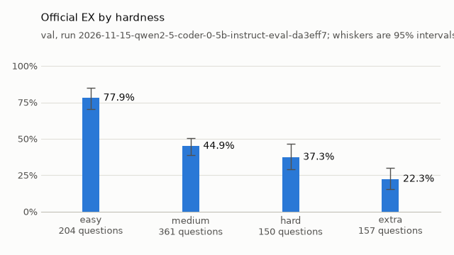

# Run 2026-11-15-qwen2-5-coder-0-5b-instruct-eval-da3eff7: official EX 47.2% [43.1%, 51.1%] on val

Generated: 2026-11-15 17:32:53 UTC

Written by `forge report run 2026-11-15-qwen2-5-coder-0-5b-instruct-eval-da3eff7` from the run's stored files and checked
against them by `forge report rebuild 2026-11-15-qwen2-5-coder-0-5b-instruct-eval-da3eff7`; don't edit it by hand.

Questions and gold queries are quoted from Spider 1.0 (Yu et al., EMNLP 2018), licensed [CC BY-SA 4.0](https://creativecommons.org/licenses/by-sa/4.0/).

| | |
|---|---|
| Model | `Qwen/Qwen2.5-Coder-0.5B-Instruct@ea3f2471cf1b1f0db85067f1ef93848e38e88c25` |
| Adapter | none |
| Backend | `hf` |
| Platform | `local-mps` |
| Prompt version | `p1` |
| Split | val: 872 questions, 1 sample each |
| Generation | greedy, at most 256 new tokens |
| Retry | none |
| Git commit | `da3eff7afa2c101f55ba23a541a73001704cf0b9` |
| Data manifest hash | `e10958d3b7a9490c15623285275d2840fbce551c32432fc62c0ad440cb06651e` |
| Manifest | [manifest.json](../manifest.json) |

## Execution accuracy

| | right | of | rate [95% interval] |
|---|---:|---:|---:|
| valid SQL | 590 | 872 | 67.7% [63.8%, 71.4%] |
| fast EX | 413 | 872 | 47.4% [43.1%, 51.3%] |
| official EX | 412 | 872 | 47.2% [43.1%, 51.1%] |

The checkers disagree on 5 samples: only fast EX matches 3, and only official EX 2.

Intervals are 95% percentile bootstraps over 1,000 resamples (seed 0) that draw whole questions, with the questions that share a gold query drawn together: 872 questions in 455 clusters.

## By hardness

| hardness | questions | fast EX [95% interval] | official EX [95% interval] |
|---|---:|---:|---:|
| easy | 204 | 77.5% [70.1%, 84.5%] | 77.9% [70.5%, 85.1%] |
| medium | 361 | 45.4% [39.4%, 51.4%] | 44.9% [38.7%, 50.7%] |
| hard | 150 | 37.3% [28.9%, 46.6%] | 37.3% [28.9%, 46.6%] |
| extra | 157 | 22.3% [15.3%, 29.9%] | 22.3% [15.3%, 29.9%] |



## Error classes

Failures of official EX by the class `forge.eval.taxonomy` gives them: the first
class that fits, in this order.

| class | failures | share of failures |
|---|---:|---:|
| no_sql | 2 | 0.4% |
| syntax | 0 | 0.0% |
| schema_link | 266 | 57.8% |
| wrong_tables | 80 | 17.4% |
| join | 21 | 4.6% |
| projection | 51 | 11.1% |
| aggregation | 2 | 0.4% |
| where | 13 | 2.8% |
| group_order | 12 | 2.6% |
| value | 10 | 2.2% |
| other | 0 | 0.0% |
| unclassified | 3 | 0.7% |

Unclassified failures are those only official EX finds: fast EX matched them, so the run gave them no class.

## Example failures

Up to 5 failures of each of the 3 most common classes,
picked by a hash of their ids so they spread over databases. The executor's error
message isn't stored, so each shows its class.

### schema_link: 5 of 266 shown

#### spider-train-00201 on bike_1 (medium)

Question: Find the day in which the difference between the max temperature and min temperature was the smallest. Also report the difference.

Gold query:

```sql
SELECT date ,  max_temperature_f - min_temperature_f FROM weather ORDER BY max_temperature_f - min_temperature_f LIMIT 1
```

Predicted query:

```sql
SELECT T1.start_date, T1.max_temperature_f - T1.min_temperature_f AS difference FROM weather AS T1 INNER JOIN trip AS T2 ON T1.date = T2.start_date WHERE T1.max_temperature_f - T1.min_temperature_f = (SELECT MIN(T1.max_temperature_f - T1.min_temperature_f) FROM weather AS T1 INNER JOIN trip AS T2 ON T1.date = T2.start_date)
```

Error: schema_link. The query failed to execute.

#### spider-train-04338 on tracking_grants_for_research (hard)

Question: List the project details of the projects which did not hire any staff for a researcher role.

Gold query:

```sql
SELECT project_details FROM Projects WHERE project_id NOT IN ( SELECT project_id FROM Project_Staff WHERE role_code  =  'researcher' )
```

Predicted query:

```sql
SELECT T2.project_details FROM Projects AS T1 JOIN Project_Staff AS T2 ON T1.project_id = T2.project_id WHERE T2.role_code = 'Research_Staff' AND T2.staff_id IS NULL
```

Error: schema_link. The query failed to execute.

#### spider-train-04371 on tracking_grants_for_research (medium)

Question: What is the type description of the organization whose detail is listed as 'quo'?

Gold query:

```sql
SELECT T1.organisation_type_description FROM organisation_Types AS T1 JOIN Organisations AS T2 ON T1.organisation_type  =  T2.organisation_type WHERE T2.organisation_details  =  'quo'
```

Predicted query:

```sql
SELECT T2.organisation_type_description FROM Organisations AS T1 INNER JOIN Project_Outcomes AS T2 ON T1.organisation_id = T2.organisation_id WHERE T1.organisation_details = 'quo'
```

Error: schema_link. The query failed to execute.

#### spider-train-05368 on tracking_software_problems (medium)

Question: Give me a list of descriptions of the problems that are reported by the staff whose first name is Christop.

Gold query:

```sql
SELECT T1.problem_description FROM problems AS T1 JOIN staff AS T2 ON T1.reported_by_staff_id = T2.staff_id WHERE T2.staff_first_name = "Christop"
```

Predicted query:

```sql
SELECT DISTINCT T2.problem_category_description FROM Problem_Log AS T1 INNER JOIN Problem_Status_Codes AS T2 ON T1.problem_status_code = T2.problem_status_code WHERE T1.reported_by_staff_id = (SELECT staff_id FROM Staff WHERE staff_first_name = 'Christop')
```

Error: schema_link. The query failed to execute.

#### spider-train-05924 on cre_Theme_park (medium)

Question: Find the details of the shops that can be reached by walk.

Gold query:

```sql
SELECT T1.Shop_Details FROM SHOPS AS T1 JOIN TOURIST_ATTRACTIONS AS T2 ON T1.Shop_ID  =  T2.Tourist_Attraction_ID WHERE T2.How_to_Get_There  =  "walk"
```

Predicted query:

```sql
SELECT T2.Shop_Details FROM Shops AS T1 JOIN Tourist_Attractions AS T2 ON T1.Shop_ID = T2.Tourist_Attraction_ID WHERE T1.How_to_Get_There = 'Walk'
```

Error: schema_link. The query failed to execute.

### wrong_tables: 5 of 80 shown

#### spider-train-00172 on bike_1 (extra)

Question: What are the names of all stations that have more than 10 bikes available and are not located in San Jose?

Gold query:

```sql
SELECT T1.name FROM station AS T1 JOIN status AS T2 ON T1.id  =  T2.station_id GROUP BY T2.station_id HAVING avg(bikes_available)  >  10 EXCEPT SELECT name FROM station WHERE city  =  "San Jose"
```

Predicted query:

```sql
SELECT name FROM station WHERE dock_count > 10 AND city != 'San Jose'
```

Error: wrong_tables. The query ran, and official EX finds no match.

#### spider-train-00256 on musical (medium)

Question: Show names of musicals and the number of actors who have appeared in the musicals.

Gold query:

```sql
SELECT T2.Name ,  COUNT(*) FROM actor AS T1 JOIN musical AS T2 ON T1.Musical_ID  =  T2.Musical_ID GROUP BY T1.Musical_ID
```

Predicted query:

```sql
SELECT Name, COUNT(*) FROM musical GROUP BY Name
```

Error: wrong_tables. The query ran, and official EX finds no match.

#### spider-train-00868 on chinook_1 (hard)

Question: Find the average millisecond length of Latin and Pop tracks.

Gold query:

```sql
SELECT AVG(Milliseconds) FROM GENRE AS T1 JOIN TRACK AS T2 ON T1.GenreId  =  T2.GenreId WHERE T1.Name  =  "Latin" OR T1.Name  =  "Pop"
```

Predicted query:

```sql
SELECT AVG(T1.Milliseconds) FROM Track AS T1 INNER JOIN MediaType AS T2 ON T1.MediaTypeId = T2.MediaTypeId WHERE T2.Name IN ('Latin', 'Pop')
```

Error: wrong_tables. The query ran, and official EX finds no match.

#### spider-train-02023 on gas_company (medium)

Question: Show the company name with the number of gas station.

Gold query:

```sql
SELECT T2.company ,  count(*) FROM station_company AS T1 JOIN company AS T2 ON T1.company_id  =  T2.company_id GROUP BY T1.company_id
```

Predicted query:

```sql
SELECT Company FROM company GROUP BY Company
```

Error: wrong_tables. The query ran, and official EX finds no match.

#### spider-train-05928 on cre_Theme_park (hard)

Question: Find the details of all the markets that are accessible by walk or bus.

Gold query:

```sql
SELECT T1.Market_Details FROM Street_Markets AS T1 JOIN TOURIST_ATTRACTIONS AS T2 ON T1.Market_ID  =  T2.Tourist_Attraction_ID WHERE T2.How_to_Get_There  =  "walk" OR  T2.How_to_Get_There  =  "bus"
```

Predicted query:

```sql
SELECT Market_Details FROM Street_Markets WHERE Market_Details LIKE '%walk%' OR Market_Details LIKE '%bus%'
```

Error: wrong_tables. The query ran, and official EX finds no match.

### projection: 5 of 51 shown

#### spider-train-00136 on bike_1 (extra)

Question: What is the id of the bike that traveled the most in 94002?

Gold query:

```sql
SELECT bike_id FROM trip WHERE zip_code  =  94002 GROUP BY bike_id ORDER BY COUNT(*) DESC LIMIT 1
```

Predicted query:

```sql
SELECT id FROM trip WHERE end_date = '2023-09-04' ORDER BY duration DESC LIMIT 1
```

Error: projection. The query ran, and official EX finds no match.

#### spider-train-00850 on chinook_1 (medium)

Question: Find the full names of employees who help customers with the first name Leonie.

Gold query:

```sql
SELECT T2.FirstName ,  T2.LastName FROM CUSTOMER AS T1 JOIN EMPLOYEE AS T2 ON T1.SupportRepId  =  T2.EmployeeId WHERE T1.FirstName  =  "Leonie"
```

Predicted query:

```sql
SELECT T2.FirstName, T2.LastName FROM Employee AS T1 JOIN Customer AS T2 ON T1.EmployeeId = T2.SupportRepId WHERE T2.FirstName = 'Leonie'
```

Error: projection. The query ran, and official EX finds no match.

#### spider-train-01813 on small_bank_1 (medium)

Question: What is the sum of checking and savings balances for all customers, ordered by the total balance?

Gold query:

```sql
SELECT T1.balance + T2.balance FROM checking AS T1 JOIN savings AS T2 ON T1.custid  =  T2.custid ORDER BY T1.balance + T2.balance
```

Predicted query:

```sql
SELECT SUM(C.balance) + SUM(S.balance) FROM CHECKING AS C JOIN SAVINGS AS S ON C.custid = S.custid ORDER BY SUM(C.balance) + SUM(S.balance)
```

Error: projection. The query ran, and official EX finds no match.

#### spider-train-02021 on gas_company (hard)

Question: Show all headquarters without a company in banking industry.

Gold query:

```sql
SELECT headquarters FROM company EXCEPT SELECT headquarters FROM company WHERE main_industry  =  'Banking'
```

Predicted query:

```sql
SELECT Headquarters FROM company WHERE Main_Industry != 'Banking'
```

Error: projection. The query ran, and official EX finds no match.

#### spider-train-04894 on school_player (hard)

Question: Show the denomination shared by schools founded before 1890 and schools founded after 1900

Gold query:

```sql
SELECT Denomination FROM school WHERE Founded  <  1890 INTERSECT SELECT Denomination FROM school WHERE Founded  >  1900
```

Predicted query:

```sql
SELECT DISTINCT Denomination FROM school WHERE Founded < 1890 OR Founded > 1900
```

Error: projection. The query ran, and official EX finds no match.
