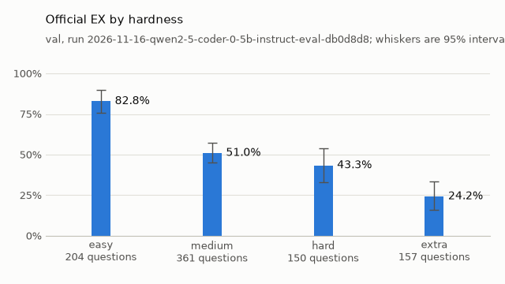

# Run 2026-11-16-qwen2-5-coder-0-5b-instruct-eval-db0d8d8: official EX 52.3% [47.9%, 56.4%] on val

Generated: 2026-11-16 05:57:29 UTC

Written by `forge report run 2026-11-16-qwen2-5-coder-0-5b-instruct-eval-db0d8d8` from the run's stored files and checked
against them by `forge report rebuild 2026-11-16-qwen2-5-coder-0-5b-instruct-eval-db0d8d8`; don't edit it by hand.

Questions and gold queries are quoted from Spider 1.0 (Yu et al., EMNLP 2018), licensed [CC BY-SA 4.0](https://creativecommons.org/licenses/by-sa/4.0/).

| | |
|---|---|
| Model | `Qwen/Qwen2.5-Coder-0.5B-Instruct@ea3f2471cf1b1f0db85067f1ef93848e38e88c25` |
| Adapter | `runs/2026-11-16-qwen2-5-coder-0-5b-instruct-sft-db0d8d8/checkpoints/final` |
| Backend | `hf` |
| Platform | `local-mps` |
| Prompt version | `p1` |
| Split | val: 872 questions, 1 sample each |
| Generation | greedy, at most 256 new tokens |
| Retry | none |
| Git commit | `db0d8d855e16a92fece33f6416b11d3b2b1fb344` |
| Data manifest hash | `e10958d3b7a9490c15623285275d2840fbce551c32432fc62c0ad440cb06651e` |
| Manifest | [manifest.json](../manifest.json) |

## Execution accuracy

| | right | of | rate [95% interval] |
|---|---:|---:|---:|
| valid SQL | 661 | 872 | 75.8% [72.2%, 79.6%] |
| fast EX | 452 | 872 | 51.8% [47.6%, 55.9%] |
| official EX | 456 | 872 | 52.3% [47.9%, 56.4%] |

The checkers disagree on 6 samples: only fast EX matches 1, and only official EX 5.

Intervals are 95% percentile bootstraps over 1,000 resamples (seed 0) that draw whole questions, with the questions that share a gold query drawn together: 872 questions in 455 clusters.

## By hardness

| hardness | questions | fast EX [95% interval] | official EX [95% interval] |
|---|---:|---:|---:|
| easy | 204 | 82.4% [75.2%, 89.3%] | 82.8% [75.7%, 89.8%] |
| medium | 361 | 50.1% [44.2%, 56.5%] | 51.0% [44.9%, 57.5%] |
| hard | 150 | 43.3% [33.1%, 54.1%] | 43.3% [33.1%, 54.1%] |
| extra | 157 | 24.2% [15.8%, 33.5%] | 24.2% [15.8%, 33.5%] |



## Error classes

Failures of official EX by the class `forge.eval.taxonomy` gives them: the first
class that fits, in this order.

| class | failures | share of failures |
|---|---:|---:|
| no_sql | 0 | 0.0% |
| syntax | 2 | 0.5% |
| schema_link | 203 | 48.8% |
| wrong_tables | 71 | 17.1% |
| join | 20 | 4.8% |
| projection | 58 | 13.9% |
| aggregation | 0 | 0.0% |
| where | 22 | 5.3% |
| group_order | 19 | 4.6% |
| value | 17 | 4.1% |
| other | 3 | 0.7% |
| unclassified | 1 | 0.2% |

Unclassified failures are those only official EX finds: fast EX matched them, so the run gave them no class.

## Example failures

Up to 5 failures of each of the 3 most common classes,
picked by a hash of their ids so they spread over databases. The executor's error
message isn't stored, so each shows its class.

### schema_link: 5 of 203 shown

#### spider-train-00658 on journal_committee (medium)

Question: Show the names of editors and the theme of journals for which they serve on committees.

Gold query:

```sql
SELECT T2.Name ,  T3.Theme FROM journal_committee AS T1 JOIN editor AS T2 ON T1.Editor_ID  =  T2.Editor_ID JOIN journal AS T3 ON T1.Journal_ID  =  T3.Journal_ID
```

Predicted query:

```sql
SELECT T1.name ,  T2.theme FROM editor AS T1 JOIN journal_committee AS T2 ON T1.editor_id  =  T2.editor_id
```

Error: schema_link. The query failed to execute.

#### spider-train-01997 on gas_company (medium)

Question: Show the company name and the main industry for all companies whose headquarters are not from USA.

Gold query:

```sql
SELECT company ,  main_industry FROM company WHERE headquarters != 'USA'
```

Predicted query:

```sql
SELECT T1.company ,  T2.main_industry FROM company AS T1 JOIN main_industry AS T2 ON T1.main_industry  =  T2.main_industry WHERE T1.headquarters != "USA"
```

Error: schema_link. The query failed to execute.

#### spider-train-02557 on county_public_safety (hard)

Question: How many cities are in counties that have populations of over 20000?

Gold query:

```sql
SELECT count(*) FROM city WHERE county_ID IN (SELECT county_ID FROM county_public_safety WHERE population  >  20000)
```

Predicted query:

```sql
SELECT count(*) FROM city WHERE population  >  20000
```

Error: schema_link. The query failed to execute.

#### spider-train-05368 on tracking_software_problems (medium)

Question: Give me a list of descriptions of the problems that are reported by the staff whose first name is Christop.

Gold query:

```sql
SELECT T1.problem_description FROM problems AS T1 JOIN staff AS T2 ON T1.reported_by_staff_id = T2.staff_id WHERE T2.staff_first_name = "Christop"
```

Predicted query:

```sql
SELECT DISTINCT T2.problem_category_description FROM Problem_Status_Codes AS T1 JOIN Problem_Status_Codes AS T2 ON T1.problem_status_code  =  T2.problem_status_code JOIN Staff AS T3 ON T2.problem_status_code  =  T3.staff_id WHERE T3.staff_first_name  =  "Christop"
```

Error: schema_link. The query failed to execute.

#### spider-train-05924 on cre_Theme_park (medium)

Question: Find the details of the shops that can be reached by walk.

Gold query:

```sql
SELECT T1.Shop_Details FROM SHOPS AS T1 JOIN TOURIST_ATTRACTIONS AS T2 ON T1.Shop_ID  =  T2.Tourist_Attraction_ID WHERE T2.How_to_Get_There  =  "walk"
```

Predicted query:

```sql
SELECT T2.Shop_Details FROM Shops AS T1 JOIN Tourist_Attractions AS T2 ON T1.Shop_ID  =  T2.Shop_ID WHERE T1.Name  =  "Walkable Shops"
```

Error: schema_link. The query failed to execute.

### wrong_tables: 5 of 71 shown

#### spider-train-00143 on bike_1 (extra)

Question: What are the names and ids of stations that had more than 14 bikes available on average or were installed in December?

Gold query:

```sql
SELECT T1.name ,  T1.id FROM station AS T1 JOIN status AS T2 ON T1.id  =  T2.station_id GROUP BY T2.station_id HAVING avg(T2.bikes_available)  >  14 UNION SELECT name ,  id FROM station WHERE installation_date LIKE "12/%"
```

Predicted query:

```sql
SELECT name ,  id FROM station WHERE dock_count  >  14 OR installation_date  =  'December'
```

Error: wrong_tables. The query ran, and official EX finds no match.

#### spider-train-00172 on bike_1 (extra)

Question: What are the names of all stations that have more than 10 bikes available and are not located in San Jose?

Gold query:

```sql
SELECT T1.name FROM station AS T1 JOIN status AS T2 ON T1.id  =  T2.station_id GROUP BY T2.station_id HAVING avg(bikes_available)  >  10 EXCEPT SELECT name FROM station WHERE city  =  "San Jose"
```

Predicted query:

```sql
SELECT name FROM station WHERE dock_count  >  10 EXCEPT SELECT name FROM station WHERE city  =  "San Jose"
```

Error: wrong_tables. The query ran, and official EX finds no match.

#### spider-train-00846 on chinook_1 (medium)

Question: Find the full name of the customer with the email "luisg@embraer.com.br".

Gold query:

```sql
SELECT FirstName ,  LastName FROM CUSTOMER WHERE Email  =  "luisg@embraer.com.br"
```

Predicted query:

```sql
SELECT T1.FirstName ,  T1.LastName FROM Customer AS T1 JOIN Employee AS T2 ON T1.SupportRepId  =  T2.EmployeeId WHERE T2.Email  =  "luisg@embraer.com.br"
```

Error: wrong_tables. The query ran, and official EX finds no match.

#### spider-train-02006 on gas_company (medium)

Question: For each headquarter, what are the headquarter and how many companies are centered there?

Gold query:

```sql
SELECT headquarters ,  count(*) FROM company GROUP BY headquarters
```

Predicted query:

```sql
SELECT T1.Headquarters ,  count(*) FROM company AS T1 JOIN station_company AS T2 ON T1.Company_ID  =  T2.Company_ID GROUP BY T1.Headquarters
```

Error: wrong_tables. The query ran, and official EX finds no match.

#### spider-train-05963 on cre_Theme_park (extra)

Question: What are the names of the tourist attractions Vincent and Marcelle visit?

Gold query:

```sql
SELECT T1.Name FROM Tourist_Attractions AS T1 JOIN VISITORS AS T2 JOIN VISITS AS T3 ON T1.Tourist_Attraction_ID  =  T3.Tourist_Attraction_ID AND T2.Tourist_ID  =  T3.Tourist_ID WHERE T2.Tourist_Details  =  "Vincent" INTERSECT SELECT T1.Name FROM Tourist_Attractions AS T1 JOIN VISITORS AS T2 JOIN VISITS AS T3 ON T1.Tourist_Attraction_ID  =  T3.Tourist_Attraction_ID AND T2.Tourist_ID  =  T3.Tourist_ID WHERE T2.Tourist_Details  =  "Marcelle"
```

Predicted query:

```sql
SELECT T2.name FROM VISITS AS T1 JOIN TOURIST_ATTRACTIONS AS T2 ON T1.TOURIST_ATTRACTION_ID  =  T2.TOURIST_ATTRACTION_ID WHERE T1.TOURIST_ID  =  1 INTERSECT SELECT T2.name FROM VISITS AS T1 JOIN TOURIST_ATTRACTIONS AS T2 ON T1.TOURIST_ATTRACTION_ID  =  T2.TOURIST_ATTRACTION_ID WHERE T1.TOURIST_ID  =  2
```

Error: wrong_tables. The query ran, and official EX finds no match.

### projection: 5 of 58 shown

#### spider-train-00201 on bike_1 (medium)

Question: Find the day in which the difference between the max temperature and min temperature was the smallest. Also report the difference.

Gold query:

```sql
SELECT date ,  max_temperature_f - min_temperature_f FROM weather ORDER BY max_temperature_f - min_temperature_f LIMIT 1
```

Predicted query:

```sql
SELECT min_temperature_f - max_temperature_f FROM weather ORDER BY min_temperature_f - max_temperature_f ASC LIMIT 1
```

Error: projection. The query ran, and official EX finds no match.

#### spider-train-00244 on musical (medium)

Question: What is the duration of the oldest actor?

Gold query:

```sql
SELECT Duration FROM actor ORDER BY Age DESC LIMIT 1
```

Predicted query:

```sql
SELECT max(Duration) FROM actor
```

Error: projection. The query ran, and official EX finds no match.

#### spider-train-00245 on musical (medium)

Question: Return the duration of the actor with the greatest age.

Gold query:

```sql
SELECT Duration FROM actor ORDER BY Age DESC LIMIT 1
```

Predicted query:

```sql
SELECT max(Duration) FROM actor
```

Error: projection. The query ran, and official EX finds no match.

#### spider-train-02023 on gas_company (medium)

Question: Show the company name with the number of gas station.

Gold query:

```sql
SELECT T2.company ,  count(*) FROM station_company AS T1 JOIN company AS T2 ON T1.company_id  =  T2.company_id GROUP BY T1.company_id
```

Predicted query:

```sql
SELECT T1.company FROM company AS T1 JOIN station_company AS T2 ON T1.company_id  =  T2.company_id GROUP BY T1.company_id ORDER BY count(*) DESC
```

Error: projection. The query ran, and official EX finds no match.

#### spider-train-04320 on tracking_grants_for_research (extra)

Question: What are the distinct grant amount for the grants where the documents were sent before '1986-08-26 20:49:27' and grant were ended after '1989-03-16 18:27:16'?

Gold query:

```sql
SELECT T1.grant_amount FROM Grants AS T1 JOIN Documents AS T2 ON T1.grant_id  =  T2.grant_id WHERE T2.sent_date  <  '1986-08-26 20:49:27' INTERSECT SELECT grant_amount FROM grants WHERE grant_end_date  >  '1989-03-16 18:27:16'
```

Predicted query:

```sql
SELECT DISTINCT T1.grant_amount FROM Grants AS T1 JOIN Documents AS T2 ON T1.grant_id  =  T2.grant_id WHERE T2.sent_date  <  '1986-08-26 20:49:27' AND T2.response_received_date  >  '1989-03-16 18:27:16'
```

Error: projection. The query ran, and official EX finds no match.
