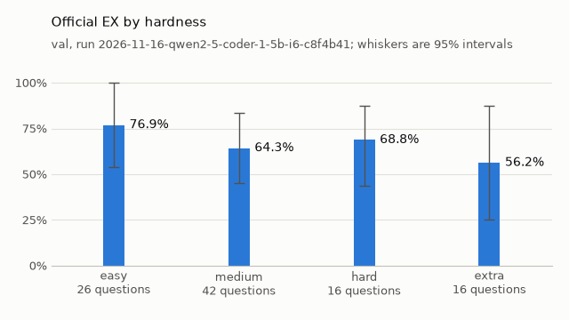

# Run 2026-11-16-qwen2-5-coder-1-5b-i6-c8f4b41: official EX 67.0% [54.0%, 79.0%] on val

Generated: 2026-11-17 00:08:37 UTC

Written by `forge report run 2026-11-16-qwen2-5-coder-1-5b-i6-c8f4b41` from the run's stored files and checked
against them by `forge report rebuild 2026-11-16-qwen2-5-coder-1-5b-i6-c8f4b41`; don't edit it by hand.

Questions and gold queries are quoted from Spider 1.0 (Yu et al., EMNLP 2018), licensed [CC BY-SA 4.0](https://creativecommons.org/licenses/by-sa/4.0/).

| | |
|---|---|
| Model | `Qwen/Qwen2.5-Coder-1.5B-Instruct@2e1fd397ee46e1388853d2af2c993145b0f1098a` |
| Adapter | none |
| Backend | `vllm` |
| Platform | `kaggle` |
| Prompt version | `p1` |
| Split | val: 100 questions (limit 100), 1 sample each |
| Generation | greedy, at most 256 new tokens |
| Retry | none |
| Git commit | `c8f4b419f1f2666984a48c49eeb7827fc0b7d1e4` |
| Data manifest hash | `e10958d3b7a9490c15623285275d2840fbce551c32432fc62c0ad440cb06651e` |
| Manifest | [manifest.json](../manifest.json) |

## Execution accuracy

| | right | of | rate [95% interval] |
|---|---:|---:|---:|
| valid SQL | 86 | 100 | 86.0% [76.0%, 95.0%] |
| fast EX | 67 | 100 | 67.0% [54.0%, 79.0%] |
| official EX | 67 | 100 | 67.0% [54.0%, 79.0%] |

Intervals are 95% percentile bootstraps over 1,000 resamples (seed 0) that draw whole questions, with the questions that share a gold query drawn together: 100 questions in 50 clusters.

## By hardness

| hardness | questions | fast EX [95% interval] | official EX [95% interval] |
|---|---:|---:|---:|
| easy | 26 | 76.9% [53.8%, 100.0%] | 76.9% [53.8%, 100.0%] |
| medium | 42 | 64.3% [45.2%, 83.3%] | 64.3% [45.2%, 83.3%] |
| hard | 16 | 68.8% [43.8%, 87.5%] | 68.8% [43.8%, 87.5%] |
| extra | 16 | 56.2% [25.0%, 87.5%] | 56.2% [25.0%, 87.5%] |



## Error classes

Failures of official EX by the class `forge.eval.taxonomy` gives them: the first
class that fits, in this order.

| class | failures | share of failures |
|---|---:|---:|
| no_sql | 1 | 3.0% |
| syntax | 0 | 0.0% |
| schema_link | 13 | 39.4% |
| wrong_tables | 5 | 15.2% |
| join | 2 | 6.1% |
| projection | 8 | 24.2% |
| aggregation | 0 | 0.0% |
| where | 2 | 6.1% |
| group_order | 2 | 6.1% |
| value | 0 | 0.0% |
| other | 0 | 0.0% |

## Example failures

Up to 5 failures of each of the 3 most common classes,
picked by a hash of their ids so they spread over databases. The executor's error
message isn't stored, so each shows its class.

### schema_link: 5 of 13 shown

#### spider-train-00041 on farm (medium)

Question: What are the themes of competitions that have corresponding host cities with more than 1000 residents?

Gold query:

```sql
SELECT T2.Theme FROM city AS T1 JOIN farm_competition AS T2 ON T1.City_ID  =  T2.Host_city_ID WHERE T1.Population  >  1000
```

Predicted query:

```sql
SELECT T2.Theme FROM farm_competition AS T1 INNER JOIN city AS T2 ON T1.Host_city_ID = T2.City_ID WHERE T2.Population > 1000
```

Error: schema_link. The query failed to execute.

#### spider-train-00137 on bike_1 (medium)

Question: How many days had both mean humidity above 50 and mean visibility above 8?

Gold query:

```sql
SELECT COUNT(*) FROM weather WHERE mean_humidity  >  50 AND mean_visibility_miles  >  8
```

Predicted query:

```sql
SELECT COUNT(DISTINCT T1.date) FROM weather AS T1 INNER JOIN station AS T2 ON T1.zip_code = T2.zip_code WHERE T1.mean_humidity > 50 AND T1.mean_visibility_miles > 8
```

Error: schema_link. The query failed to execute.

#### spider-train-00143 on bike_1 (extra)

Question: What are the names and ids of stations that had more than 14 bikes available on average or were installed in December?

Gold query:

```sql
SELECT T1.name ,  T1.id FROM station AS T1 JOIN status AS T2 ON T1.id  =  T2.station_id GROUP BY T2.station_id HAVING avg(T2.bikes_available)  >  14 UNION SELECT name ,  id FROM station WHERE installation_date LIKE "12/%"
```

Predicted query:

```sql
SELECT name, id FROM station WHERE bikes_available > (SELECT AVG(bikes_available) FROM status) OR installation_date LIKE '2021-12-%'
```

Error: schema_link. The query failed to execute.

#### spider-train-00144 on bike_1 (extra)

Question: What are the names and ids of all stations that have more than 14 bikes available on average or had bikes installed in December?

Gold query:

```sql
SELECT T1.name ,  T1.id FROM station AS T1 JOIN status AS T2 ON T1.id  =  T2.station_id GROUP BY T2.station_id HAVING avg(T2.bikes_available)  >  14 UNION SELECT name ,  id FROM station WHERE installation_date LIKE "12/%"
```

Predicted query:

```sql
SELECT name, id FROM station WHERE bikes_available > (SELECT AVG(bikes_available) FROM status) OR installation_date LIKE '2021-12-%'
```

Error: schema_link. The query failed to execute.

#### spider-train-00154 on bike_1 (medium)

Question: What zip codes have a station with a max temperature greater than or equal to 80 and when did it reach that temperature?

Gold query:

```sql
SELECT date ,  zip_code FROM weather WHERE max_temperature_f  >=  80
```

Predicted query:

```sql
SELECT T2.zip_code, T1.max_temperature_f, T1.date
FROM weather AS T1
JOIN station AS T2 ON T1.zip_code = T2.zip_code
WHERE T1.max_temperature_f >= 80
ORDER BY T1.max_temperature_f DESC
```

Error: schema_link. The query failed to execute.

### projection: 5 of 8 shown

#### spider-train-00019 on farm (easy)

Question: What is the total horses record for each farm, sorted ascending?

Gold query:

```sql
SELECT Total_Horses FROM farm ORDER BY Total_Horses ASC
```

Predicted query:

```sql
SELECT T1.Farm_ID, SUM(T1.Total_Horses) AS Total_Horses
FROM farm AS T1
GROUP BY T1.Farm_ID
ORDER BY Total_Horses ASC
```

Error: projection. The query ran, and official EX finds no match.

#### spider-train-00044 on farm (medium)

Question: Please show the different statuses, ordered by the number of cities that have each.

Gold query:

```sql
SELECT Status FROM city GROUP BY Status ORDER BY COUNT(*) ASC
```

Predicted query:

```sql
SELECT Status, COUNT(*) FROM city GROUP BY Status ORDER BY COUNT(*) DESC
```

Error: projection. The query ran, and official EX finds no match.

#### spider-train-00050 on farm (hard)

Question: Show the status shared by cities with population bigger than 1500 and smaller than 500.

Gold query:

```sql
SELECT Status FROM city WHERE Population  >  1500 INTERSECT SELECT Status FROM city WHERE Population  <  500
```

Predicted query:

```sql
SELECT Status FROM city WHERE Population > 1500 AND Population < 500
```

Error: projection. The query ran, and official EX finds no match.

#### spider-train-00123 on bike_1 (hard)

Question: For each zip code, return the average mean temperature of August there.

Gold query:

```sql
SELECT zip_code  ,  avg(mean_temperature_f) FROM weather WHERE date LIKE "8/%" GROUP BY zip_code
```

Predicted query:

```sql
SELECT w.zip_code, AVG(w.mean_temperature_f) AS avg_mean_temp
FROM weather w
WHERE w.date LIKE '2023-08-%'
GROUP BY w.zip_code
```

Error: projection. The query ran, and official EX finds no match.

#### spider-train-00161 on bike_1 (medium)

Question: For each trip, return its ending station's installation date.

Gold query:

```sql
SELECT T1.id ,  T2.installation_date FROM trip AS T1 JOIN station AS T2 ON T1.end_station_id  =  T2.id
```

Predicted query:

```sql
SELECT T2.installation_date FROM trip AS T1 INNER JOIN station AS T2 ON T1.end_station_id = T2.id
```

Error: projection. The query ran, and official EX finds no match.

### wrong_tables: 5 of 5 shown

#### spider-train-00133 on bike_1 (extra)

Question: Which start station had the most trips starting from August? Give me the name and id of the station.

Gold query:

```sql
SELECT start_station_name ,  start_station_id FROM trip WHERE start_date LIKE "8/%" GROUP BY start_station_name ORDER BY COUNT(*) DESC LIMIT 1
```

Predicted query:

```sql
SELECT T1.name, T1.id FROM station AS T1 INNER JOIN trip AS T2 ON T1.id = T2.start_station_id WHERE T2.start_date LIKE '2023-08%' GROUP BY T1.id ORDER BY COUNT(*) DESC LIMIT 1
```

Error: wrong_tables. The query ran, and official EX finds no match.

#### spider-train-00142 on bike_1 (hard)

Question: What are the ids of the stations in San Francisco that normally have more than 10 bikes available?

Gold query:

```sql
SELECT id FROM station WHERE city  =  "San Francisco" INTERSECT SELECT station_id FROM status GROUP BY station_id HAVING avg(bikes_available)  >  10
```

Predicted query:

```sql
SELECT id FROM station WHERE city = 'San Francisco' AND dock_count > 10
```

Error: wrong_tables. The query ran, and official EX finds no match.

#### spider-train-00153 on bike_1 (medium)

Question: When and in what zip code did max temperature reach 80?

Gold query:

```sql
SELECT date ,  zip_code FROM weather WHERE max_temperature_f  >=  80
```

Predicted query:

```sql
SELECT T1.date, T1.zip_code FROM weather AS T1 INNER JOIN trip AS T2 ON T1.zip_code = T2.zip_code WHERE T1.max_temperature_f = 80
```

Error: wrong_tables. The query ran, and official EX finds no match.

#### spider-train-00165 on bike_1 (medium)

Question: Count the number of trips that did not end in San Francisco city.

Gold query:

```sql
SELECT count(*) FROM trip AS T1 JOIN station AS T2 ON T1.end_station_id  =  T2.id WHERE T2.city !=  "San Francisco"
```

Predicted query:

```sql
SELECT COUNT(*) FROM trip WHERE end_station_name != 'San Francisco'
```

Error: wrong_tables. The query ran, and official EX finds no match.

#### spider-train-00166 on bike_1 (medium)

Question: How many trips did not end in San Francisco?

Gold query:

```sql
SELECT count(*) FROM trip AS T1 JOIN station AS T2 ON T1.end_station_id  =  T2.id WHERE T2.city != "San Francisco"
```

Predicted query:

```sql
SELECT COUNT(*) FROM trip WHERE end_station_name != 'San Francisco'
```

Error: wrong_tables. The query ran, and official EX finds no match.
