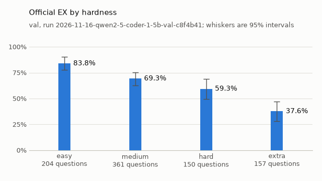

# Run 2026-11-16-qwen2-5-coder-1-5b-val-c8f4b41: official EX 65.3% [61.2%, 69.1%] on val

Generated: 2026-11-17 00:08:35 UTC

Written by `forge report run 2026-11-16-qwen2-5-coder-1-5b-val-c8f4b41` from the run's stored files and checked
against them by `forge report rebuild 2026-11-16-qwen2-5-coder-1-5b-val-c8f4b41`; don't edit it by hand.

Questions and gold queries are quoted from Spider 1.0 (Yu et al., EMNLP 2018), licensed [CC BY-SA 4.0](https://creativecommons.org/licenses/by-sa/4.0/).

| | |
|---|---|
| Model | `Qwen/Qwen2.5-Coder-1.5B-Instruct@2e1fd397ee46e1388853d2af2c993145b0f1098a` |
| Adapter | none |
| Backend | `vllm` |
| Platform | `kaggle` |
| Prompt version | `p1` |
| Split | val: 872 questions, 1 sample each |
| Generation | greedy, at most 256 new tokens |
| Retry | none |
| Git commit | `c8f4b419f1f2666984a48c49eeb7827fc0b7d1e4` |
| Data manifest hash | `e10958d3b7a9490c15623285275d2840fbce551c32432fc62c0ad440cb06651e` |
| Manifest | [manifest.json](../manifest.json) |

## Execution accuracy

| | right | of | rate [95% interval] |
|---|---:|---:|---:|
| valid SQL | 743 | 872 | 85.2% [82.2%, 88.1%] |
| fast EX | 568 | 872 | 65.1% [61.0%, 69.0%] |
| official EX | 569 | 872 | 65.3% [61.2%, 69.1%] |

The checkers disagree on 9 samples: only fast EX matches 4, and only official EX 5.

Intervals are 95% percentile bootstraps over 1,000 resamples (seed 0) that draw whole questions, with the questions that share a gold query drawn together: 872 questions in 455 clusters.

## By hardness

| hardness | questions | fast EX [95% interval] | official EX [95% interval] |
|---|---:|---:|---:|
| easy | 204 | 83.8% [77.5%, 90.3%] | 83.8% [77.6%, 90.2%] |
| medium | 361 | 69.0% [62.6%, 75.0%] | 69.3% [62.8%, 75.3%] |
| hard | 150 | 58.7% [49.0%, 68.2%] | 59.3% [49.7%, 69.1%] |
| extra | 157 | 38.2% [29.1%, 47.5%] | 37.6% [28.0%, 46.8%] |



## Error classes

Failures of official EX by the class `forge.eval.taxonomy` gives them: the first
class that fits, in this order.

| class | failures | share of failures |
|---|---:|---:|
| no_sql | 2 | 0.7% |
| syntax | 1 | 0.3% |
| schema_link | 119 | 39.3% |
| wrong_tables | 49 | 16.2% |
| join | 48 | 15.8% |
| projection | 26 | 8.6% |
| aggregation | 4 | 1.3% |
| where | 14 | 4.6% |
| group_order | 16 | 5.3% |
| value | 20 | 6.6% |
| other | 0 | 0.0% |
| unclassified | 4 | 1.3% |

Unclassified failures are those only official EX finds: fast EX matched them, so the run gave them no class.

## Example failures

Up to 5 failures of each of the 3 most common classes,
picked by a hash of their ids so they spread over databases. The executor's error
message isn't stored, so each shows its class.

### schema_link: 5 of 119 shown

#### spider-train-00143 on bike_1 (extra)

Question: What are the names and ids of stations that had more than 14 bikes available on average or were installed in December?

Gold query:

```sql
SELECT T1.name ,  T1.id FROM station AS T1 JOIN status AS T2 ON T1.id  =  T2.station_id GROUP BY T2.station_id HAVING avg(T2.bikes_available)  >  14 UNION SELECT name ,  id FROM station WHERE installation_date LIKE "12/%"
```

Predicted query:

```sql
SELECT name, id FROM station WHERE bikes_available > (SELECT AVG(bikes_available) FROM status) OR installation_date LIKE '2021-12-%'
```

Error: schema_link. The query failed to execute.

#### spider-train-00172 on bike_1 (extra)

Question: What are the names of all stations that have more than 10 bikes available and are not located in San Jose?

Gold query:

```sql
SELECT T1.name FROM station AS T1 JOIN status AS T2 ON T1.id  =  T2.station_id GROUP BY T2.station_id HAVING avg(bikes_available)  >  10 EXCEPT SELECT name FROM station WHERE city  =  "San Jose"
```

Predicted query:

```sql
SELECT name FROM station WHERE bikes_available > 10 AND city != 'San Jose'
```

Error: schema_link. The query failed to execute.

#### spider-train-01790 on small_bank_1 (hard)

Question: Find the checking balance and saving balance in the Brown’s account.

Gold query:

```sql
SELECT T2.balance ,  T3.balance FROM accounts AS T1 JOIN checking AS T2 ON T1.custid  =  T2.custid JOIN savings AS T3 ON T1.custid  =  T3.custid WHERE T1.name  =  'Brown'
```

Predicted query:

```sql
SELECT T2.balance AS checking_balance, T1.balance AS saving_balance
FROM ACCOUNTS AS T1
JOIN SAVINGS AS T2 ON T1.custid = T2.custid
WHERE T1.name = 'Brown’s'
```

Error: schema_link. The query failed to execute.

#### spider-train-05368 on tracking_software_problems (medium)

Question: Give me a list of descriptions of the problems that are reported by the staff whose first name is Christop.

Gold query:

```sql
SELECT T1.problem_description FROM problems AS T1 JOIN staff AS T2 ON T1.reported_by_staff_id = T2.staff_id WHERE T2.staff_first_name = "Christop"
```

Predicted query:

```sql
SELECT T2.problem_description FROM Staff AS T1 INNER JOIN Problem_Log AS T2 ON T1.staff_id = T2.assigned_to_staff_id WHERE T1.staff_first_name = 'Christop'
```

Error: schema_link. The query failed to execute.

#### spider-train-05924 on cre_Theme_park (medium)

Question: Find the details of the shops that can be reached by walk.

Gold query:

```sql
SELECT T1.Shop_Details FROM SHOPS AS T1 JOIN TOURIST_ATTRACTIONS AS T2 ON T1.Shop_ID  =  T2.Tourist_Attraction_ID WHERE T2.How_to_Get_There  =  "walk"
```

Predicted query:

```sql
SELECT T1.Name, T1.Description, T1.Opening_Hours
FROM Tourist_Attractions AS T1
JOIN Street_Markets AS T2 ON T1.Tourist_Attraction_ID = T2.Tourist_Attraction_ID
WHERE T2.How_to_Get_There = 'Walk'
```

Error: schema_link. The query failed to execute.

### wrong_tables: 5 of 49 shown

#### spider-train-00209 on bike_1 (extra)

Question: How many trips started from Mountain View city and ended at Palo Alto city?

Gold query:

```sql
SELECT count(*) FROM station AS T1 JOIN trip AS T2 JOIN station AS T3 JOIN trip AS T4 ON T1.id  =  T2.start_station_id AND T2.id  =  T4.id AND T3.id  =  T4.end_station_id WHERE T1.city  =  "Mountain View" AND T3.city  =  "Palo Alto"
```

Predicted query:

```sql
SELECT COUNT(*) FROM trip WHERE start_station_name = 'Mountain View' AND end_station_name = 'Palo Alto'
```

Error: wrong_tables. The query ran, and official EX finds no match.

#### spider-train-02035 on gas_company (medium)

Question: find the rank, company names, market values of the companies in the banking industry order by their sales and profits in billion.

Gold query:

```sql
SELECT rank ,  company ,  market_value FROM company WHERE main_industry  =  'Banking' ORDER BY sales_billion ,  profits_billion
```

Predicted query:

```sql
SELECT T1.Rank, T1.Company, T1.Market_Value
FROM company AS T1
JOIN station_company AS T2 ON T1.Company_ID = T2.Company_ID
JOIN gas_station AS T3 ON T2.Station_ID = T3.Station_ID
WHERE T1.Main_Industry = 'Banking'
ORDER BY T1.Sales_billion DESC, T1.Profits_billion DESC
```

Error: wrong_tables. The query ran, and official EX finds no match.

#### spider-train-04339 on tracking_grants_for_research (hard)

Question: What are the details for all projects that did not hire any staff in a research role?

Gold query:

```sql
SELECT project_details FROM Projects WHERE project_id NOT IN ( SELECT project_id FROM Project_Staff WHERE role_code  =  'researcher' )
```

Predicted query:

```sql
SELECT p.project_id, p.project_details
FROM Projects p
LEFT JOIN Project_Staff ps ON p.project_id = ps.project_id
LEFT JOIN Research_Staff rs ON ps.staff_id = rs.staff_id
WHERE rs.staff_id IS NULL
```

Error: wrong_tables. The query ran, and official EX finds no match.

#### spider-train-04369 on tracking_grants_for_research (hard)

Question: For each grant id, how many documents does it have, and which one has the most?

Gold query:

```sql
SELECT grant_id ,  count(*) FROM Documents GROUP BY grant_id ORDER BY count(*) DESC LIMIT 1
```

Predicted query:

```sql
SELECT g.grant_id, COUNT(d.document_id) AS document_count, d.document_id AS most_recent_document
FROM Grants g
JOIN Documents d ON g.grant_id = d.grant_id
GROUP BY g.grant_id
ORDER BY document_count DESC
LIMIT 1
```

Error: wrong_tables. The query ran, and official EX finds no match.

#### spider-train-06809 on flight_4 (easy)

Question: How many airlines does Russia has?

Gold query:

```sql
SELECT count(*) FROM airlines WHERE country  =  'Russia'
```

Predicted query:

```sql
SELECT COUNT(DISTINCT T1.name) FROM airlines AS T1 INNER JOIN airports AS T2 ON T1.iata = T2.iata WHERE T2.country = 'Russia'
```

Error: wrong_tables. The query ran, and official EX finds no match.

### join: 5 of 48 shown

#### spider-train-00197 on bike_1 (hard)

Question: Find the id for the trips that lasted at least as long as the average duration of trips in zip code 94103.

Gold query:

```sql
SELECT id FROM trip WHERE duration  >=  (SELECT avg(duration) FROM trip WHERE zip_code  =  94103)
```

Predicted query:

```sql
SELECT T1.id FROM trip AS T1 INNER JOIN (SELECT zip_code, AVG(duration) AS avg_duration FROM trip GROUP BY zip_code HAVING avg_duration >= (SELECT AVG(duration) FROM trip WHERE zip_code = 94103)) AS T2 ON T1.zip_code = T2.zip_code AND T1.duration >= T2.avg_duration
```

Error: join. The query ran, and official EX finds no match.

#### spider-train-00207 on bike_1 (hard)

Question: What are the names of stations that are located in Palo Alto city but have never been the ending point of trips more than 100 times?

Gold query:

```sql
SELECT name FROM station WHERE city  =  "Palo Alto" EXCEPT SELECT end_station_name FROM trip GROUP BY end_station_name HAVING count(*)  >  100
```

Predicted query:

```sql
SELECT T1.name FROM station AS T1 INNER JOIN trip AS T2 ON T1.id = T2.start_station_id WHERE T1.city = 'Palo Alto' AND T2.end_station_id NOT IN (SELECT end_station_id FROM trip GROUP BY end_station_id HAVING COUNT(*) > 100)
```

Error: join. The query ran, and official EX finds no match.

#### spider-train-00256 on musical (medium)

Question: Show names of musicals and the number of actors who have appeared in the musicals.

Gold query:

```sql
SELECT T2.Name ,  COUNT(*) FROM actor AS T1 JOIN musical AS T2 ON T1.Musical_ID  =  T2.Musical_ID GROUP BY T1.Musical_ID
```

Predicted query:

```sql
SELECT Name, COUNT(*) FROM musical AS T1 JOIN actor AS T2 ON T1.Musical_ID = T2.Musical_ID GROUP BY Name
```

Error: join. The query failed to execute.

#### spider-train-05384 on tracking_software_problems (extra)

Question: What are the id of problems reported by the staff named Dameon Frami or Jolie Weber?

Gold query:

```sql
SELECT product_id FROM problems AS T1 JOIN staff AS T2 ON T1.reported_by_staff_id = T2.staff_id WHERE T2.staff_first_name = "Dameon" AND T2.staff_last_name = "Frami" UNION SELECT product_id FROM problems AS T1 JOIN staff AS T2 ON T1.reported_by_staff_id = T2.staff_id WHERE T2.staff_first_name = "Jolie" AND T2.staff_last_name = "Weber"
```

Predicted query:

```sql
SELECT problem_id FROM Problems WHERE reported_by_staff_id IN (SELECT staff_id FROM Staff WHERE staff_first_name = 'Dameon' AND staff_last_name = 'Frami' UNION SELECT staff_id FROM Staff WHERE staff_first_name = 'Jolie' AND staff_last_name = 'Weber')
```

Error: join. The query ran, and official EX finds no match.

#### spider-train-05963 on cre_Theme_park (extra)

Question: What are the names of the tourist attractions Vincent and Marcelle visit?

Gold query:

```sql
SELECT T1.Name FROM Tourist_Attractions AS T1 JOIN VISITORS AS T2 JOIN VISITS AS T3 ON T1.Tourist_Attraction_ID  =  T3.Tourist_Attraction_ID AND T2.Tourist_ID  =  T3.Tourist_ID WHERE T2.Tourist_Details  =  "Vincent" INTERSECT SELECT T1.Name FROM Tourist_Attractions AS T1 JOIN VISITORS AS T2 JOIN VISITS AS T3 ON T1.Tourist_Attraction_ID  =  T3.Tourist_Attraction_ID AND T2.Tourist_ID  =  T3.Tourist_ID WHERE T2.Tourist_Details  =  "Marcelle"
```

Predicted query:

```sql
SELECT T2.Name FROM Visits AS T1 INNER JOIN Tourist_Attractions AS T2 ON T1.Tourist_Attraction_ID = T2.Tourist_Attraction_ID WHERE T1.Tourist_ID IN (SELECT Tourist_ID FROM Visitors WHERE Tourist_Details = 'Vincent' OR Tourist_Details = 'Marcelle')
```

Error: join. The query ran, and official EX finds no match.
