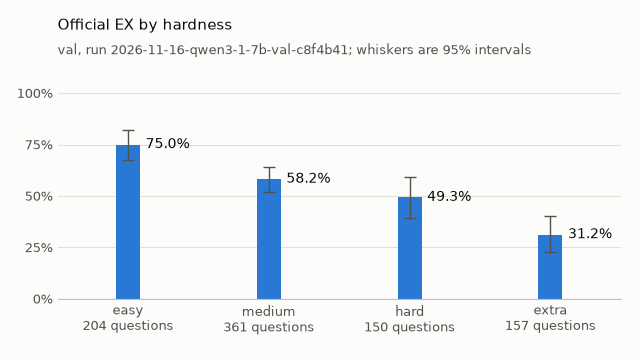

# Run 2026-11-16-qwen3-1-7b-val-c8f4b41: official EX 55.7% [51.7%, 59.9%] on val

Generated: 2026-11-17 00:08:31 UTC

Written by `forge report run 2026-11-16-qwen3-1-7b-val-c8f4b41` from the run's stored files and checked
against them by `forge report rebuild 2026-11-16-qwen3-1-7b-val-c8f4b41`; don't edit it by hand.

Questions and gold queries are quoted from Spider 1.0 (Yu et al., EMNLP 2018), licensed [CC BY-SA 4.0](https://creativecommons.org/licenses/by-sa/4.0/).

| | |
|---|---|
| Model | `Qwen/Qwen3-1.7B@70d244cc86ccca08cf5af4e1e306ecf908b1ad5e` |
| Adapter | none |
| Backend | `vllm` |
| Platform | `kaggle` |
| Prompt version | `p1` |
| Split | val: 872 questions, 1 sample each |
| Generation | greedy, at most 256 new tokens |
| Retry | none |
| Git commit | `c8f4b419f1f2666984a48c49eeb7827fc0b7d1e4` |
| Data manifest hash | `e10958d3b7a9490c15623285275d2840fbce551c32432fc62c0ad440cb06651e` |
| Manifest | [manifest.json](../manifest.json) |

## Execution accuracy

| | right | of | rate [95% interval] |
|---|---:|---:|---:|
| valid SQL | 778 | 872 | 89.2% [86.9%, 91.6%] |
| fast EX | 479 | 872 | 54.9% [50.9%, 59.2%] |
| official EX | 486 | 872 | 55.7% [51.7%, 59.9%] |

The checkers disagree on 17 samples: only fast EX matches 5, and only official EX 12.

Intervals are 95% percentile bootstraps over 1,000 resamples (seed 0) that draw whole questions, with the questions that share a gold query drawn together: 872 questions in 455 clusters.

## By hardness

| hardness | questions | fast EX [95% interval] | official EX [95% interval] |
|---|---:|---:|---:|
| easy | 204 | 73.5% [66.3%, 80.6%] | 75.0% [67.5%, 82.1%] |
| medium | 361 | 56.8% [50.7%, 62.7%] | 58.2% [52.1%, 64.2%] |
| hard | 150 | 49.3% [39.5%, 59.1%] | 49.3% [39.5%, 59.1%] |
| extra | 157 | 31.8% [23.4%, 40.8%] | 31.2% [22.8%, 40.1%] |



## Error classes

Failures of official EX by the class `forge.eval.taxonomy` gives them: the first
class that fits, in this order.

| class | failures | share of failures |
|---|---:|---:|
| no_sql | 0 | 0.0% |
| syntax | 2 | 0.5% |
| schema_link | 86 | 22.3% |
| wrong_tables | 110 | 28.5% |
| join | 67 | 17.4% |
| projection | 83 | 21.5% |
| aggregation | 5 | 1.3% |
| where | 12 | 3.1% |
| group_order | 3 | 0.8% |
| value | 12 | 3.1% |
| other | 1 | 0.3% |
| unclassified | 5 | 1.3% |

Unclassified failures are those only official EX finds: fast EX matched them, so the run gave them no class.

## Example failures

Up to 5 failures of each of the 3 most common classes,
picked by a hash of their ids so they spread over databases. The executor's error
message isn't stored, so each shows its class.

### wrong_tables: 5 of 110 shown

#### spider-train-00172 on bike_1 (extra)

Question: What are the names of all stations that have more than 10 bikes available and are not located in San Jose?

Gold query:

```sql
SELECT T1.name FROM station AS T1 JOIN status AS T2 ON T1.id  =  T2.station_id GROUP BY T2.station_id HAVING avg(bikes_available)  >  10 EXCEPT SELECT name FROM station WHERE city  =  "San Jose"
```

Predicted query:

```sql
SELECT name
FROM station
WHERE dock_count > 10
AND city != 'San Jose'
```

Error: wrong_tables. The query ran, and official EX finds no match.

#### spider-train-00256 on musical (medium)

Question: Show names of musicals and the number of actors who have appeared in the musicals.

Gold query:

```sql
SELECT T2.Name ,  COUNT(*) FROM actor AS T1 JOIN musical AS T2 ON T1.Musical_ID  =  T2.Musical_ID GROUP BY T1.Musical_ID
```

Predicted query:

```sql
SELECT "Name", COUNT(*) as NumActors
FROM "musical"
GROUP BY "Name"
```

Error: wrong_tables. The query ran, and official EX finds no match.

#### spider-train-04371 on tracking_grants_for_research (medium)

Question: What is the type description of the organization whose detail is listed as 'quo'?

Gold query:

```sql
SELECT T1.organisation_type_description FROM organisation_Types AS T1 JOIN Organisations AS T2 ON T1.organisation_type  =  T2.organisation_type WHERE T2.organisation_details  =  'quo'
```

Predicted query:

```sql
SELECT dt.`document_description` 
FROM `Documents` d
JOIN `Document_Types` dt ON d.`document_type_code` = dt.`document_type_code`
JOIN `Organisations` o ON d.`grant_id` = o.`organisation_id`
WHERE o.`organisation_details` = 'quo'
```

Error: wrong_tables. The query ran, and official EX finds no match.

#### spider-train-04612 on entertainment_awards (hard)

Question: Show the id, name of each festival and the number of artworks it has nominated.

Gold query:

```sql
SELECT T1.Festival_ID ,  T3.Festival_Name ,  COUNT(*) FROM nomination AS T1 JOIN artwork AS T2 ON T1.Artwork_ID  =  T2.Artwork_ID JOIN festival_detail AS T3 ON T1.Festival_ID  =  T3.Festival_ID GROUP BY T1.Festival_ID
```

Predicted query:

```sql
SELECT fd.Festival_ID, fd.Festival_Name, COUNT(n.Artwork_ID) as Num_Artworks
FROM festival_detail fd
LEFT JOIN nomination n ON fd.Festival_ID = n.Festival_ID
GROUP BY fd.Festival_ID, fd.Festival_Name
```

Error: wrong_tables. The query ran, and official EX finds no match.

#### spider-train-05368 on tracking_software_problems (medium)

Question: Give me a list of descriptions of the problems that are reported by the staff whose first name is Christop.

Gold query:

```sql
SELECT T1.problem_description FROM problems AS T1 JOIN staff AS T2 ON T1.reported_by_staff_id = T2.staff_id WHERE T2.staff_first_name = "Christop"
```

Predicted query:

```sql
SELECT p.problem_description
FROM Problem_Log pl
JOIN Problems p ON pl.problem_id = p.problem_id
JOIN Staff s ON pl.assigned_to_staff_id = s.staff_id
WHERE s.staff_first_name = 'Christop'
```

Error: wrong_tables. The query ran, and official EX finds no match.

### schema_link: 5 of 86 shown

#### spider-train-00876 on chinook_1 (hard)

Question: What are the names and ids of artists with 3 or more albums, listed in alphabetical order?

Gold query:

```sql
SELECT T2.Name ,  T1.ArtistId FROM ALBUM AS T1 JOIN ARTIST AS T2 ON T1.ArtistId  =  T2.ArtistID GROUP BY T1.ArtistId HAVING COUNT(*)  >=  3 ORDER BY T2.Name
```

Predicted query:

```sql
SELECT Artist.ArtistId, Artist.Name
FROM Artist
WHERE Artist.Id IN (
    SELECT Album.ArtistId
    FROM Album
    GROUP BY Album.ArtistId
    HAVING COUNT(*) >= 3
)
ORDER BY Artist.Name
```

Error: schema_link. The query failed to execute.

#### spider-train-04320 on tracking_grants_for_research (extra)

Question: What are the distinct grant amount for the grants where the documents were sent before '1986-08-26 20:49:27' and grant were ended after '1989-03-16 18:27:16'?

Gold query:

```sql
SELECT T1.grant_amount FROM Grants AS T1 JOIN Documents AS T2 ON T1.grant_id  =  T2.grant_id WHERE T2.sent_date  <  '1986-08-26 20:49:27' INTERSECT SELECT grant_amount FROM grants WHERE grant_end_date  >  '1989-03-16 18:27:16'
```

Predicted query:

```sql
SELECT DISTINCT d.grant_amount
FROM Documents d
WHERE d.sent_date < '1986-08-26 20:49:27'
  AND d.response_received_date > '1989-03-16 18:27:16'
```

Error: schema_link. The query failed to execute.

#### spider-train-05924 on cre_Theme_park (medium)

Question: Find the details of the shops that can be reached by walk.

Gold query:

```sql
SELECT T1.Shop_Details FROM SHOPS AS T1 JOIN TOURIST_ATTRACTIONS AS T2 ON T1.Shop_ID  =  T2.Tourist_Attraction_ID WHERE T2.How_to_Get_There  =  "walk"
```

Predicted query:

```sql
SELECT s.Shop_Details
FROM Shops s
JOIN Tourist_Attraction_Features taf ON s.Tourist_Attraction_ID = taf.Tourist_Attraction_ID
JOIN Tourist_Attractions ta ON taf.Tourist_Attraction_ID = ta.Tourist_Attraction_ID
JOIN Locations l ON ta.Location_ID = l.Location_ID
WHERE l.Other_Details = 'walk'
```

Error: schema_link. The query failed to execute.

#### spider-train-05928 on cre_Theme_park (hard)

Question: Find the details of all the markets that are accessible by walk or bus.

Gold query:

```sql
SELECT T1.Market_Details FROM Street_Markets AS T1 JOIN TOURIST_ATTRACTIONS AS T2 ON T1.Market_ID  =  T2.Tourist_Attraction_ID WHERE T2.How_to_Get_There  =  "walk" OR  T2.How_to_Get_There  =  "bus"
```

Predicted query:

```sql
SELECT m.Name, m.Museum_Details, m.Other_Details
FROM Tourist_Attractions m
JOIN Street_Markets s ON m.Tourist_Attraction_ID = s.Market_ID
WHERE m.How_to_Get_There LIKE '%walk%' OR m.How_to_Get_There LIKE '%bus%'
```

Error: schema_link. The query failed to execute.

#### spider-train-05963 on cre_Theme_park (extra)

Question: What are the names of the tourist attractions Vincent and Marcelle visit?

Gold query:

```sql
SELECT T1.Name FROM Tourist_Attractions AS T1 JOIN VISITORS AS T2 JOIN VISITS AS T3 ON T1.Tourist_Attraction_ID  =  T3.Tourist_Attraction_ID AND T2.Tourist_ID  =  T3.Tourist_ID WHERE T2.Tourist_Details  =  "Vincent" INTERSECT SELECT T1.Name FROM Tourist_Attractions AS T1 JOIN VISITORS AS T2 JOIN VISITS AS T3 ON T1.Tourist_Attraction_ID  =  T3.Tourist_Attraction_ID AND T2.Tourist_ID  =  T3.Tourist_ID WHERE T2.Tourist_Details  =  "Marcelle"
```

Predicted query:

```sql
SELECT Tourist_Attractions.Name
FROM Tourist_Attractions
JOIN Visits ON Tourist_Attractions.Tourist_Attraction_ID = Visits.Tourist_Attraction_ID
JOIN Visitors ON Visits.Tourist_ID = Visitors.Tourist_ID
WHERE Visitors.Name IN ('Vincent', 'Marcelle')
```

Error: schema_link. The query failed to execute.

### projection: 5 of 83 shown

#### spider-train-00019 on farm (easy)

Question: What is the total horses record for each farm, sorted ascending?

Gold query:

```sql
SELECT Total_Horses FROM farm ORDER BY Total_Horses ASC
```

Predicted query:

```sql
SELECT f.Farm_ID, f.Total_Horses
FROM farm f
ORDER BY f.Total_Horses ASC
```

Error: projection. The query ran, and official EX finds no match.

#### spider-train-00136 on bike_1 (extra)

Question: What is the id of the bike that traveled the most in 94002?

Gold query:

```sql
SELECT bike_id FROM trip WHERE zip_code  =  94002 GROUP BY bike_id ORDER BY COUNT(*) DESC LIMIT 1
```

Predicted query:

```sql
SELECT t.bike_id
FROM trip t
WHERE t.zip_code = 94002
ORDER BY t.duration DESC
LIMIT 1
```

Error: projection. The query ran, and official EX finds no match.

#### spider-train-00201 on bike_1 (medium)

Question: Find the day in which the difference between the max temperature and min temperature was the smallest. Also report the difference.

Gold query:

```sql
SELECT date ,  max_temperature_f - min_temperature_f FROM weather ORDER BY max_temperature_f - min_temperature_f LIMIT 1
```

Predicted query:

```sql
SELECT MIN(diff) AS smallest_diff
FROM (
    SELECT (max_temperature_f - min_temperature_f) AS diff
    FROM weather
    GROUP BY date
) AS diff_table
```

Error: projection. The query ran, and official EX finds no match.

#### spider-train-00273 on musical (medium)

Question: Who are the nominees who were nominated for either of the Bob Fosse or Cleavant Derricks awards?

Gold query:

```sql
SELECT Nominee FROM musical WHERE Award  =  "Tony Award" OR Award  =  "Cleavant Derricks"
```

Predicted query:

```sql
SELECT "Nominee"
FROM "musical"
WHERE "Award" = 'Bob Fosse' OR "Award" = 'Cleavant Derricks'
```

Error: projection. The query ran, and official EX finds no match.

#### spider-train-00846 on chinook_1 (medium)

Question: Find the full name of the customer with the email "luisg@embraer.com.br".

Gold query:

```sql
SELECT FirstName ,  LastName FROM CUSTOMER WHERE Email  =  "luisg@embraer.com.br"
```

Predicted query:

```sql
SELECT Customer.FirstName || ' ' || Customer.LastName AS FullName
FROM Customer
WHERE Customer.Email = 'luisg@embraer.com.br'
```

Error: projection. The query ran, and official EX finds no match.
