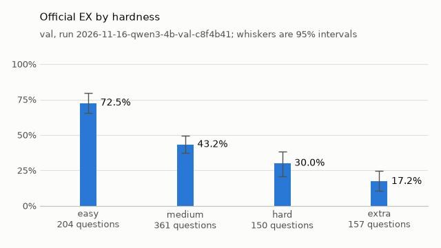

# Run 2026-11-16-qwen3-4b-val-c8f4b41: official EX 43.1% [39.2%, 47.2%] on val

Generated: 2026-11-17 00:08:33 UTC

Written by `forge report run 2026-11-16-qwen3-4b-val-c8f4b41` from the run's stored files and checked
against them by `forge report rebuild 2026-11-16-qwen3-4b-val-c8f4b41`; don't edit it by hand.

Questions and gold queries are quoted from Spider 1.0 (Yu et al., EMNLP 2018), licensed [CC BY-SA 4.0](https://creativecommons.org/licenses/by-sa/4.0/).

| | |
|---|---|
| Model | `Qwen/Qwen3-4B@1cfa9a7208912126459214e8b04321603b3df60c` |
| Adapter | none |
| Backend | `vllm` |
| Platform | `kaggle` |
| Prompt version | `p1` |
| Split | val: 872 questions, 1 sample each |
| Generation | greedy, at most 256 new tokens |
| Retry | none |
| Git commit | `c8f4b419f1f2666984a48c49eeb7827fc0b7d1e4` |
| Data manifest hash | `e10958d3b7a9490c15623285275d2840fbce551c32432fc62c0ad440cb06651e` |
| Manifest | [manifest.json](../manifest.json) |

## Execution accuracy

| | right | of | rate [95% interval] |
|---|---:|---:|---:|
| valid SQL | 479 | 872 | 54.9% [51.1%, 59.2%] |
| fast EX | 374 | 872 | 42.9% [39.0%, 47.0%] |
| official EX | 376 | 872 | 43.1% [39.2%, 47.2%] |

The checkers disagree on 4 samples: only fast EX matches 1, and only official EX 3.

Intervals are 95% percentile bootstraps over 1,000 resamples (seed 0) that draw whole questions, with the questions that share a gold query drawn together: 872 questions in 455 clusters.

## By hardness

| hardness | questions | fast EX [95% interval] | official EX [95% interval] |
|---|---:|---:|---:|
| easy | 204 | 72.1% [64.8%, 79.3%] | 72.5% [65.5%, 79.8%] |
| medium | 361 | 42.9% [37.0%, 49.2%] | 43.2% [37.3%, 49.4%] |
| hard | 150 | 30.0% [20.9%, 38.3%] | 30.0% [20.9%, 38.3%] |
| extra | 157 | 17.2% [10.7%, 24.7%] | 17.2% [10.7%, 24.7%] |



## Error classes

Failures of official EX by the class `forge.eval.taxonomy` gives them: the first
class that fits, in this order.

| class | failures | share of failures |
|---|---:|---:|
| no_sql | 1 | 0.2% |
| syntax | 3 | 0.6% |
| schema_link | 388 | 78.2% |
| wrong_tables | 24 | 4.8% |
| join | 29 | 5.8% |
| projection | 30 | 6.0% |
| aggregation | 0 | 0.0% |
| where | 7 | 1.4% |
| group_order | 3 | 0.6% |
| value | 10 | 2.0% |
| other | 0 | 0.0% |
| unclassified | 1 | 0.2% |

Unclassified failures are those only official EX finds: fast EX matched them, so the run gave them no class.

## Example failures

Up to 5 failures of each of the 3 most common classes,
picked by a hash of their ids so they spread over databases. The executor's error
message isn't stored, so each shows its class.

### schema_link: 5 of 388 shown

#### spider-train-00207 on bike_1 (hard)

Question: What are the names of stations that are located in Palo Alto city but have never been the ending point of trips more than 100 times?

Gold query:

```sql
SELECT name FROM station WHERE city  =  "Palo Alto" EXCEPT SELECT end_station_name FROM trip GROUP BY end_station_name HAVING count(*)  >  100
```

Predicted query:

```sql
SELECT end_station_id
```

Error: schema_link. The query failed to execute.

#### spider-train-01997 on gas_company (medium)

Question: Show the company name and the main industry for all companies whose headquarters are not from USA.

Gold query:

```sql
SELECT company ,  main_industry FROM company WHERE headquarters != 'USA'
```

Predicted query:

```sql
SELECT Company, Main_Industry
```

Error: schema_link. The query failed to execute.

#### spider-train-02011 on gas_company (medium)

Question: Show headquarters with at least two companies in the banking industry.

Gold query:

```sql
SELECT headquarters FROM company WHERE main_industry  =  'Banking' GROUP BY headquarters HAVING count(*)  >=  2
```

Predicted query:

```sql
SELECT Headquarters
```

Error: schema_link. The query failed to execute.

#### spider-train-04338 on tracking_grants_for_research (hard)

Question: List the project details of the projects which did not hire any staff for a researcher role.

Gold query:

```sql
SELECT project_details FROM Projects WHERE project_id NOT IN ( SELECT project_id FROM Project_Staff WHERE role_code  =  'researcher' )
```

Predicted query:

```sql
SELECT role_code
```

Error: schema_link. The query failed to execute.

#### spider-train-05368 on tracking_software_problems (medium)

Question: Give me a list of descriptions of the problems that are reported by the staff whose first name is Christop.

Gold query:

```sql
SELECT T1.problem_description FROM problems AS T1 JOIN staff AS T2 ON T1.reported_by_staff_id = T2.staff_id WHERE T2.staff_first_name = "Christop"
```

Predicted query:

```sql
SELECT p.problem_description
```

Error: schema_link. The query failed to execute.

### projection: 5 of 30 shown

#### spider-train-00022 on farm (easy)

Question: What are the themes of farm competitions sorted by year in ascending order?

Gold query:

```sql
SELECT Theme FROM farm_competition ORDER BY YEAR ASC
```

Predicted query:

```sql
SELECT Theme, Year FROM farm_competition ORDER BY Year ASC
```

Error: projection. The query ran, and official EX finds no match.

#### spider-train-00242 on musical (easy)

Question: What are the characters of actors in descending order of age?

Gold query:

```sql
SELECT Character FROM actor ORDER BY age DESC
```

Predicted query:

```sql
SELECT Character, age
FROM actor
ORDER BY age DESC
```

Error: projection. The query ran, and official EX finds no match.

#### spider-train-00243 on musical (easy)

Question: Return the characters for actors, ordered by age descending.

Gold query:

```sql
SELECT Character FROM actor ORDER BY age DESC
```

Predicted query:

```sql
SELECT Character, age
FROM actor
ORDER BY age DESC
```

Error: projection. The query ran, and official EX finds no match.

#### spider-train-00656 on journal_committee (hard)

Question: Please show the most common age of editors.

Gold query:

```sql
SELECT Age FROM editor GROUP BY Age ORDER BY COUNT(*) DESC LIMIT 1
```

Predicted query:

```sql
SELECT Age, COUNT(*) as count FROM editor GROUP BY Age ORDER BY count DESC LIMIT 1
```

Error: projection. The query ran, and official EX finds no match.

#### spider-train-02021 on gas_company (hard)

Question: Show all headquarters without a company in banking industry.

Gold query:

```sql
SELECT headquarters FROM company EXCEPT SELECT headquarters FROM company WHERE main_industry  =  'Banking'
```

Predicted query:

```sql
SELECT Headquarters FROM company WHERE Main_Industry != 'Banking'
```

Error: projection. The query ran, and official EX finds no match.

### join: 5 of 29 shown

#### spider-train-00143 on bike_1 (extra)

Question: What are the names and ids of stations that had more than 14 bikes available on average or were installed in December?

Gold query:

```sql
SELECT T1.name ,  T1.id FROM station AS T1 JOIN status AS T2 ON T1.id  =  T2.station_id GROUP BY T2.station_id HAVING avg(T2.bikes_available)  >  14 UNION SELECT name ,  id FROM station WHERE installation_date LIKE "12/%"
```

Predicted query:

```sql
SELECT id, name FROM station WHERE installation_date LIKE '%Dec%' OR (SELECT AVG(bikes_available) FROM status WHERE status.station_id = station.id) > 14
```

Error: join. The query ran, and official EX finds no match.

#### spider-train-00172 on bike_1 (extra)

Question: What are the names of all stations that have more than 10 bikes available and are not located in San Jose?

Gold query:

```sql
SELECT T1.name FROM station AS T1 JOIN status AS T2 ON T1.id  =  T2.station_id GROUP BY T2.station_id HAVING avg(bikes_available)  >  10 EXCEPT SELECT name FROM station WHERE city  =  "San Jose"
```

Predicted query:

```sql
SELECT name FROM station WHERE id NOT IN (SELECT station_id FROM status WHERE bikes_available > 10 AND city = 'San Jose') AND id IN (SELECT station_id FROM status WHERE bikes_available > 10)
```

Error: join. The query ran, and official EX finds no match.

#### spider-train-05384 on tracking_software_problems (extra)

Question: What are the id of problems reported by the staff named Dameon Frami or Jolie Weber?

Gold query:

```sql
SELECT product_id FROM problems AS T1 JOIN staff AS T2 ON T1.reported_by_staff_id = T2.staff_id WHERE T2.staff_first_name = "Dameon" AND T2.staff_last_name = "Frami" UNION SELECT product_id FROM problems AS T1 JOIN staff AS T2 ON T1.reported_by_staff_id = T2.staff_id WHERE T2.staff_first_name = "Jolie" AND T2.staff_last_name = "Weber"
```

Predicted query:

```sql
SELECT problem_id FROM Problems WHERE reported_by_staff_id = (SELECT staff_id FROM Staff WHERE staff_first_name = 'Dameon' AND staff_last_name = 'Frami') OR reported_by_staff_id = (SELECT staff_id FROM Staff WHERE staff_first_name = 'Jolie' AND staff_last_name = 'Weber')
```

Error: join. The query ran, and official EX finds no match.

#### spider-train-05963 on cre_Theme_park (extra)

Question: What are the names of the tourist attractions Vincent and Marcelle visit?

Gold query:

```sql
SELECT T1.Name FROM Tourist_Attractions AS T1 JOIN VISITORS AS T2 JOIN VISITS AS T3 ON T1.Tourist_Attraction_ID  =  T3.Tourist_Attraction_ID AND T2.Tourist_ID  =  T3.Tourist_ID WHERE T2.Tourist_Details  =  "Vincent" INTERSECT SELECT T1.Name FROM Tourist_Attractions AS T1 JOIN VISITORS AS T2 JOIN VISITS AS T3 ON T1.Tourist_Attraction_ID  =  T3.Tourist_Attraction_ID AND T2.Tourist_ID  =  T3.Tourist_ID WHERE T2.Tourist_Details  =  "Marcelle"
```

Predicted query:

```sql
SELECT Name FROM Tourist_Attractions WHERE Tourist_Attraction_ID IN (SELECT Tourist_Attraction_ID FROM Visits WHERE Tourist_ID = (SELECT Tourist_ID FROM Visitors WHERE Tourist_Details = 'Vincent') OR Tourist_ID = (SELECT Tourist_ID FROM Visitors WHERE Tourist_Details = 'Marcelle'))
```

Error: join. The query ran, and official EX finds no match.

#### spider-train-06883 on flight_4 (extra)

Question: Find the busiest destination airport that runs most number of routes in China.

Gold query:

```sql
SELECT T1.name FROM airports AS T1 JOIN routes AS T2 ON T1.apid  =  T2.dst_apid WHERE T1.country  =  'China' GROUP BY T1.name ORDER BY count(*) DESC LIMIT 1
```

Predicted query:

```sql
SELECT dst_apid, COUNT(*) as num_routes
FROM routes
WHERE dst_apid IN (SELECT apid FROM airports WHERE country = 'China')
GROUP BY dst_apid
ORDER BY num_routes DESC
LIMIT 1
```

Error: join. The query ran, and official EX finds no match.
