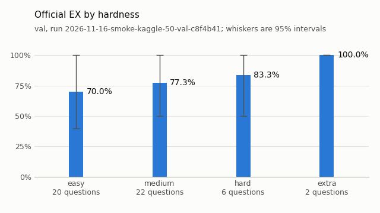

# Run 2026-11-16-smoke-kaggle-50-val-c8f4b41: official EX 76.0% [60.0%, 90.0%] on val

Generated: 2026-11-16 18:47:59 UTC

Written by `forge report run 2026-11-16-smoke-kaggle-50-val-c8f4b41` from the run's stored files and checked
against them by `forge report rebuild 2026-11-16-smoke-kaggle-50-val-c8f4b41`; don't edit it by hand.

Questions and gold queries are quoted from Spider 1.0 (Yu et al., EMNLP 2018), licensed [CC BY-SA 4.0](https://creativecommons.org/licenses/by-sa/4.0/).

| | |
|---|---|
| Model | `Qwen/Qwen2.5-Coder-1.5B-Instruct@2e1fd397ee46e1388853d2af2c993145b0f1098a` |
| Adapter | none |
| Backend | `vllm` |
| Platform | `kaggle` |
| Prompt version | `p1` |
| Split | val: 50 questions (limit 50), 1 sample each |
| Generation | greedy, at most 256 new tokens |
| Retry | none |
| Git commit | `c8f4b419f1f2666984a48c49eeb7827fc0b7d1e4` |
| Data manifest hash | `e10958d3b7a9490c15623285275d2840fbce551c32432fc62c0ad440cb06651e` |
| Manifest | [manifest.json](../manifest.json) |

## Execution accuracy

| | right | of | rate [95% interval] |
|---|---:|---:|---:|
| valid SQL | 42 | 50 | 84.0% [68.0%, 96.0%] |
| fast EX | 38 | 50 | 76.0% [60.0%, 90.0%] |
| official EX | 38 | 50 | 76.0% [60.0%, 90.0%] |

Intervals are 95% percentile bootstraps over 1,000 resamples (seed 0) that draw whole questions, with the questions that share a gold query drawn together: 50 questions in 25 clusters.

## By hardness

| hardness | questions | fast EX [95% interval] | official EX [95% interval] |
|---|---:|---:|---:|
| easy | 20 | 70.0% [40.0%, 100.0%] | 70.0% [40.0%, 100.0%] |
| medium | 22 | 77.3% [50.0%, 100.0%] | 77.3% [50.0%, 100.0%] |
| hard | 6 | 83.3% [50.0%, 100.0%] | 83.3% [50.0%, 100.0%] |
| extra | 2 | 100.0% [100.0%, 100.0%] | 100.0% [100.0%, 100.0%] |



## Error classes

Failures of official EX by the class `forge.eval.taxonomy` gives them: the first
class that fits, in this order.

| class | failures | share of failures |
|---|---:|---:|
| no_sql | 0 | 0.0% |
| syntax | 0 | 0.0% |
| schema_link | 8 | 66.7% |
| wrong_tables | 0 | 0.0% |
| join | 0 | 0.0% |
| projection | 4 | 33.3% |
| aggregation | 0 | 0.0% |
| where | 0 | 0.0% |
| group_order | 0 | 0.0% |
| value | 0 | 0.0% |
| other | 0 | 0.0% |

## Example failures

Up to 5 failures of each of the 3 most common classes,
picked by a hash of their ids so they spread over databases. The executor's error
message isn't stored, so each shows its class.

### schema_link: 5 of 8 shown

#### spider-train-00025 on farm (easy)

Question: Give the average number of working horses on farms with more than 5000 total horses.

Gold query:

```sql
SELECT avg(Working_Horses) FROM farm WHERE Total_Horses  >  5000
```

Predicted query:

```sql
SELECT AVG(T2.Working_Horses) FROM farm AS T1 INNER JOIN farm_competition AS T2 ON T1.Farm_ID = T2.Farm_ID WHERE T1.Total_Horses > 5000
```

Error: schema_link. The query failed to execute.

#### spider-train-00034 on farm (medium)

Question: Show the years and the official names of the host cities of competitions.

Gold query:

```sql
SELECT T2.Year ,  T1.Official_Name FROM city AS T1 JOIN farm_competition AS T2 ON T1.City_ID  =  T2.Host_city_ID
```

Predicted query:

```sql
SELECT T1.Year, T1.Official_Name FROM city AS T1 JOIN farm_competition AS T2 ON T1.City_ID = T2.Host_city_ID
```

Error: schema_link. The query failed to execute.

#### spider-train-00035 on farm (medium)

Question: Give the years and official names of the cities of each competition.

Gold query:

```sql
SELECT T2.Year ,  T1.Official_Name FROM city AS T1 JOIN farm_competition AS T2 ON T1.City_ID  =  T2.Host_city_ID
```

Predicted query:

```sql
SELECT T1.Year, T1.Official_Name FROM city AS T1 JOIN farm_competition AS T2 ON T1.City_ID = T2.Host_city_ID
```

Error: schema_link. The query failed to execute.

#### spider-train-00040 on farm (medium)

Question: Please show the themes of competitions with host cities having populations larger than 1000.

Gold query:

```sql
SELECT T2.Theme FROM city AS T1 JOIN farm_competition AS T2 ON T1.City_ID  =  T2.Host_city_ID WHERE T1.Population  >  1000
```

Predicted query:

```sql
SELECT T2.Theme FROM farm_competition AS T1 INNER JOIN city AS T2 ON T1.Host_city_ID = T2.City_ID WHERE T2.Population > 1000
```

Error: schema_link. The query failed to execute.

#### spider-train-00041 on farm (medium)

Question: What are the themes of competitions that have corresponding host cities with more than 1000 residents?

Gold query:

```sql
SELECT T2.Theme FROM city AS T1 JOIN farm_competition AS T2 ON T1.City_ID  =  T2.Host_city_ID WHERE T1.Population  >  1000
```

Predicted query:

```sql
SELECT T2.Theme FROM farm_competition AS T1 INNER JOIN city AS T2 ON T1.Host_city_ID = T2.City_ID WHERE T2.Population > 1000
```

Error: schema_link. The query failed to execute.

### projection: 4 of 4 shown

#### spider-train-00018 on farm (easy)

Question: List the total number of horses on farms in ascending order.

Gold query:

```sql
SELECT Total_Horses FROM farm ORDER BY Total_Horses ASC
```

Predicted query:

```sql
SELECT SUM(Total_Horses) FROM farm ORDER BY Total_Horses ASC
```

Error: projection. The query ran, and official EX finds no match.

#### spider-train-00019 on farm (easy)

Question: What is the total horses record for each farm, sorted ascending?

Gold query:

```sql
SELECT Total_Horses FROM farm ORDER BY Total_Horses ASC
```

Predicted query:

```sql
SELECT T1.Farm_ID, SUM(T1.Total_Horses) AS Total_Horses
FROM farm AS T1
GROUP BY T1.Farm_ID
ORDER BY Total_Horses ASC
```

Error: projection. The query ran, and official EX finds no match.

#### spider-train-00044 on farm (medium)

Question: Please show the different statuses, ordered by the number of cities that have each.

Gold query:

```sql
SELECT Status FROM city GROUP BY Status ORDER BY COUNT(*) ASC
```

Predicted query:

```sql
SELECT Status, COUNT(*) FROM city GROUP BY Status ORDER BY COUNT(*) DESC
```

Error: projection. The query ran, and official EX finds no match.

#### spider-train-00050 on farm (hard)

Question: Show the status shared by cities with population bigger than 1500 and smaller than 500.

Gold query:

```sql
SELECT Status FROM city WHERE Population  >  1500 INTERSECT SELECT Status FROM city WHERE Population  <  500
```

Predicted query:

```sql
SELECT Status FROM city WHERE Population > 1500 AND Population < 500
```

Error: projection. The query ran, and official EX finds no match.
