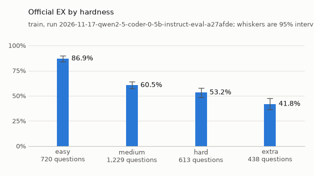

# Run 2026-11-17-qwen2-5-coder-0-5b-instruct-eval-a27afde: official EX 62.6% [60.6%, 64.8%] on train

Generated: 2026-11-17 08:31:17 UTC

Written by `forge report run 2026-11-17-qwen2-5-coder-0-5b-instruct-eval-a27afde` from the run's stored files and checked
against them by `forge report rebuild 2026-11-17-qwen2-5-coder-0-5b-instruct-eval-a27afde`; don't edit it by hand.

Questions and gold queries are quoted from Spider 1.0 (Yu et al., EMNLP 2018), licensed [CC BY-SA 4.0](https://creativecommons.org/licenses/by-sa/4.0/).

| | |
|---|---|
| Model | `Qwen/Qwen2.5-Coder-0.5B-Instruct@ea3f2471cf1b1f0db85067f1ef93848e38e88c25` |
| Adapter | `runs/2026-11-16-qwen2-5-coder-0-5b-instruct-sft-db0d8d8/checkpoints/final` |
| Backend | `hf` |
| Platform | `local-mps` |
| Prompt version | `p1` |
| Split | train: 3,000 questions (limit 3,000), 1 sample each |
| Generation | greedy, at most 256 new tokens |
| Retry | none |
| Git commit | `a27afde37a2fdfef8456a07f9bc46296a1924e9f` |
| Data manifest hash | `e10958d3b7a9490c15623285275d2840fbce551c32432fc62c0ad440cb06651e` |
| Manifest | [manifest.json](../manifest.json) |

## Execution accuracy

| | right | of | rate [95% interval] |
|---|---:|---:|---:|
| valid SQL | 2,369 | 3,000 | 79.0% [77.1%, 80.8%] |
| fast EX | 1,860 | 3,000 | 62.0% [59.9%, 64.2%] |
| official EX | 1,878 | 3,000 | 62.6% [60.6%, 64.8%] |

The checkers disagree on 36 samples: only fast EX matches 9, and only official EX 27.

Intervals are 95% percentile bootstraps over 1,000 resamples (seed 0) that draw whole questions, with the questions that share a gold query drawn together: 3,000 questions in 1,815 clusters.

## By hardness

| hardness | questions | fast EX [95% interval] | official EX [95% interval] |
|---|---:|---:|---:|
| easy | 720 | 85.3% [82.2%, 88.2%] | 86.9% [83.8%, 89.6%] |
| medium | 1,229 | 60.1% [56.9%, 63.6%] | 60.5% [57.2%, 63.9%] |
| hard | 613 | 53.0% [48.2%, 57.4%] | 53.2% [48.3%, 57.5%] |
| extra | 438 | 41.6% [36.0%, 47.3%] | 41.8% [36.1%, 47.5%] |



## Error classes

Failures of official EX by the class `forge.eval.taxonomy` gives them: the first
class that fits, in this order.

| class | failures | share of failures |
|---|---:|---:|
| no_sql | 1 | 0.1% |
| syntax | 0 | 0.0% |
| schema_link | 622 | 55.4% |
| wrong_tables | 220 | 19.6% |
| join | 44 | 3.9% |
| projection | 116 | 10.3% |
| aggregation | 10 | 0.9% |
| where | 45 | 4.0% |
| group_order | 27 | 2.4% |
| value | 25 | 2.2% |
| other | 3 | 0.3% |
| unclassified | 9 | 0.8% |

Unclassified failures are those only official EX finds: fast EX matched them, so the run gave them no class.

## Example failures

Up to 5 failures of each of the 3 most common classes,
picked by a hash of their ids so they spread over databases. The executor's error
message isn't stored, so each shows its class.

### schema_link: 5 of 622 shown

#### spider-train-01688 on theme_gallery (hard)

Question: What are the names of artist whose exhibitions draw over 200 attendees on average?

Gold query:

```sql
SELECT T3.name FROM exhibition_record AS T1 JOIN exhibition AS T2 ON T1.exhibition_id  =  T2.exhibition_id JOIN artist AS T3 ON T3.artist_id  =  T2.artist_id GROUP BY T3.artist_id HAVING avg(T1.attendance)  >  200
```

Predicted query:

```sql
SELECT T1.name FROM exhibition_record AS T1 JOIN exhibition AS T2 ON T1.exhibition_id  =  T2.exhibition_id JOIN artist AS T3 ON T2.artist_id  =  T3.artist_id GROUP BY T3.artist_id HAVING avg(T1.attendance)  >  200
```

Error: schema_link. The query failed to execute.

#### spider-train-02282 on entrepreneur (medium)

Question: Give the total money requested by entrepreneurs who are taller than 1.85.

Gold query:

```sql
SELECT sum(T1.Money_Requested) FROM entrepreneur AS T1 JOIN people AS T2 ON T1.People_ID  =  T2.People_ID WHERE T2.Height  >  1.85
```

Predicted query:

```sql
SELECT sum(Money_Requested) FROM entrepreneur WHERE Height  >  1.85
```

Error: schema_link. The query failed to execute.

#### spider-train-02874 on icfp_1 (hard)

Question: Who belong to the institution "University of Oxford"? Show the first names and last names.

Gold query:

```sql
SELECT DISTINCT t1.fname ,  t1.lname FROM authors AS t1 JOIN authorship AS t2 ON t1.authid  =  t2.authid JOIN inst AS t3 ON t2.instid  =  t3.instid WHERE t3.name  =  "University of Oxford"
```

Predicted query:

```sql
SELECT fname ,  lname FROM authors WHERE instID IN (SELECT instID FROM inst WHERE name  =  "University of Oxford")
```

Error: schema_link. The query failed to execute.

#### spider-train-03294 on college_1 (extra)

Question: What are the first names of all students taking accoutning and Computer Information Systems classes?

Gold query:

```sql
SELECT T1.stu_fname FROM student AS T1 JOIN enroll AS T2 ON T1.stu_num  =  T2.stu_num JOIN CLASS AS T3 ON T2.class_code  =  T3.class_code JOIN course AS T4 ON T3.crs_code  =  T4.crs_code JOIN department AS T5 ON T5.dept_code  =  T4.dept_code WHERE T5.dept_name  =  'Accounting' INTERSECT SELECT T1.stu_fname FROM student AS T1 JOIN enroll AS T2 ON T1.stu_num  =  T2.stu_num JOIN CLASS AS T3 ON T2.class_code  =  T3.class_code JOIN course AS T4 ON T3.crs_code  =  T4.crs_code JOIN department AS T5 ON T5.dept_code  =  T4.dept_code WHERE T5.dept_name  =  'Computer Info. Systems'
```

Predicted query:

```sql
SELECT T1.stu_fname FROM CLASS AS T1 JOIN enroll AS T2 ON T1.class_code  =  T2.class_code JOIN student AS T3 ON T2.stu_num  =  T3.stu_num WHERE T1.class_section  =  'Accounting' AND T1.class_section  =  'Computer Information Systems'
```

Error: schema_link. The query failed to execute.

#### spider-train-03356 on sports_competition (medium)

Question: What are the names and players of all the clubs?

Gold query:

```sql
SELECT T1.name ,  T2.Player_id FROM club AS T1 JOIN player AS T2 ON T1.Club_ID  =  T2.Club_ID
```

Predicted query:

```sql
SELECT name ,  player_id FROM club
```

Error: schema_link. The query failed to execute.

### wrong_tables: 5 of 220 shown

#### spider-train-00091 on student_assessment (easy)

Question: Find distinct cities of addresses of people?

Gold query:

```sql
SELECT DISTINCT T1.city FROM addresses AS T1 JOIN people_addresses AS T2 ON T1.address_id = T2.address_id
```

Predicted query:

```sql
SELECT DISTINCT city FROM addresses
```

Error: wrong_tables. The query ran, and official EX finds no match.

#### spider-train-00292 on twitter_1 (medium)

Question: List the name and number of followers for each user, and sort the results by the number of followers in descending order.

Gold query:

```sql
SELECT name ,  followers FROM user_profiles ORDER BY followers DESC
```

Predicted query:

```sql
SELECT T1.name ,  T1.followers FROM user_profiles AS T1 JOIN follows AS T2 ON T1.uid  =  T2.f1 ORDER BY T1.followers DESC
```

Error: wrong_tables. The query ran, and official EX finds no match.

#### spider-train-03062 on loan_1 (medium)

Question: Find the name of customers who have more than one loan.

Gold query:

```sql
SELECT T1.cust_name FROM customer AS T1 JOIN loan AS T2 ON T1.cust_id  =  T2.cust_id GROUP BY T1.cust_name HAVING count(*)  >  1
```

Predicted query:

```sql
SELECT cust_name FROM customer GROUP BY cust_name HAVING count(*)  >  1
```

Error: wrong_tables. The query ran, and official EX finds no match.

#### spider-train-03242 on college_1 (medium)

Question: What are the total number of students enrolled in ACCT-211?

Gold query:

```sql
SELECT count(*) FROM CLASS AS T1 JOIN enroll AS T2 ON T1.class_code  =  T2.class_code WHERE T1.crs_code  =  'ACCT-211'
```

Predicted query:

```sql
SELECT sum(enroll_grade) FROM enroll WHERE CLASS_CODE  =  "ACCT-211"
```

Error: wrong_tables. The query ran, and official EX finds no match.

#### spider-train-03451 on hr_1 (medium)

Question: Find the ids of the departments where any manager is managing 4 or more employees.

Gold query:

```sql
SELECT DISTINCT department_id FROM employees GROUP BY department_id ,  manager_id HAVING COUNT(employee_id)  >= 4
```

Predicted query:

```sql
SELECT T1.department_id FROM employees AS T1 JOIN job_history AS T2 ON T1.employee_id  =  T2.employee_id JOIN departments AS T3 ON T2.department_id  =  T3.department_id GROUP BY T1.department_id HAVING count(*)  >=  4
```

Error: wrong_tables. The query ran, and official EX finds no match.

### projection: 5 of 116 shown

#### spider-train-01919 on protein_institute (medium)

Question: Show the institution type with an institution founded after 1990 and an institution with at least 1000 enrollment.

Gold query:

```sql
SELECT TYPE FROM institution WHERE founded  >  1990 AND enrollment  >=  1000
```

Predicted query:

```sql
SELECT TYPE FROM institution WHERE founded  >  1990 INTERSECT SELECT TYPE FROM institution WHERE enrollment  >=  1000
```

Error: projection. The query ran, and official EX finds no match.

#### spider-train-02417 on candidate_poll (medium)

Question: For each sex, what is the name and sex of the candidate with the oppose rate for their sex?

Gold query:

```sql
SELECT t1.name ,  t1.sex ,  min(oppose_rate) FROM people AS t1 JOIN candidate AS t2 ON t1.people_id  =  t2.people_id GROUP BY t1.sex
```

Predicted query:

```sql
SELECT T1.name ,  T1.sex FROM people AS T1 JOIN candidate AS T2 ON T1.People_ID  =  T2.People_ID WHERE T2.Oppose_rate  =  ( SELECT max(Oppose_rate) FROM candidate )
```

Error: projection. The query ran, and official EX finds no match.

#### spider-train-02522 on movie_1 (easy)

Question: Find the ids of reviewers who didn't only give 4 star.

Gold query:

```sql
SELECT rID FROM Rating WHERE stars != 4
```

Predicted query:

```sql
SELECT rID FROM Rating WHERE stars  =  4 EXCEPT SELECT rID FROM Rating
```

Error: projection. The query ran, and official EX finds no match.

#### spider-train-03387 on sports_competition (hard)

Question: Find the countries that have never participated in any competition with Friendly type.

Gold query:

```sql
SELECT country FROM competition EXCEPT SELECT country FROM competition WHERE competition_type  =  'Friendly'
```

Predicted query:

```sql
SELECT DISTINCT country FROM competition WHERE Competition_type != "Friendly"
```

Error: projection. The query ran, and official EX finds no match.

#### spider-train-03454 on hr_1 (medium)

Question: What is the average salary of employees who have a commission percentage that is not null?

Gold query:

```sql
SELECT department_id ,  AVG(salary) FROM employees WHERE commission_pct != "null" GROUP BY department_id
```

Predicted query:

```sql
SELECT avg(salary) FROM employees WHERE commission_pct IS NOT NULL
```

Error: projection. The query ran, and official EX finds no match.
