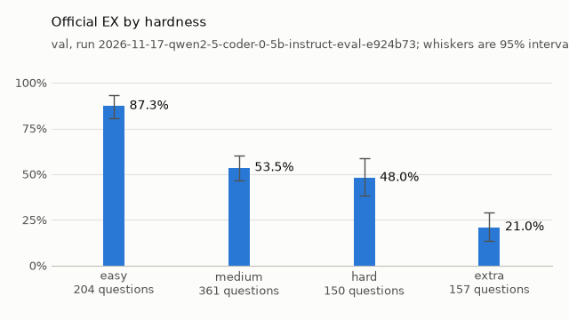

# Run 2026-11-17-qwen2-5-coder-0-5b-instruct-eval-e924b73: official EX 54.6% [50.0%, 58.9%] on val

Generated: 2026-11-17 11:27:00 UTC

Written by `forge report run 2026-11-17-qwen2-5-coder-0-5b-instruct-eval-e924b73` from the run's stored files and checked
against them by `forge report rebuild 2026-11-17-qwen2-5-coder-0-5b-instruct-eval-e924b73`; don't edit it by hand.

Questions and gold queries are quoted from Spider 1.0 (Yu et al., EMNLP 2018), licensed [CC BY-SA 4.0](https://creativecommons.org/licenses/by-sa/4.0/).

| | |
|---|---|
| Model | `Qwen/Qwen2.5-Coder-0.5B-Instruct@ea3f2471cf1b1f0db85067f1ef93848e38e88c25` |
| Adapter | `runs/2026-11-17-qwen2-5-coder-0-5b-instruct-grpo-e924b73/checkpoints/step-000250` |
| Backend | `hf` |
| Platform | `local-mps` |
| Prompt version | `p1` |
| Split | val: 872 questions, 1 sample each |
| Generation | greedy, at most 256 new tokens |
| Retry | none |
| Git commit | `e924b73e2f96908016b56db6134ed7fef4b87cb9` |
| Data manifest hash | `e10958d3b7a9490c15623285275d2840fbce551c32432fc62c0ad440cb06651e` |
| Manifest | [manifest.json](../manifest.json) |

## Execution accuracy

| | right | of | rate [95% interval] |
|---|---:|---:|---:|
| valid SQL | 681 | 872 | 78.1% [74.3%, 81.5%] |
| fast EX | 474 | 872 | 54.4% [49.8%, 58.5%] |
| official EX | 476 | 872 | 54.6% [50.0%, 58.9%] |

The checkers disagree on 6 samples: only fast EX matches 2, and only official EX 4.

Intervals are 95% percentile bootstraps over 1,000 resamples (seed 0) that draw whole questions, with the questions that share a gold query drawn together: 872 questions in 455 clusters.

## By hardness

| hardness | questions | fast EX [95% interval] | official EX [95% interval] |
|---|---:|---:|---:|
| easy | 204 | 86.8% [80.5%, 92.8%] | 87.3% [80.7%, 93.1%] |
| medium | 361 | 53.2% [46.6%, 59.8%] | 53.5% [46.7%, 59.9%] |
| hard | 150 | 48.0% [38.2%, 58.7%] | 48.0% [38.2%, 58.7%] |
| extra | 157 | 21.0% [13.3%, 29.1%] | 21.0% [13.3%, 29.1%] |



## Error classes

Failures of official EX by the class `forge.eval.taxonomy` gives them: the first
class that fits, in this order.

| class | failures | share of failures |
|---|---:|---:|
| no_sql | 0 | 0.0% |
| syntax | 0 | 0.0% |
| schema_link | 179 | 45.2% |
| wrong_tables | 94 | 23.7% |
| join | 21 | 5.3% |
| projection | 49 | 12.4% |
| aggregation | 0 | 0.0% |
| where | 19 | 4.8% |
| group_order | 14 | 3.5% |
| value | 16 | 4.0% |
| other | 2 | 0.5% |
| unclassified | 2 | 0.5% |

Unclassified failures are those only official EX finds: fast EX matched them, so the run gave them no class.

## Example failures

Up to 5 failures of each of the 3 most common classes,
picked by a hash of their ids so they spread over databases. The executor's error
message isn't stored, so each shows its class.

### schema_link: 5 of 179 shown

#### spider-train-00658 on journal_committee (medium)

Question: Show the names of editors and the theme of journals for which they serve on committees.

Gold query:

```sql
SELECT T2.Name ,  T3.Theme FROM journal_committee AS T1 JOIN editor AS T2 ON T1.Editor_ID  =  T2.Editor_ID JOIN journal AS T3 ON T1.Journal_ID  =  T3.Journal_ID
```

Predicted query:

```sql
SELECT T1.name ,  T2.theme FROM editor AS T1 JOIN journal_committee AS T2 ON T1.editor_id  =  T2.editor_id
```

Error: schema_link. The query failed to execute.

#### spider-train-00872 on chinook_1 (medium)

Question: What are the last names of employees who serve at most 20 customers?

Gold query:

```sql
SELECT T1.LastName FROM CUSTOMER AS T1 JOIN EMPLOYEE AS T2 ON T1.SupportRepId  =  T2.EmployeeId GROUP BY T1.SupportRepId HAVING COUNT(*)  <=  20
```

Predicted query:

```sql
SELECT T1.LastName FROM Employee AS T1 JOIN Customer AS T2 ON T1.CustomerId  =  T2.CustomerId GROUP BY T1.LastName HAVING COUNT(*)  <=  20
```

Error: schema_link. The query failed to execute.

#### spider-train-02557 on county_public_safety (hard)

Question: How many cities are in counties that have populations of over 20000?

Gold query:

```sql
SELECT count(*) FROM city WHERE county_ID IN (SELECT county_ID FROM county_public_safety WHERE population  >  20000)
```

Predicted query:

```sql
SELECT count(*) FROM city WHERE population  >  20000
```

Error: schema_link. The query failed to execute.

#### spider-train-02568 on county_public_safety (hard)

Question: Show the names of cities in counties that have a crime rate less than 100.

Gold query:

```sql
SELECT name FROM city WHERE county_id IN (SELECT county_id FROM county_public_safety WHERE Crime_rate  <  100)
```

Predicted query:

```sql
SELECT name FROM city WHERE crime_rate  <  100
```

Error: schema_link. The query failed to execute.

#### spider-train-05924 on cre_Theme_park (medium)

Question: Find the details of the shops that can be reached by walk.

Gold query:

```sql
SELECT T1.Shop_Details FROM SHOPS AS T1 JOIN TOURIST_ATTRACTIONS AS T2 ON T1.Shop_ID  =  T2.Tourist_Attraction_ID WHERE T2.How_to_Get_There  =  "walk"
```

Predicted query:

```sql
SELECT shop_details FROM shops WHERE other_details  =  "walk"
```

Error: schema_link. The query failed to execute.

### wrong_tables: 5 of 94 shown

#### spider-train-00172 on bike_1 (extra)

Question: What are the names of all stations that have more than 10 bikes available and are not located in San Jose?

Gold query:

```sql
SELECT T1.name FROM station AS T1 JOIN status AS T2 ON T1.id  =  T2.station_id GROUP BY T2.station_id HAVING avg(bikes_available)  >  10 EXCEPT SELECT name FROM station WHERE city  =  "San Jose"
```

Predicted query:

```sql
SELECT name FROM station WHERE dock_count  >  10 AND city != "San Jose"
```

Error: wrong_tables. The query ran, and official EX finds no match.

#### spider-train-00256 on musical (medium)

Question: Show names of musicals and the number of actors who have appeared in the musicals.

Gold query:

```sql
SELECT T2.Name ,  COUNT(*) FROM actor AS T1 JOIN musical AS T2 ON T1.Musical_ID  =  T2.Musical_ID GROUP BY T1.Musical_ID
```

Predicted query:

```sql
SELECT name ,  count(*) FROM musical GROUP BY name
```

Error: wrong_tables. The query ran, and official EX finds no match.

#### spider-train-02023 on gas_company (medium)

Question: Show the company name with the number of gas station.

Gold query:

```sql
SELECT T2.company ,  count(*) FROM station_company AS T1 JOIN company AS T2 ON T1.company_id  =  T2.company_id GROUP BY T1.company_id
```

Predicted query:

```sql
SELECT company FROM company GROUP BY company ORDER BY count(*) DESC
```

Error: wrong_tables. The query ran, and official EX finds no match.

#### spider-train-04371 on tracking_grants_for_research (medium)

Question: What is the type description of the organization whose detail is listed as 'quo'?

Gold query:

```sql
SELECT T1.organisation_type_description FROM organisation_Types AS T1 JOIN Organisations AS T2 ON T1.organisation_type  =  T2.organisation_type WHERE T2.organisation_details  =  'quo'
```

Predicted query:

```sql
SELECT document_description FROM document_types WHERE document_type_code  =  'quo'
```

Error: wrong_tables. The query ran, and official EX finds no match.

#### spider-train-05368 on tracking_software_problems (medium)

Question: Give me a list of descriptions of the problems that are reported by the staff whose first name is Christop.

Gold query:

```sql
SELECT T1.problem_description FROM problems AS T1 JOIN staff AS T2 ON T1.reported_by_staff_id = T2.staff_id WHERE T2.staff_first_name = "Christop"
```

Predicted query:

```sql
SELECT problem_category_description FROM Problem_category_codes WHERE problem_category_code IN (SELECT problem_category_code FROM Problem_status_codes WHERE problem_status_code IN (SELECT problem_status_code FROM Staff WHERE staff_first_name  =  "Christop"))
```

Error: wrong_tables. The query ran, and official EX finds no match.

### projection: 5 of 49 shown

#### spider-train-00195 on bike_1 (hard)

Question: Find all the zip codes in which the max dew point have never reached 70.

Gold query:

```sql
SELECT DISTINCT zip_code FROM weather EXCEPT SELECT DISTINCT zip_code FROM weather WHERE max_dew_point_f  >=  70
```

Predicted query:

```sql
SELECT zip_code FROM weather WHERE max_dew_point_f  =  70 EXCEPT SELECT zip_code FROM weather WHERE max_dew_point_f  =  0
```

Error: projection. The query ran, and official EX finds no match.

#### spider-train-00244 on musical (medium)

Question: What is the duration of the oldest actor?

Gold query:

```sql
SELECT Duration FROM actor ORDER BY Age DESC LIMIT 1
```

Predicted query:

```sql
SELECT max(Duration) FROM actor
```

Error: projection. The query ran, and official EX finds no match.

#### spider-train-00434 on flight_1 (extra)

Question: What is the name and distance of every aircraft that can cover a distance of more than 5000 and which at least 5 people can fly?

Gold query:

```sql
SELECT T2.name FROM Certificate AS T1 JOIN Aircraft AS T2 ON T2.aid  =  T1.aid WHERE T2.distance  >  5000 GROUP BY T1.aid ORDER BY count(*)  >=  5
```

Predicted query:

```sql
SELECT name ,  distance FROM aircraft WHERE distance  >  5000 INTERSECT SELECT T1.name ,  T1.distance FROM aircraft AS T1 JOIN certificate AS T2 ON T1.aid  =  T2.aid GROUP BY T1.name HAVING COUNT(*)  >=  5
```

Error: projection. The query ran, and official EX finds no match.

#### spider-train-02021 on gas_company (hard)

Question: Show all headquarters without a company in banking industry.

Gold query:

```sql
SELECT headquarters FROM company EXCEPT SELECT headquarters FROM company WHERE main_industry  =  'Banking'
```

Predicted query:

```sql
SELECT Headquarters FROM company WHERE Main_Industry != "Banking"
```

Error: projection. The query ran, and official EX finds no match.

#### spider-train-04346 on tracking_grants_for_research (medium)

Question: What is the total amount of grants given by each organisations? Also list the organisation id.

Gold query:

```sql
SELECT sum(grant_amount) ,  organisation_id FROM Grants GROUP BY organisation_id
```

Predicted query:

```sql
SELECT grant_id ,  organisation_id ,  sum(grant_amount) FROM Grants GROUP BY organisation_id
```

Error: projection. The query ran, and official EX finds no match.
