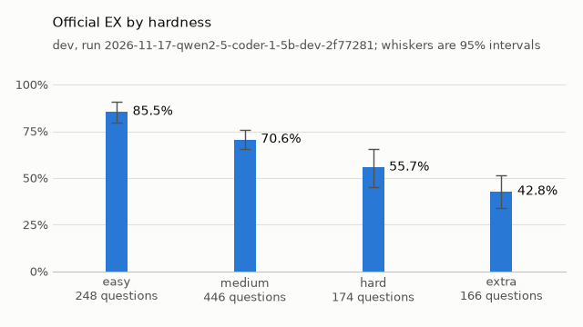

# Run 2026-11-17-qwen2-5-coder-1-5b-dev-2f77281: official EX 67.2% [63.6%, 70.7%] on dev

Generated: 2026-11-17 01:47:06 UTC

Written by `forge report run 2026-11-17-qwen2-5-coder-1-5b-dev-2f77281` from the run's stored files and checked
against them by `forge report rebuild 2026-11-17-qwen2-5-coder-1-5b-dev-2f77281`; don't edit it by hand.

Questions and gold queries are quoted from Spider 1.0 (Yu et al., EMNLP 2018), licensed [CC BY-SA 4.0](https://creativecommons.org/licenses/by-sa/4.0/).

| | |
|---|---|
| Model | `Qwen/Qwen2.5-Coder-1.5B-Instruct@2e1fd397ee46e1388853d2af2c993145b0f1098a` |
| Adapter | none |
| Backend | `vllm` |
| Platform | `kaggle` |
| Prompt version | `p2` |
| Split | dev: 1,034 questions, 1 sample each |
| Generation | greedy, at most 256 new tokens |
| Retry | none |
| Git commit | `2f772811aa28ddea5b5f2a3282b47ab4698c5ba1` |
| Data manifest hash | `e10958d3b7a9490c15623285275d2840fbce551c32432fc62c0ad440cb06651e` |
| Manifest | [manifest.json](../manifest.json) |

## Execution accuracy

| | right | of | rate [95% interval] |
|---|---:|---:|---:|
| valid SQL | 870 | 1,034 | 84.1% [81.1%, 86.8%] |
| fast EX | 690 | 1,034 | 66.7% [62.9%, 70.2%] |
| official EX | 695 | 1,034 | 67.2% [63.6%, 70.7%] |

The checkers disagree on 17 samples: only fast EX matches 6, and only official EX 11.

Intervals are 95% percentile bootstraps over 1,000 resamples (seed 0) that draw whole questions, with the questions that share a gold query drawn together: 1,034 questions in 564 clusters.

## By hardness

| hardness | questions | fast EX [95% interval] | official EX [95% interval] |
|---|---:|---:|---:|
| easy | 248 | 85.5% [79.4%, 90.8%] | 85.5% [79.5%, 90.8%] |
| medium | 446 | 70.2% [64.8%, 75.3%] | 70.6% [65.3%, 75.6%] |
| hard | 174 | 55.2% [44.4%, 64.9%] | 55.7% [45.1%, 65.3%] |
| extra | 166 | 41.6% [32.7%, 50.0%] | 42.8% [33.9%, 51.2%] |



## Error classes

Failures of official EX by the class `forge.eval.taxonomy` gives them: the first
class that fits, in this order.

| class | failures | share of failures |
|---|---:|---:|
| no_sql | 0 | 0.0% |
| syntax | 0 | 0.0% |
| schema_link | 153 | 45.1% |
| wrong_tables | 64 | 18.9% |
| join | 45 | 13.3% |
| projection | 25 | 7.4% |
| aggregation | 1 | 0.3% |
| where | 22 | 6.5% |
| group_order | 12 | 3.5% |
| value | 11 | 3.2% |
| other | 0 | 0.0% |
| unclassified | 6 | 1.8% |

Unclassified failures are those only official EX finds: fast EX matched them, so the run gave them no class.

## Example failures

Up to 5 failures of each of the 3 most common classes,
picked by a hash of their ids so they spread over databases. The executor's error
message isn't stored, so each shows its class.

### schema_link: 5 of 153 shown

#### spider-dev-00533 on student_transcripts_tracking (medium)

Question: Who are enrolled in 2 degree programs in one semester? List the first name, middle name and last name and the id.

Gold query:

```sql
SELECT T1.first_name ,  T1.middle_name ,  T1.last_name ,  T1.student_id FROM Students AS T1 JOIN Student_Enrolment AS T2 ON T1.student_id  =  T2.student_id GROUP BY T1.student_id HAVING count(*)  =  2
```

Predicted query:

```sql
SELECT T1.first_name, T1.middle_name, T1.last_name, T1.student_id
FROM Student_Enrolment AS T1
JOIN Degree_Programs AS T2 ON T1.degree_program_id = T2.degree_program_id
JOIN Semesters AS T3 ON T1.semester_id = T3.semester_id
GROUP BY T1.student_id
HAVING COUNT(T2.degree_program_id) = 2
```

Error: schema_link. The query failed to execute.

#### spider-dev-00664 on poker_player (medium)

Question: What are the names of poker players, ordered ascending by the number of final tables they have made?

Gold query:

```sql
SELECT T1.Name FROM people AS T1 JOIN poker_player AS T2 ON T1.People_ID  =  T2.People_ID ORDER BY T2.Final_Table_Made
```

Predicted query:

```sql
SELECT Name FROM poker_player ORDER BY Final_Table_Made ASC
```

Error: schema_link. The query failed to execute.

#### spider-dev-00667 on poker_player (hard)

Question: What is the money rank of the tallest poker player?

Gold query:

```sql
SELECT T2.Money_Rank FROM people AS T1 JOIN poker_player AS T2 ON T1.People_ID  =  T2.People_ID ORDER BY T1.Height DESC LIMIT 1
```

Predicted query:

```sql
SELECT Money_Rank FROM poker_player ORDER BY Height DESC LIMIT 1
```

Error: schema_link. The query failed to execute.

#### spider-dev-00671 on poker_player (medium)

Question: What are the names of poker players in descending order of earnings?

Gold query:

```sql
SELECT T1.Name FROM people AS T1 JOIN poker_player AS T2 ON T1.People_ID  =  T2.People_ID ORDER BY T2.Earnings DESC
```

Predicted query:

```sql
SELECT Name FROM poker_player ORDER BY Earnings DESC
```

Error: schema_link. The query failed to execute.

#### spider-dev-00742 on world_1 (extra)

Question: Which continent has the most diverse languages?

Gold query:

```sql
SELECT T1.Continent FROM country AS T1 JOIN countrylanguage AS T2 ON T1.Code  =  T2.CountryCode GROUP BY T1.Continent ORDER BY COUNT(*) DESC LIMIT 1
```

Predicted query:

```sql
SELECT Continent FROM countrylanguage GROUP BY Continent ORDER BY COUNT(DISTINCT Language) DESC LIMIT 1
```

Error: schema_link. The query failed to execute.

### wrong_tables: 5 of 64 shown

#### spider-dev-00241 on flight_2 (medium)

Question: Find all airlines that have at least 10 flights.

Gold query:

```sql
SELECT T1.Airline FROM AIRLINES AS T1 JOIN FLIGHTS AS T2 ON T1.uid  =  T2.Airline GROUP BY T1.Airline HAVING count(*)  >  10
```

Predicted query:

```sql
SELECT Airline FROM flights GROUP BY Airline HAVING COUNT(*) >= 10
```

Error: wrong_tables. The query ran, and official EX finds no match.

#### spider-dev-00426 on museum_visit (extra)

Question: What is the name of the visitor who visited both a museum opened before 2009 and a museum opened after 2011?

Gold query:

```sql
SELECT t1.name FROM visitor AS t1 JOIN visit AS t2 ON t1.id  =  t2.visitor_id JOIN museum AS t3 ON t3.Museum_ID  =  t2.Museum_ID WHERE t3.open_year  <  2009 INTERSECT SELECT t1.name FROM visitor AS t1 JOIN visit AS t2 ON t1.id  =  t2.visitor_id JOIN museum AS t3 ON t3.Museum_ID  =  t2.Museum_ID WHERE t3.open_year  >  2011
```

Predicted query:

```sql
SELECT T2.Name FROM visit AS T1 INNER JOIN museum AS T2 ON T1.Museum_ID = T2.Museum_ID WHERE T2.Open_Year < '2009' INTERSECT SELECT T2.Name FROM visit AS T1 INNER JOIN museum AS T2 ON T1.Museum_ID = T2.Museum_ID WHERE T2.Open_Year > '2011'
```

Error: wrong_tables. The query ran, and official EX finds no match.

#### spider-dev-00464 on wta_1 (hard)

Question: What is the name of the winner who has won the most matches, and how many rank points does this player have?

Gold query:

```sql
SELECT winner_name ,  winner_rank_points FROM matches GROUP BY winner_name ORDER BY count(*) DESC LIMIT 1
```

Predicted query:

```sql
SELECT T1.winner_name, T2.ranking_points FROM matches AS T1 INNER JOIN rankings AS T2 ON T1.winner_id = T2.player_id ORDER BY T1.match_num DESC LIMIT 1
```

Error: wrong_tables. The query ran, and official EX finds no match.

#### spider-dev-00745 on world_1 (easy)

Question: What is the number of nations that use English and Dutch?

Gold query:

```sql
SELECT COUNT(*) FROM (SELECT T1.Name FROM country AS T1 JOIN countrylanguage AS T2 ON T1.Code  =  T2.CountryCode WHERE T2.Language  =  "English" INTERSECT SELECT T1.Name FROM country AS T1 JOIN countrylanguage AS T2 ON T1.Code  =  T2.CountryCode WHERE T2.Language  =  "Dutch")
```

Predicted query:

```sql
SELECT COUNT(*) FROM countrylanguage WHERE Language IN ('English', 'Dutch')
```

Error: wrong_tables. The query ran, and official EX finds no match.

#### spider-dev-00817 on world_1 (medium)

Question: What are the country codes of the different countries, and what are the languages spoken by the greatest percentage of people for each?

Gold query:

```sql
SELECT LANGUAGE ,  CountryCode ,  max(Percentage) FROM countrylanguage GROUP BY CountryCode
```

Predicted query:

```sql
SELECT T1.Code, T1.Name, T2.Language
FROM country AS T1
JOIN countrylanguage AS T2 ON T1.Code = T2.CountryCode
WHERE T2.Percentage = (SELECT MAX(Percentage) FROM countrylanguage)
ORDER BY T1.Name
```

Error: wrong_tables. The query ran, and official EX finds no match.

### join: 5 of 45 shown

#### spider-dev-00467 on wta_1 (medium)

Question: find the names of loser and winner who played in the match with greatest number of minutes.

Gold query:

```sql
SELECT winner_name ,  loser_name FROM matches ORDER BY minutes DESC LIMIT 1
```

Predicted query:

```sql
SELECT T1.loser_name, T1.winner_name
FROM matches AS T1
JOIN (
    SELECT loser_id, winner_id, MAX(minutes) AS max_minutes
    FROM matches
    GROUP BY loser_id, winner_id
) AS T2
ON T1.loser_id = T2.loser_id AND T1.winner_id = T2.winner_id AND T1.minutes = T2.max_minutes
```

Error: join. The query ran, and official EX finds no match.

#### spider-dev-00544 on student_transcripts_tracking (hard)

Question: What is the name of the semester with no students enrolled?

Gold query:

```sql
SELECT semester_name FROM Semesters WHERE semester_id NOT IN( SELECT semester_id FROM Student_Enrolment )
```

Predicted query:

```sql
SELECT T1.semester_name FROM Semesters AS T1 INNER JOIN Student_Enrolment AS T2 ON T1.semester_id = T2.semester_id WHERE T2.student_id IS NULL
```

Error: join. The query ran, and official EX finds no match.

#### spider-dev-00637 on tvshow (extra)

Question: Find the series name and country of the tv channel that is playing some cartoons directed by Ben Jones and Michael Chang?

Gold query:

```sql
SELECT T1.series_name ,  T1.country FROM TV_Channel AS T1 JOIN cartoon AS T2 ON T1.id = T2.Channel WHERE T2.directed_by  =  'Michael Chang' INTERSECT SELECT T1.series_name ,  T1.country FROM TV_Channel AS T1 JOIN cartoon AS T2 ON T1.id = T2.Channel WHERE T2.directed_by  =  'Ben Jones'
```

Predicted query:

```sql
SELECT T1.series_name, T1.Country FROM TV_Channel AS T1 INNER JOIN Cartoon AS T2 ON T1.id = T2.Channel WHERE T2.Directed_by IN ('Ben Jones', 'Michael Chang')
```

Error: join. The query ran, and official EX finds no match.

#### spider-dev-00638 on tvshow (extra)

Question: What is the series name and country of all TV channels that are playing cartoons directed by Ben Jones and cartoons directed by Michael Chang?

Gold query:

```sql
SELECT T1.series_name ,  T1.country FROM TV_Channel AS T1 JOIN cartoon AS T2 ON T1.id = T2.Channel WHERE T2.directed_by  =  'Michael Chang' INTERSECT SELECT T1.series_name ,  T1.country FROM TV_Channel AS T1 JOIN cartoon AS T2 ON T1.id = T2.Channel WHERE T2.directed_by  =  'Ben Jones'
```

Predicted query:

```sql
SELECT T1.series_name, T1.Country FROM TV_Channel AS T1 INNER JOIN Cartoon AS T2 ON T1.id = T2.Channel WHERE T2.Directed_by IN ('Ben Jones', 'Michael Chang')
```

Error: join. The query ran, and official EX finds no match.

#### spider-dev-00776 on world_1 (extra)

Question: Which Asian countries have a population that is larger than any country in Africa?

Gold query:

```sql
SELECT Name FROM country WHERE Continent  =  "Asia"  AND population  >  (SELECT max(population) FROM country WHERE Continent  =  "Africa")
```

Predicted query:

```sql
SELECT T1.Name FROM country AS T1 INNER JOIN country AS T2 ON T1.Code = T2.Code2 WHERE T1.Continent = 'Asia' AND T1.Population > (SELECT MAX(Population) FROM country WHERE Continent = 'Africa')
```

Error: join. The query ran, and official EX finds no match.
