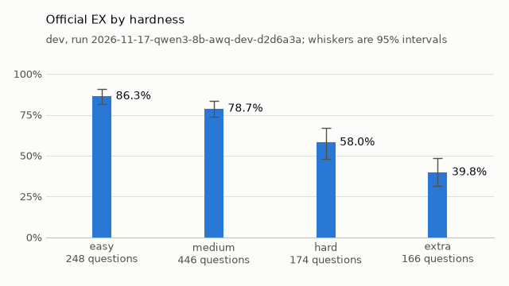

# Run 2026-11-17-qwen3-8b-awq-dev-d2d6a3a: official EX 70.8% [67.2%, 74.0%] on dev

Generated: 2026-11-17 02:29:10 UTC

Written by `forge report run 2026-11-17-qwen3-8b-awq-dev-d2d6a3a` from the run's stored files and checked
against them by `forge report rebuild 2026-11-17-qwen3-8b-awq-dev-d2d6a3a`; don't edit it by hand.

Questions and gold queries are quoted from Spider 1.0 (Yu et al., EMNLP 2018), licensed [CC BY-SA 4.0](https://creativecommons.org/licenses/by-sa/4.0/).

| | |
|---|---|
| Model | `Qwen/Qwen3-8B-AWQ@4da05a8edb55c6046cce958586c33b61da07bb79` |
| Adapter | none |
| Backend | `vllm` |
| Platform | `kaggle` |
| Prompt version | `p2` |
| Split | dev: 1,034 questions, 1 sample each |
| Generation | greedy, at most 256 new tokens |
| Retry | none |
| Git commit | `d2d6a3a2f9921cc1f7c3fc9dcea1b43d5becec1f` |
| Data manifest hash | `e10958d3b7a9490c15623285275d2840fbce551c32432fc62c0ad440cb06651e` |
| Manifest | [manifest.json](../manifest.json) |

## Execution accuracy

| | right | of | rate [95% interval] |
|---|---:|---:|---:|
| valid SQL | 1,002 | 1,034 | 96.9% [95.6%, 98.1%] |
| fast EX | 733 | 1,034 | 70.9% [67.3%, 74.1%] |
| official EX | 732 | 1,034 | 70.8% [67.2%, 74.0%] |

The checkers disagree on 25 samples: only fast EX matches 13, and only official EX 12.

Intervals are 95% percentile bootstraps over 1,000 resamples (seed 0) that draw whole questions, with the questions that share a gold query drawn together: 1,034 questions in 564 clusters.

## By hardness

| hardness | questions | fast EX [95% interval] | official EX [95% interval] |
|---|---:|---:|---:|
| easy | 248 | 85.5% [80.6%, 90.3%] | 86.3% [81.5%, 91.0%] |
| medium | 446 | 78.3% [73.3%, 83.0%] | 78.7% [73.8%, 83.4%] |
| hard | 174 | 59.8% [50.0%, 68.4%] | 58.0% [48.0%, 67.0%] |
| extra | 166 | 41.0% [32.1%, 49.4%] | 39.8% [31.4%, 48.5%] |



## Error classes

Failures of official EX by the class `forge.eval.taxonomy` gives them: the first
class that fits, in this order.

| class | failures | share of failures |
|---|---:|---:|
| no_sql | 0 | 0.0% |
| syntax | 2 | 0.7% |
| schema_link | 24 | 7.9% |
| wrong_tables | 73 | 24.2% |
| join | 106 | 35.1% |
| projection | 61 | 20.2% |
| aggregation | 6 | 2.0% |
| where | 8 | 2.6% |
| group_order | 1 | 0.3% |
| value | 8 | 2.6% |
| other | 0 | 0.0% |
| unclassified | 13 | 4.3% |

Unclassified failures are those only official EX finds: fast EX matched them, so the run gave them no class.

## Example failures

Up to 5 failures of each of the 3 most common classes,
picked by a hash of their ids so they spread over databases. The executor's error
message isn't stored, so each shows its class.

### join: 5 of 106 shown

#### spider-dev-00150 on car_1 (medium)

Question: What are the names and ids of all makers with more than 3 models?

Gold query:

```sql
SELECT T1.FullName ,  T1.Id FROM CAR_MAKERS AS T1 JOIN MODEL_LIST AS T2 ON T1.Id  =  T2.Maker GROUP BY T1.Id HAVING count(*)  >  3;
```

Predicted query:

```sql
SELECT car_makers.Id, car_makers.Maker
FROM car_makers
JOIN model_list ON car_makers.Id = model_list.Maker
GROUP BY car_makers.Id
HAVING COUNT(model_list.Model) > 3
```

Error: join. The query ran, and official EX finds no match.

#### spider-dev-00426 on museum_visit (extra)

Question: What is the name of the visitor who visited both a museum opened before 2009 and a museum opened after 2011?

Gold query:

```sql
SELECT t1.name FROM visitor AS t1 JOIN visit AS t2 ON t1.id  =  t2.visitor_id JOIN museum AS t3 ON t3.Museum_ID  =  t2.Museum_ID WHERE t3.open_year  <  2009 INTERSECT SELECT t1.name FROM visitor AS t1 JOIN visit AS t2 ON t1.id  =  t2.visitor_id JOIN museum AS t3 ON t3.Museum_ID  =  t2.Museum_ID WHERE t3.open_year  >  2011
```

Predicted query:

```sql
SELECT v.Name
FROM visitor v
JOIN visit vis ON v.ID = vis.visitor_ID
WHERE vis.Museum_ID IN (
    SELECT Museum_ID
    FROM museum
    WHERE Open_Year < '2009'
)
AND vis.Museum_ID IN (
    SELECT Museum_ID
    FROM museum
    WHERE Open_Year > '2011'
)
```

Error: join. The query ran, and official EX finds no match.

#### spider-dev-00638 on tvshow (extra)

Question: What is the series name and country of all TV channels that are playing cartoons directed by Ben Jones and cartoons directed by Michael Chang?

Gold query:

```sql
SELECT T1.series_name ,  T1.country FROM TV_Channel AS T1 JOIN cartoon AS T2 ON T1.id = T2.Channel WHERE T2.directed_by  =  'Michael Chang' INTERSECT SELECT T1.series_name ,  T1.country FROM TV_Channel AS T1 JOIN cartoon AS T2 ON T1.id = T2.Channel WHERE T2.directed_by  =  'Ben Jones'
```

Predicted query:

```sql
SELECT DISTINCT TV_Channel.series_name, TV_Channel.Country
FROM TV_Channel
JOIN Cartoon ON TV_Channel.id = Cartoon.Channel
WHERE Cartoon.Directed_by IN ('Ben Jones', 'Michael Chang')
```

Error: join. The query ran, and official EX finds no match.

#### spider-dev-00742 on world_1 (extra)

Question: Which continent has the most diverse languages?

Gold query:

```sql
SELECT T1.Continent FROM country AS T1 JOIN countrylanguage AS T2 ON T1.Code  =  T2.CountryCode GROUP BY T1.Continent ORDER BY COUNT(*) DESC LIMIT 1
```

Predicted query:

```sql
SELECT Continent, COUNT(DISTINCT Language) AS LanguageCount
FROM country
JOIN countrylanguage ON country.Code = countrylanguage.CountryCode
GROUP BY Continent
ORDER BY LanguageCount DESC
LIMIT 1
```

Error: join. The query ran, and official EX finds no match.

#### spider-dev-00745 on world_1 (easy)

Question: What is the number of nations that use English and Dutch?

Gold query:

```sql
SELECT COUNT(*) FROM (SELECT T1.Name FROM country AS T1 JOIN countrylanguage AS T2 ON T1.Code  =  T2.CountryCode WHERE T2.Language  =  "English" INTERSECT SELECT T1.Name FROM country AS T1 JOIN countrylanguage AS T2 ON T1.Code  =  T2.CountryCode WHERE T2.Language  =  "Dutch")
```

Predicted query:

```sql
SELECT COUNT(DISTINCT country.Code) FROM country 
JOIN countrylanguage ON country.Code = countrylanguage.CountryCode 
WHERE countrylanguage.Language IN ('English', 'Dutch')
```

Error: join. The query ran, and official EX finds no match.

### wrong_tables: 5 of 73 shown

#### spider-dev-00221 on flight_2 (extra)

Question: Which city has most number of arriving flights?

Gold query:

```sql
SELECT T1.City FROM AIRPORTS AS T1 JOIN FLIGHTS AS T2 ON T1.AirportCode  =  T2.DestAirport GROUP BY T1.City ORDER BY count(*) DESC LIMIT 1
```

Predicted query:

```sql
SELECT SourceAirport, COUNT(*) AS num_flights
FROM flights
GROUP BY SourceAirport
ORDER BY num_flights DESC
LIMIT 1
```

Error: wrong_tables. The query ran, and official EX finds no match.

#### spider-dev-00241 on flight_2 (medium)

Question: Find all airlines that have at least 10 flights.

Gold query:

```sql
SELECT T1.Airline FROM AIRLINES AS T1 JOIN FLIGHTS AS T2 ON T1.uid  =  T2.Airline GROUP BY T1.Airline HAVING count(*)  >  10
```

Predicted query:

```sql
SELECT Airline FROM flights GROUP BY Airline HAVING COUNT(*) >= 10
```

Error: wrong_tables. The query ran, and official EX finds no match.

#### spider-dev-00464 on wta_1 (hard)

Question: What is the name of the winner who has won the most matches, and how many rank points does this player have?

Gold query:

```sql
SELECT winner_name ,  winner_rank_points FROM matches GROUP BY winner_name ORDER BY count(*) DESC LIMIT 1
```

Predicted query:

```sql
SELECT winner_name, ranking_points
FROM matches
JOIN rankings ON matches.winner_id = rankings.player_id
GROUP BY winner_name
ORDER BY COUNT(*) DESC
LIMIT 1
```

Error: wrong_tables. The query failed to execute.

#### spider-dev-00778 on world_1 (hard)

Question: What are the country codes for countries that do not speak English?

Gold query:

```sql
SELECT CountryCode FROM countrylanguage EXCEPT SELECT CountryCode FROM countrylanguage WHERE LANGUAGE  =  "English"
```

Predicted query:

```sql
SELECT Code FROM country WHERE Code NOT IN (SELECT CountryCode FROM countrylanguage WHERE Language = 'English')
```

Error: wrong_tables. The query ran, and official EX finds no match.

#### spider-dev-00817 on world_1 (medium)

Question: What are the country codes of the different countries, and what are the languages spoken by the greatest percentage of people for each?

Gold query:

```sql
SELECT LANGUAGE ,  CountryCode ,  max(Percentage) FROM countrylanguage GROUP BY CountryCode
```

Predicted query:

```sql
SELECT c.Code, cl.Language, cl.Percentage
FROM country c
JOIN countrylanguage cl ON c.Code = cl.CountryCode
GROUP BY c.Code, cl.Language
ORDER BY c.Code, cl.Percentage DESC
LIMIT 1
```

Error: wrong_tables. The query ran, and official EX finds no match.

### projection: 5 of 61 shown

#### spider-dev-00016 on concert_singer (medium)

Question: What is the maximum capacity and the average of all stadiums ?

Gold query:

```sql
select max(capacity), average from stadium
```

Predicted query:

```sql
SELECT MAX(Capacity) AS Max_Capacity, AVG(Capacity) AS Avg_Capacity FROM stadium
```

Error: projection. The query ran, and official EX finds no match.

#### spider-dev-00142 on car_1 (hard)

Question: What model has the most different versions?

Gold query:

```sql
SELECT Model FROM CAR_NAMES GROUP BY Model ORDER BY count(*) DESC LIMIT 1;
```

Predicted query:

```sql
SELECT Model, COUNT(DISTINCT MakeId) AS VersionCount
FROM car_names
GROUP BY Model
ORDER BY VersionCount DESC
LIMIT 1
```

Error: projection. The query ran, and official EX finds no match.

#### spider-dev-00802 on world_1 (medium)

Question: What are names of countries with the top 3 largest population?

Gold query:

```sql
SELECT Name FROM country ORDER BY Population DESC LIMIT 3
```

Predicted query:

```sql
SELECT c.Name, c.Population
FROM country c
ORDER BY c.Population DESC
LIMIT 3
```

Error: projection. The query ran, and official EX finds no match.

#### spider-dev-00837 on orchestra (easy)

Question: What are the names of conductors, sorted descending by the number of years they have worked?

Gold query:

```sql
SELECT Name FROM conductor ORDER BY Year_of_Work DESC
```

Predicted query:

```sql
SELECT Name, Year_of_Work FROM conductor ORDER BY Year_of_Work DESC
```

Error: projection. The query ran, and official EX finds no match.

#### spider-dev-00878 on network_1 (hard)

Question: Which grade has the most high schoolers?

Gold query:

```sql
SELECT grade FROM Highschooler GROUP BY grade ORDER BY count(*) DESC LIMIT 1
```

Predicted query:

```sql
SELECT grade, COUNT(*) as count
FROM Highschooler
GROUP BY grade
ORDER BY count DESC
LIMIT 1
```

Error: projection. The query ran, and official EX finds no match.
