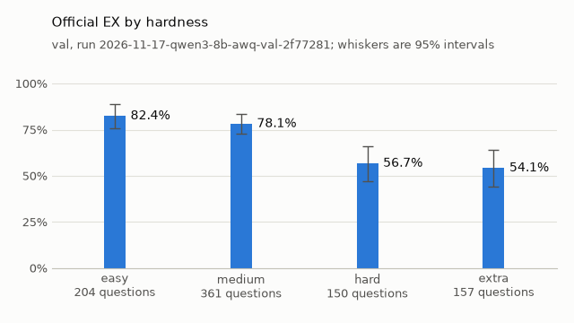

# Run 2026-11-17-qwen3-8b-awq-val-2f77281: official EX 71.1% [67.2%, 74.9%] on val

Generated: 2026-11-17 01:47:04 UTC

Written by `forge report run 2026-11-17-qwen3-8b-awq-val-2f77281` from the run's stored files and checked
against them by `forge report rebuild 2026-11-17-qwen3-8b-awq-val-2f77281`; don't edit it by hand.

Questions and gold queries are quoted from Spider 1.0 (Yu et al., EMNLP 2018), licensed [CC BY-SA 4.0](https://creativecommons.org/licenses/by-sa/4.0/).

| | |
|---|---|
| Model | `Qwen/Qwen3-8B-AWQ@4da05a8edb55c6046cce958586c33b61da07bb79` |
| Adapter | none |
| Backend | `vllm` |
| Platform | `kaggle` |
| Prompt version | `p2` |
| Split | val: 872 questions, 1 sample each |
| Generation | greedy, at most 256 new tokens |
| Retry | none |
| Git commit | `2f772811aa28ddea5b5f2a3282b47ab4698c5ba1` |
| Data manifest hash | `e10958d3b7a9490c15623285275d2840fbce551c32432fc62c0ad440cb06651e` |
| Manifest | [manifest.json](../manifest.json) |

## Execution accuracy

| | right | of | rate [95% interval] |
|---|---:|---:|---:|
| valid SQL | 847 | 872 | 97.1% [95.7%, 98.4%] |
| fast EX | 620 | 872 | 71.1% [67.2%, 74.7%] |
| official EX | 620 | 872 | 71.1% [67.2%, 74.9%] |

The checkers disagree on 14 samples: only fast EX matches 7, and only official EX 7.

Intervals are 95% percentile bootstraps over 1,000 resamples (seed 0) that draw whole questions, with the questions that share a gold query drawn together: 872 questions in 455 clusters.

## By hardness

| hardness | questions | fast EX [95% interval] | official EX [95% interval] |
|---|---:|---:|---:|
| easy | 204 | 80.9% [73.8%, 87.7%] | 82.4% [75.8%, 88.8%] |
| medium | 361 | 77.8% [72.4%, 83.2%] | 78.1% [72.8%, 83.5%] |
| hard | 150 | 58.0% [48.3%, 67.3%] | 56.7% [46.9%, 66.2%] |
| extra | 157 | 55.4% [45.6%, 64.9%] | 54.1% [44.3%, 63.9%] |



## Error classes

Failures of official EX by the class `forge.eval.taxonomy` gives them: the first
class that fits, in this order.

| class | failures | share of failures |
|---|---:|---:|
| no_sql | 0 | 0.0% |
| syntax | 0 | 0.0% |
| schema_link | 17 | 6.7% |
| wrong_tables | 54 | 21.4% |
| join | 77 | 30.6% |
| projection | 82 | 32.5% |
| aggregation | 2 | 0.8% |
| where | 4 | 1.6% |
| group_order | 6 | 2.4% |
| value | 3 | 1.2% |
| other | 0 | 0.0% |
| unclassified | 7 | 2.8% |

Unclassified failures are those only official EX finds: fast EX matched them, so the run gave them no class.

## Example failures

Up to 5 failures of each of the 3 most common classes,
picked by a hash of their ids so they spread over databases. The executor's error
message isn't stored, so each shows its class.

### projection: 5 of 82 shown

#### spider-train-00019 on farm (easy)

Question: What is the total horses record for each farm, sorted ascending?

Gold query:

```sql
SELECT Total_Horses FROM farm ORDER BY Total_Horses ASC
```

Predicted query:

```sql
SELECT Farm_ID, Total_Horses FROM farm ORDER BY Total_Horses ASC
```

Error: projection. The query ran, and official EX finds no match.

#### spider-train-00167 on bike_1 (medium)

Question: In zip code 94107, on which day neither Fog nor Rain was not observed?

Gold query:

```sql
SELECT date FROM weather WHERE zip_code  =  94107 AND EVENTS != "Fog" AND EVENTS != "Rain"
```

Predicted query:

```sql
SELECT DISTINCT date 
FROM weather 
WHERE zip_code = 94107 
AND events NOT LIKE '%Fog%' 
AND events NOT LIKE '%Rain%'
```

Error: projection. The query ran, and official EX finds no match.

#### spider-train-00242 on musical (easy)

Question: What are the characters of actors in descending order of age?

Gold query:

```sql
SELECT Character FROM actor ORDER BY age DESC
```

Predicted query:

```sql
SELECT Character, age FROM actor ORDER BY age DESC
```

Error: projection. The query ran, and official EX finds no match.

#### spider-train-00273 on musical (medium)

Question: Who are the nominees who were nominated for either of the Bob Fosse or Cleavant Derricks awards?

Gold query:

```sql
SELECT Nominee FROM musical WHERE Award  =  "Tony Award" OR Award  =  "Cleavant Derricks"
```

Predicted query:

```sql
SELECT DISTINCT Nominee 
FROM musical 
WHERE Nominee IN ('Bob Fosse', 'Cleavant Derricks')
```

Error: projection. The query ran, and official EX finds no match.

#### spider-train-04896 on school_player (easy)

Question: Show the nicknames of schools that are not in division 1.

Gold query:

```sql
SELECT Nickname FROM school_details WHERE Division != "Division 1"
```

Predicted query:

```sql
SELECT sd.Nickname
FROM school_details sd
WHERE sd.Division NOT IN ('1', '1.0')
```

Error: projection. The query ran, and official EX finds no match.

### join: 5 of 77 shown

#### spider-train-00256 on musical (medium)

Question: Show names of musicals and the number of actors who have appeared in the musicals.

Gold query:

```sql
SELECT T2.Name ,  COUNT(*) FROM actor AS T1 JOIN musical AS T2 ON T1.Musical_ID  =  T2.Musical_ID GROUP BY T1.Musical_ID
```

Predicted query:

```sql
SELECT Name, COUNT(*) AS num_actors
FROM musical
JOIN actor ON musical.Musical_ID = actor.Musical_ID
GROUP BY Name
```

Error: join. The query failed to execute.

#### spider-train-00872 on chinook_1 (medium)

Question: What are the last names of employees who serve at most 20 customers?

Gold query:

```sql
SELECT T1.LastName FROM CUSTOMER AS T1 JOIN EMPLOYEE AS T2 ON T1.SupportRepId  =  T2.EmployeeId GROUP BY T1.SupportRepId HAVING COUNT(*)  <=  20
```

Predicted query:

```sql
SELECT e.LastName
FROM Employee e
JOIN Customer c ON e.EmployeeId = c.SupportRepId
GROUP BY e.LastName
HAVING COUNT(DISTINCT c.CustomerId) <= 20
```

Error: join. The query ran, and official EX finds no match.

#### spider-train-05384 on tracking_software_problems (extra)

Question: What are the id of problems reported by the staff named Dameon Frami or Jolie Weber?

Gold query:

```sql
SELECT product_id FROM problems AS T1 JOIN staff AS T2 ON T1.reported_by_staff_id = T2.staff_id WHERE T2.staff_first_name = "Dameon" AND T2.staff_last_name = "Frami" UNION SELECT product_id FROM problems AS T1 JOIN staff AS T2 ON T1.reported_by_staff_id = T2.staff_id WHERE T2.staff_first_name = "Jolie" AND T2.staff_last_name = "Weber"
```

Predicted query:

```sql
SELECT problem_id
FROM Problems
WHERE reported_by_staff_id IN (
    SELECT staff_id
    FROM Staff
    WHERE (staff_first_name = 'Dameon' AND staff_last_name = 'Frami') OR (staff_first_name = 'Jolie' AND staff_last_name = 'Weber')
)
```

Error: join. The query ran, and official EX finds no match.

#### spider-train-05924 on cre_Theme_park (medium)

Question: Find the details of the shops that can be reached by walk.

Gold query:

```sql
SELECT T1.Shop_Details FROM SHOPS AS T1 JOIN TOURIST_ATTRACTIONS AS T2 ON T1.Shop_ID  =  T2.Tourist_Attraction_ID WHERE T2.How_to_Get_There  =  "walk"
```

Predicted query:

```sql
SELECT s.Shop_Details, ta.How_to_Get_There
FROM Shops s
JOIN Tourist_Attractions ta ON s.Shop_ID = ta.Tourist_Attraction_ID
WHERE ta.How_to_Get_There = 'Walk'
```

Error: join. The query ran, and official EX finds no match.

#### spider-train-06883 on flight_4 (extra)

Question: Find the busiest destination airport that runs most number of routes in China.

Gold query:

```sql
SELECT T1.name FROM airports AS T1 JOIN routes AS T2 ON T1.apid  =  T2.dst_apid WHERE T1.country  =  'China' GROUP BY T1.name ORDER BY count(*) DESC LIMIT 1
```

Predicted query:

```sql
SELECT dst_apid, COUNT(*) AS route_count
FROM routes
JOIN airports ON routes.dst_apid = airports.apid
WHERE airports.country = 'China'
GROUP BY dst_apid
ORDER BY route_count DESC
LIMIT 1
```

Error: join. The query ran, and official EX finds no match.

### wrong_tables: 5 of 54 shown

#### spider-train-00172 on bike_1 (extra)

Question: What are the names of all stations that have more than 10 bikes available and are not located in San Jose?

Gold query:

```sql
SELECT T1.name FROM station AS T1 JOIN status AS T2 ON T1.id  =  T2.station_id GROUP BY T2.station_id HAVING avg(bikes_available)  >  10 EXCEPT SELECT name FROM station WHERE city  =  "San Jose"
```

Predicted query:

```sql
SELECT name FROM station WHERE dock_count > 10 AND city != 'San Jose'
```

Error: wrong_tables. The query ran, and official EX finds no match.

#### spider-train-00850 on chinook_1 (medium)

Question: Find the full names of employees who help customers with the first name Leonie.

Gold query:

```sql
SELECT T2.FirstName ,  T2.LastName FROM CUSTOMER AS T1 JOIN EMPLOYEE AS T2 ON T1.SupportRepId  =  T2.EmployeeId WHERE T1.FirstName  =  "Leonie"
```

Predicted query:

```sql
SELECT e.FirstName, e.LastName
FROM Employee e
JOIN Customer c ON e.EmployeeId = c.SupportRepId
JOIN Invoice i ON c.CustomerId = i.CustomerId
JOIN InvoiceLine il ON i.InvoiceId = il.InvoiceId
JOIN Track t ON il.TrackId = t.TrackId
JOIN Album a ON t.AlbumId = a.AlbumId
JOIN Artist ar ON a.ArtistId = ar.ArtistId
WHERE ar.Name = 'Leonie'
```

Error: wrong_tables. The query ran, and official EX finds no match.

#### spider-train-02035 on gas_company (medium)

Question: find the rank, company names, market values of the companies in the banking industry order by their sales and profits in billion.

Gold query:

```sql
SELECT rank ,  company ,  market_value FROM company WHERE main_industry  =  'Banking' ORDER BY sales_billion ,  profits_billion
```

Predicted query:

```sql
SELECT c.Rank, c.Company, c.Market_Value
FROM company c
JOIN station_company sc ON c.Company_ID = sc.Company_ID
JOIN gas_station gs ON sc.Station_ID = gs.Station_ID
WHERE c.Main_Industry = 'Banking'
ORDER BY c.Sales_billion DESC, c.Profits_billion DESC
```

Error: wrong_tables. The query ran, and official EX finds no match.

#### spider-train-04338 on tracking_grants_for_research (hard)

Question: List the project details of the projects which did not hire any staff for a researcher role.

Gold query:

```sql
SELECT project_details FROM Projects WHERE project_id NOT IN ( SELECT project_id FROM Project_Staff WHERE role_code  =  'researcher' )
```

Predicted query:

```sql
SELECT p.project_details
FROM Projects p
WHERE NOT EXISTS (
    SELECT 1
    FROM Project_Staff ps
    JOIN Staff_Roles sr ON ps.role_code = sr.role_code
    WHERE ps.project_id = p.project_id
    AND sr.role_description = 'Researcher'
)
```

Error: wrong_tables. The query ran, and official EX finds no match.

#### spider-train-04612 on entertainment_awards (hard)

Question: Show the id, name of each festival and the number of artworks it has nominated.

Gold query:

```sql
SELECT T1.Festival_ID ,  T3.Festival_Name ,  COUNT(*) FROM nomination AS T1 JOIN artwork AS T2 ON T1.Artwork_ID  =  T2.Artwork_ID JOIN festival_detail AS T3 ON T1.Festival_ID  =  T3.Festival_ID GROUP BY T1.Festival_ID
```

Predicted query:

```sql
SELECT 
    fd.Festival_ID, 
    fd.Festival_Name, 
    COUNT(n.Artwork_ID) AS Num_of_Artworks_Nominated
FROM 
    festival_detail fd
LEFT JOIN 
    nomination n ON fd.Festival_ID = n.Festival_ID
GROUP BY 
    fd.Festival_ID, 
    fd.Festival_Name
```

Error: wrong_tables. The query ran, and official EX finds no match.
